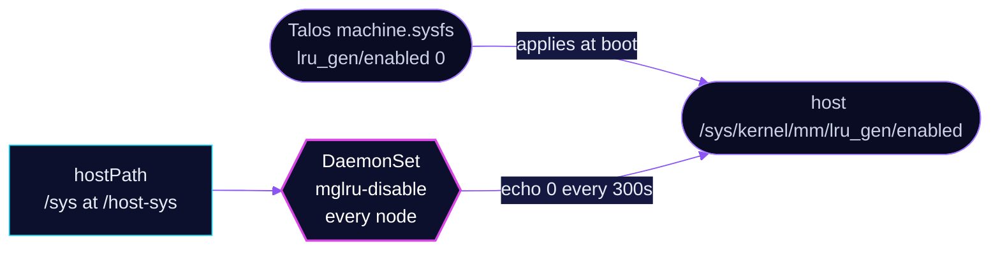

<!-- header: icon=memory-stick -->
<!-- concept: From a reboot to MGLRU off | power Boot | toggle-left Reassert | timer Repeat -->
<p align="center"></p>

> Keeps the kernel's multi-gen LRU switched off on every node by rewriting its sysfs key every five minutes.

**Live facts:** <https://skrumbach.github.io/home-ops/apps/kube-system/mglru-disable/> (workloads, routes, storage, backups, secrets and alerts, generated on every merge)

## What it does

- **Writes `0`** to `/sys/kernel/mm/lru_gen/enabled` on the host, once per pass.
- **Runs on every node.** The DaemonSet tolerates every taint (`operator: Exists`), so talos-3's
  `PreferNoSchedule` taint does not keep it off.
- **Repeats every 300 seconds**, so a change by anything else is undone within five minutes.
- **Backs up the Talos setting.** `machine.sysfs` in `talos/machineconfig.yaml.j2` sets the same key.

## Why it is built this way

| Choice | Why |
|---|---|
| **Two writers of one key** | The comment in the DaemonSet: it reasserts `kernel/mm/lru_gen/enabled=0`, and `machine.sysfs` sets the same key. Do not delete this until a reboot proves sysfs alone holds. The Talos comment says the same of the sysfs entry. |
| **`priorityClassName: system-node-critical`** | The manifest records no reason. |
| **Privileged, root, `/sys` hostPath** | A write to the host's `/sys` needs it. The pod has no service account token (`automountServiceAccountToken: false`) and does not share the host PID namespace (`hostPID: false`). |

## How it works

<p align="center"></p>

<details>
<summary><b>Resource graph</b>: every object involved, by name</summary>



</details>

1. **Talos.** `machine.sysfs` sets `kernel/mm/lru_gen/enabled: "0"` and applies it immediately.
2. **Flux.** Kustomization `mglru-disable` ([overlay](../../../main/kube-system/mglru-disable.yaml)) applies
   `app/`, a single DaemonSet, into `kube-system`.
3. **Reassert.** The container mounts host `/sys` at `/host-sys`. If `/host-sys/kernel/mm/lru_gen/enabled` is
   writable, it writes `0` there, then sleeps 300 seconds and repeats. A failed write is ignored
   (`2>/dev/null || true`).

## Settings that matter

All values are in [`app/daemonset.yaml`](app/daemonset.yaml).

| Setting | Value | Why |
|---|---|---|
| `tolerations` | `operator: Exists` | Runs on every node whatever its taints. |
| `securityContext` | `privileged: true`, `runAsUser: 0` | Needed to write host sysfs. |
| `sleep` | `300` | Reassertion interval. The manifest records no reason for five minutes. |
| `resources` | 1m CPU, 16Mi request; 32Mi limit | Every limit has a request. |
| image | busybox, pinned by digest | Renovate owns the tag. |

## Operate it

```bash
flux -n kube-system get ks mglru-disable
kubectl -n kube-system get ds mglru-disable -o wide            # one pod per node
kubectl -n kube-system get pods -l app.kubernetes.io/name=mglru-disable -o wide
```

Reading the live key needs `exec`, which only the admin kubeconfig grants. This command reads and changes
nothing:

```bash
kubectl -n kube-system exec ds/mglru-disable -- cat /host-sys/kernel/mm/lru_gen/enabled   # expect 0
```

## Invariants

- **Do not delete this until a reboot proves sysfs alone holds.** It reasserts `kernel/mm/lru_gen/enabled=0`;
  `machine.sysfs` sets the same key. Do not delete either until a reboot proves the other holds.

Upstream: [Multi-gen LRU](https://docs.kernel.org/admin-guide/mm/multigen_lru.html)
