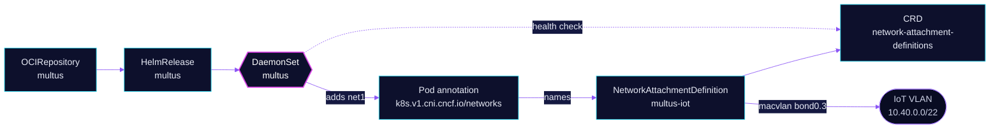

<!-- header: icon=cable -->
<!-- concept: From a pod annotation to a second interface on a VLAN | tag Annotate | cable Attach | network VLAN | route Route -->
<p align="center"></p>

> Gives a pod a second network interface on a VLAN, so devices on the IoT network can reach it directly.

**Live facts:** <https://skrumbach.github.io/home-ops/apps/kube-system/multus/> (workloads, routes, storage, backups, secrets and alerts, generated on every merge)

## What it does

- **Adds interfaces.** A pod that carries the annotation `k8s.v1.cni.cncf.io/networks` gets an extra interface
  (`net1`) next to its Cilium interface. Multus runs as DaemonSet `multus` and calls the other CNI plugins.
- **Defines one network** in [`networks/`](networks/): `multus-iot` (macvlan on `bond0.3`), a
  `NetworkAttachmentDefinition` in `kube-system`.
- **Serves four apps today**, all in `home-automation`: `home-assistant`, `zigbee2mqtt`, `matter-server` and
  `esphome` attach `multus-iot` with a fixed address each.

## Why it is built this way

| Choice | Why |
|---|---|
| **Macvlan in `bridge` mode on a VLAN sub-interface** | The pod gets an address on the VLAN itself, and IoT devices key on IP (`home-assistant` manifest). The manifest records no further reason for `bridge` mode. |
| **Static IPAM, set per pod** | The NAD carries no address. Each app pins its own in the annotation `ips`, so the address survives a reschedule. |
| **`sbr` plugin on `multus-iot`** | Source-based routing. The `zigbee2mqtt` manifest says it keeps the connected route in policy table 100, matched by source IP, while the main table sends traffic via `eth0`. |
| **Two Flux Kustomizations** | `multus` installs the DaemonSet and is health-checked on the CRD. `multus-networks` depends on it (`dependsOn`), so no NAD is applied before its CRD exists. Apps depend on `multus-networks`. |
| **Cilium keeps the primary role** | `cni.exclusive: false` in the Cilium release lets Multus run alongside. |

## How it works

<p align="center"></p>

<details>
<summary><b>Resource graph</b>: every object involved, by name</summary>



</details>

1. **Flux.** Kustomization `multus` applies `app/` and waits for DaemonSet `multus` and the CRD
   `network-attachment-definitions.k8s.cni.cncf.io`. Then `multus-networks` applies NAD `multus-iot`.
2. **Pod start.** The pod annotation names a NAD (`name`, `namespace: kube-system`) and an address (`ips`).
   Multus reads the NAD and runs the macvlan plugin on the node, then `sbr` for `multus-iot`.
3. **Routing.** `multus-iot` has a default route via `10.40.0.1`; `sbr` applies it by source address.
   `zigbee2mqtt` adds a route in the main table at start (init container `init-iot-route`), because its bridge
   at `10.40.2.101` must be reached through `net1`.

## Settings that matter

| Setting | Value | Why |
|---|---|---|
| `cni.binPath`, `cni.netPath` | `/opt/cni/bin`, `/etc/cni/net.d` | Where the DaemonSet writes the plugins and its config on the node. The manifest records no reason. |
| `postRenderers` toleration | `home-operations.com/dedicated`, `Exists`, `PreferNoSchedule` | The manifest says the chart merge drops a values `tolerations` list, so this patch is the only way. The effect must stay `PreferNoSchedule`, matching the taint in `talos/nodes/talos-3.yaml.j2`. |
| `multus.resources` | request 10m CPU and 64Mi, limit 512Mi | The memory request is explicit: a limit with no request reserves the whole limit. |
| NAD `multus-iot` `master` | `bond0.3` | The IoT VLAN sub-interface from the node templates. |

## Operate it

```bash
flux -n kube-system get ks multus multus-networks
kubectl -n kube-system get ds multus
kubectl -n kube-system get network-attachment-definitions
kubectl get pods -A -o jsonpath='{range .items[?(@.metadata.annotations.k8s\.v1\.cni\.cncf\.io/networks)]}{.metadata.namespace}/{.metadata.name}{"\n"}{end}'
kubectl -n home-automation get pod -l app.kubernetes.io/name=home-assistant -o jsonpath='{.items[0].metadata.annotations.k8s\.v1\.cni\.cncf\.io/network-status}'
```

## Invariants

- **The toleration effect stays `PreferNoSchedule`.** A hard `NoSchedule` strands drains (root `AGENTS.md`).
- **Attach apps depend on `multus-networks`.** An app that names a NAD before it exists fails to start.

Upstream: [Multus CNI](https://github.com/k8snetworkplumbingwg/multus-cni) •
[bjw-s multus chart](https://github.com/bjw-s-labs/helm-charts)
