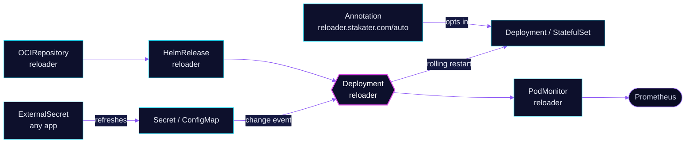

<!-- header: icon=refresh-cw -->
<!-- concept: From a changed Secret to a rolled pod | file-pen Change | eye Watch | tag Match | refresh-cw Restart -->
<p align="center"></p>

> Restarts a workload when a ConfigMap or Secret it uses changes, for apps that read their config only at start.

**Live facts:** <https://skrumbach.github.io/home-ops/apps/kube-system/reloader/> (workloads, routes, storage, backups, secrets and alerts, generated on every merge)

## What it does

- **Watches** ConfigMaps and Secrets in every namespace (chart default `watchGlobally: true`).
- **Restarts opted-in workloads.** When an object a workload uses changes, Reloader rolls that workload.
- **Opts in by annotation.** Nothing restarts without one: the chart default `autoReloadAll` is `false`.
- **Exposes metrics** through a `PodMonitor` in `kube-system`.

## Why it is built this way

| Choice | Why |
|---|---|
| **Annotation opt-in, not restart-everything** | The chart default `autoReloadAll` is `false`, so only workloads that carry an annotation roll. The manifest records no further reason. |
| **Controller-level annotation on app-template apps** | `reloader.stakater.com/auto: "true"` goes on the controller. The `hermes` and `samba` manifests say Reloader restarts the pod on a content change, since the ConfigMap has no suffix hash. |
| **Pod-template annotation where the CRD has no controller hook** | `ai/toolhive` `grafana-mcp` and `ai/litellm` say Reloader falls back to pod-template annotations. |

## How it works

<p align="center"></p>

<details>
<summary><b>Resource graph</b>: every object involved, by name</summary>



</details>

1. **Flux** applies the HelmRelease. The release name and `fullnameOverride` are both `reloader`.
2. **A change.** Flux, External Secrets Operator or a kustomize generator updates a Secret or ConfigMap.
3. **The match.** Reloader checks every workload that mounts or references the object. It acts on those with an
   annotation.
4. **The restart.** It rolls the workload. The annotation forms in this repository:
   - `reloader.stakater.com/auto: "true"`: any ConfigMap or Secret the workload uses. This is the common form.
   - `secret.reloader.stakater.com/reload: <names>` and `configmap.reloader.stakater.com/reload: <names>`: only
     the listed objects. Examples: `monitoring/grafana`, `home-automation/esphome`.

## Settings that matter

| Setting | Value | Why |
|---|---|---|
| `reloader.enableHA` | `true` | The manifest records no reason. With `deployment.replicas: 1` there is nothing to elect between. |
| `reloader.deployment.replicas` | `1` | The manifest records no reason. |
| `reloader.deployment.resources` | request 10m CPU and 128Mi, limit 256Mi | Every limit has a request. |
| `reloader.readOnlyRootFileSystem` | `true` | The manifest records no reason. |
| `reloader.podMonitor` | enabled, namespace `{{ .Release.Namespace }}` | Scrape metrics in the release namespace. |

## Operate it

```bash
flux -n kube-system get ks reloader
flux -n kube-system get hr reloader
kubectl -n kube-system get deploy reloader
kubectl -n kube-system logs deploy/reloader --tail=50
git grep -n "reloader.stakater.com"            # who opted in (repository root)
```

Upstream: [Reloader](https://github.com/stakater/Reloader)
