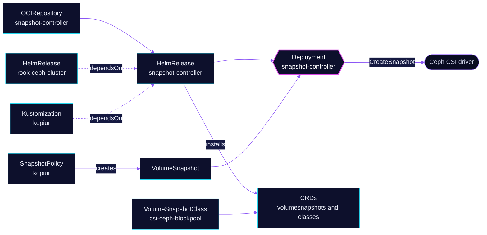

<!-- header: icon=camera -->
<!-- concept: From a snapshot request to a point-in-time copy | file-plus Request | camera Snapshot | hard-drive Volume | copy Copy -->
<p align="center"></p>

> Runs the CSI snapshot controller and its CRDs, so Ceph volumes can be snapshotted and kopiur can back them up.

**Live facts:** <https://skrumbach.github.io/home-ops/apps/kube-system/snapshot-controller/> (workloads, routes, storage, backups, secrets and alerts, generated on every merge)

## What it does

- **Installs the snapshot CRDs** (`VolumeSnapshot`, `VolumeSnapshotContent`, `VolumeSnapshotClass`). The chart
  default `installCRDs` is `true` and the manifest does not change it.
- **Runs the controller** (Deployment `snapshot-controller`) that turns a `VolumeSnapshot` into a
  `VolumeSnapshotContent` through the CSI driver.
- **Feeds kopiur.** The `kopiur` Kustomization depends on it, because `copyMethod: Snapshot` backups take CSI
  VolumeSnapshots. The kopiur `SnapshotPolicy` objects name class `csi-ceph-blockpool` by default.

## How it works

<p align="center"></p>

<details>
<summary><b>Resource graph</b>: every object involved, by name</summary>



</details>

1. **Flux** applies the chart. The Kustomization health-checks Deployment `snapshot-controller`.
2. **Order.** HelmRelease `rook-ceph-cluster` and Kustomization `kopiur` both list `snapshot-controller` in
   `dependsOn`, so the CRDs exist before the `VolumeSnapshotClass` and before any backup.
3. **A snapshot.** kopiur creates a `VolumeSnapshot` of a claim. The controller asks the Ceph CSI driver for the
   snapshot and binds a `VolumeSnapshotContent`.

## Settings that matter

| Setting | Value | Why |
|---|---|---|
| `controller.resources` | request 25m CPU and 32Mi, limit 128Mi | Every limit has a request. |
| `controller.serviceMonitor.create` | `true` | Scrape metrics. |
| Kustomization `healthChecks` | Deployment `snapshot-controller` | Targets the workload, not the HelmRelease. `wait` stays unset. |

## Operate it

```bash
flux -n kube-system get ks snapshot-controller
kubectl -n kube-system get deploy snapshot-controller
kubectl get volumesnapshotclass
kubectl get volumesnapshot,volumesnapshotcontent -A
```

Upstream: [external-snapshotter](https://github.com/kubernetes-csi/external-snapshotter) •
[Piraeus chart](https://github.com/piraeusdatastore/helm-charts/tree/main/charts/snapshot-controller)
