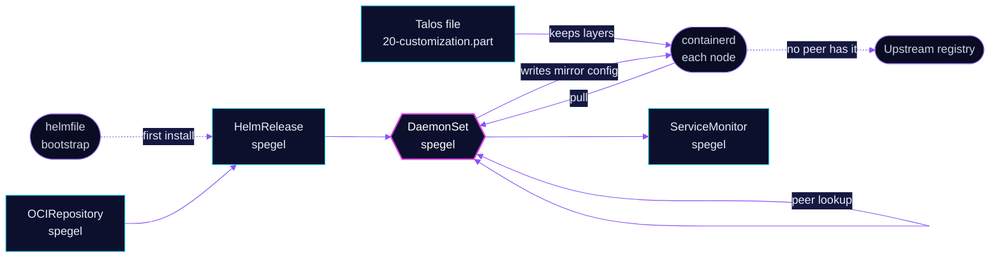

<!-- header: icon=share-2 -->
<!-- concept: From an image pull to a copy on a neighbour node | download Pull | search Find | share-2 Peer | hard-drive Cache -->
<p align="center"></p>

> A peer-to-peer image mirror: a node pulls container images from the other nodes before it goes to a registry.

**Live facts:** <https://skrumbach.github.io/home-ops/apps/kube-system/spegel/> (workloads, routes, storage, backups, secrets and alerts, generated on every merge)

## What it does

- **Mirrors images between the nodes.** DaemonSet `spegel` runs on every node and serves the image layers that
  node's containerd already holds.
- **Wires containerd to it.** The chart default `containerdMirrorAdd: true` writes mirror config into the
  registry config path on the node. No registry is excluded (`mirroredRegistries` is the default empty list).
- **Installs early.** The bootstrap helmfile installs it after CoreDNS and before cert-manager and Flux, so
  those images can come from a neighbour node.

## Why it is built this way

| Choice | Why |
|---|---|
| **Talos keeps unpacked layers** | `talos/machineconfig.yaml.j2` writes `/etc/cri/conf.d/20-customization.part` with `discard_unpacked_layers = false`. Its comment says spegel needs it. |
| **Talos paths for the socket and config** | `containerdSock` and `containerdRegistryConfigPath` are set to `/run/containerd/containerd.sock` and `/etc/cri/conf.d/hosts`. The chart defaults are `/etc/containerd/certs.d` for the second. The manifest records no further reason. |
| **Bootstrapped by helmfile, then Flux** | See the bootstrap order in `bootstrap/helmfile/apps.yaml`: `cilium`, `coredns`, `spegel`, `cert-manager`, `flux-operator`, `flux-instance`. |

## How it works

<p align="center"></p>

<details>
<summary><b>Resource graph</b>: every object involved, by name</summary>



</details>

1. **Bootstrap.** The helmfile installs the chart first, from this directory's `ocirepository.yaml` and
   `helmrelease.yaml`. Flux then takes over through Kustomization `spegel` ([overlay](../../../main/kube-system/spegel.yaml)).
2. **Mirror config.** On each node, Spegel adds mirror entries to the containerd registry config path.
3. **A pull.** containerd asks the local Spegel first. Spegel looks for a node that has the layer and streams it.
   If none has it, containerd goes to the upstream registry. This is the chart's behaviour, not a setting here.

## Settings that matter

| Setting | Value | Why |
|---|---|---|
| `spegel.containerdSock` | `/run/containerd/containerd.sock` | Same as the chart default. The manifest records no reason. |
| `spegel.containerdRegistryConfigPath` | `/etc/cri/conf.d/hosts` | Differs from the chart default. The manifest records no reason. |
| `resources` | request 50m CPU and 64Mi, limit 256Mi | Every limit has a request. |
| `serviceMonitor.enabled` | `true` | Scrape metrics. |

## Operate it

```bash
flux -n kube-system get ks spegel
flux -n kube-system get hr spegel
kubectl -n kube-system get ds spegel -o wide
kubectl -n kube-system logs ds/spegel --tail=50
```

## Invariants

- **Keep `discard_unpacked_layers = false` in the Talos machine config.** Spegel serves the layers containerd
  keeps. The file is Talos config, which Flux does not apply (root `AGENTS.md`).
- **Renovate bumps it as the `Spegel` group** (`.renovate/groups.json5`).

Upstream: [Spegel](https://spegel.dev/) • [Talos setup](https://spegel.dev/docs/getting-started/#talos)
