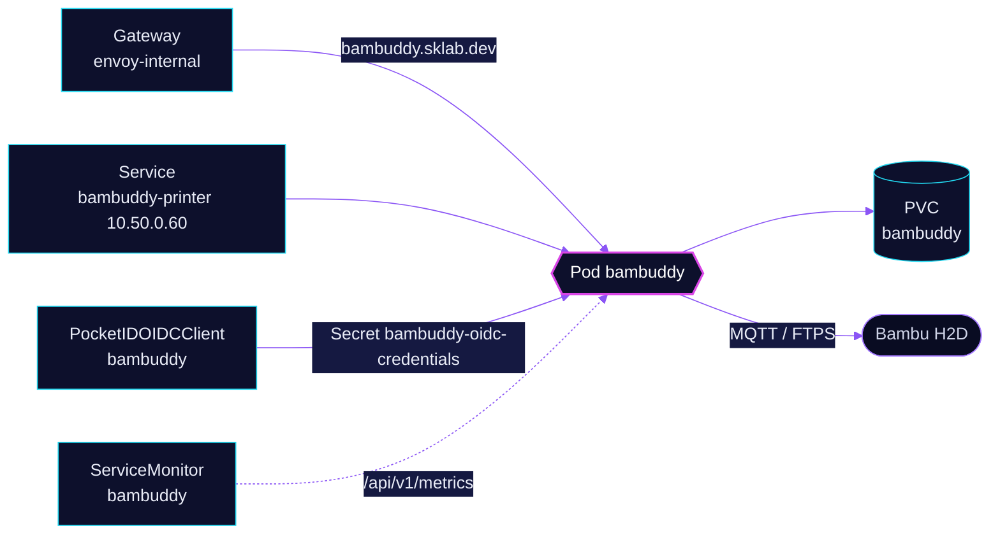

<!-- header: icon=printer -->
<!-- concept: From a slicer to a print | file-box Slicer | server Virtual printer | archive Archive | printer H2D -->
<p align="center"></p>

> Bambuddy, the self-hosted control center for the Bambu H2D: print archive, live status, camera and a virtual printer.

**Live facts:** <https://skrumbach.github.io/home-ops/apps/maker/bambuddy/> (workloads, routes, storage, backups, secrets and alerts, generated on every merge)

## What it does

- **Archives and queues prints** from the web UI at `bambuddy.sklab.dev` on `envoy-internal`; the H2D is added in the UI by IP, serial and access code.
- **Acts as a virtual printer.** LoadBalancer Service `bambuddy-printer` on `10.50.0.60` takes Bambu Studio uploads (MQTT 8883, FTPS 990, RTSPS 322, 3000, 3002, 6000, passive 50000-50029).
- **Signs in with Pocket ID.** `BAMBUDDY_OIDC_*` defines one env-managed provider from Secret `bambuddy-oidc-credentials`.
- **Exports metrics.** ServiceMonitor `bambuddy` scrapes `/api/v1/metrics`; GrafanaDashboard `bambuddy` (folder Apps) draws them.
- **Backs up the claim `bambuddy`** with kopiur (ceph and r2).

## Why it is built this way

| Choice | Why |
|---|---|
| **Native OIDC, no Envoy gate** | A SecurityPolicy would put a second login in front of Bambuddy's own and break the slicer's API calls. |
| **Fixed LoadBalancer IP for the virtual printer** | Slicers are told one address (`VIRTUAL_PRINTER_ADVERTISE_ADDRESS`) and FTP passive replies carry it (`..._PASV_ADDRESS`). |
| **Sysctl `net.ipv4.ip_unprivileged_port_start=0` and `NET_BIND_SERVICE`** | The pod runs as uid 1000 and the virtual printer binds 322 and 990. The image also sets a file capability on python3, so dropping every capability makes `exec` fail with `Operation not permitted`. |
| **uid/gid 1000 with `fsGroup`** | kopiur's default identity, so no `KOPIUR_PUID` override; the image's chown-and-gosu entrypoint is a no-op as non-root. |

## How it works

<p align="center"></p>

<details>
<summary><b>Resource graph</b>: every object involved, by name</summary>



</details>

1. Flux applies Kustomization `bambuddy` after `kopiur-repository`; the kopiur component adds the SnapshotPolicies for `bambuddy`.
2. The chart creates the claim `bambuddy` (`retain: true`, 10Gi, `ceph-block`) and mounts it at `/app/data`.
3. On start Bambuddy upserts the Pocket ID provider from the environment; it stays read-only in the UI.
4. The H2D is reached outbound from the pod, so no inbound path is needed for it.

## First boot (do these in order)

Authentication is off until it is enabled in the UI, so the route and the virtual printer are open until step 2.

1. Open `https://bambuddy.sklab.dev`, create the local admin.
2. Settings, Authentication: enable authentication, then sign in once with Pocket ID so the account links by email.
3. On the H2D enable LAN mode and Developer Mode; note the access code and serial. Add the printer by IP (`10.0.0.206`).
4. Settings, Prometheus: switch it on (no token; the Service is cluster-internal).
5. Create a virtual printer (archive or queue mode). In Bambu Studio add a LAN printer at `10.50.0.60` with the virtual printer's access code and trust its CA.

## Settings that matter

| Setting | Value | Why |
|---|---|---|
| `APP_URL` | `https://bambuddy.sklab.dev` | Base of the OIDC `redirect_uri`; the fallback is `http://localhost:5173`. |
| `BAMBUDDY_OIDC_AUTO_CREATE_USERS` | `"false"` | Only linked accounts sign in. |
| `BAMBUDDY_OIDC_AUTO_LINK_EXISTING` | `"true"` | Links the first Pocket ID sign-in to the local account with the same verified email. |
| `KOPIUR_SCHEDULE_R2` | `H 16 * * *` | The maker namespace's r2 hour. |

## Operate it

```bash
flux -n maker get ks bambuddy
kubectl -n maker get pods -l app.kubernetes.io/name=bambuddy -o wide
kubectl -n maker get svc bambuddy-printer
kubectl get snapshotpolicy,restore -n maker
```

## Invariants

- The claim stays on `components/kopiur` alone until it has `Succeeded` ceph and r2 snapshots; only then does it move to `components/kopiur/pvc`.
- `10.50.0.60` is the address the slicer is told; changing it changes both `VIRTUAL_PRINTER_*` values and the Service annotation together.

## Known gaps

- **Proxy-mode virtual printers** forward 50000-50100 and are not exposed; only three non-proxy virtual printers fit the 30 passive ports.
- **Reservation not applied yet.** The H2D (`10.0.0.206`, Home [Default], `h2d.sklab.dev`) has a `unifi_client` in home-infra on branch `feat/bambu-h2d-reservation`; until the owner applies it the address is a DHCP lease.

Upstream: [Bambuddy](https://github.com/maziggy/bambuddy)
