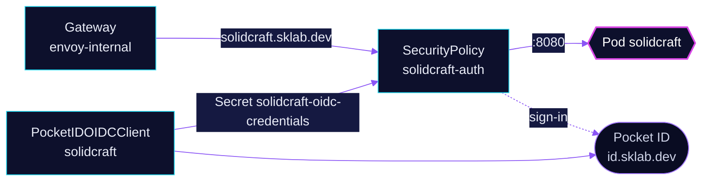

<!-- header: icon=box -->
<!-- concept: From a sign-in to a model | fingerprint Sign-in | door-open Route | box Model -->
<p align="center"></p>

> SolidCraft, a browser CAD app, served as a stateless static site on the LAN behind Pocket ID sign-in.

**Live facts:** <https://skrumbach.github.io/home-ops/apps/maker/solidcraft/> (workloads, routes, storage, backups, secrets and alerts, generated on every merge)

## What it does

- **Serves the CAD app** at `solidcraft.sklab.dev` on `envoy-internal` only.
- **Signs people in at Envoy.** SecurityPolicy `solidcraft-auth` runs native OIDC against Pocket ID; only the group `admins` (namespace `security`) is allowed.
- **Keeps no server state.** The image is nginx serving a client-side bundle, so there is no volume to back up.

## Why it is built this way

| Choice | Why |
|---|---|
| **Gate the whole route** | The app has no login of its own, like its peer `selfhosted/excalidraw`. |
| **Read-only root with three emptyDir mounts** | nginx writes its pid, temp and cache files under `/tmp`, `/var/cache/nginx` and `/var/run`. |
| **Gatus probes the Service** | The route redirects to the Pocket ID sign-in page, so a route check would measure that page. |

## How it works

<p align="center"></p>

<details>
<summary><b>Resource graph</b>: every object involved, by name</summary>



</details>

1. Flux applies Kustomization `solidcraft` with no dependencies and no components.
2. The Pocket ID operator turns `PocketIDOIDCClient` `solidcraft` into a client and writes Secret `solidcraft-oidc-credentials`.
3. A request to `https://solidcraft.sklab.dev` meets the SecurityPolicy first, then Envoy forwards it to Service `solidcraft` on port 8080.

## Settings that matter

| Setting | Value | Why |
|---|---|---|
| `defaultPodOptions.securityContext` | uid/gid/fsGroup 101 | The image's `User` is 101 (nginx). |
| `image.tag` | `0.48.0@sha256:...` | The upstream image is built by mirceanton/container-images; the tag is the app version. |

## Operate it

```bash
flux -n maker get ks solidcraft
kubectl -n maker get pods -l app.kubernetes.io/name=solidcraft -o wide
kubectl -n maker get securitypolicy/solidcraft-auth pocketidoidcclient/solidcraft
```

## Invariants

- A SecurityPolicy that fails to translate makes the route answer 500, not pass through. A policy whose `targetRef` matches no route leaves that route open.
- Deleting the `PocketIDOIDCClient` deletes the client in Pocket ID.

Upstream: [SolidCraft](https://solidcraft.io)
