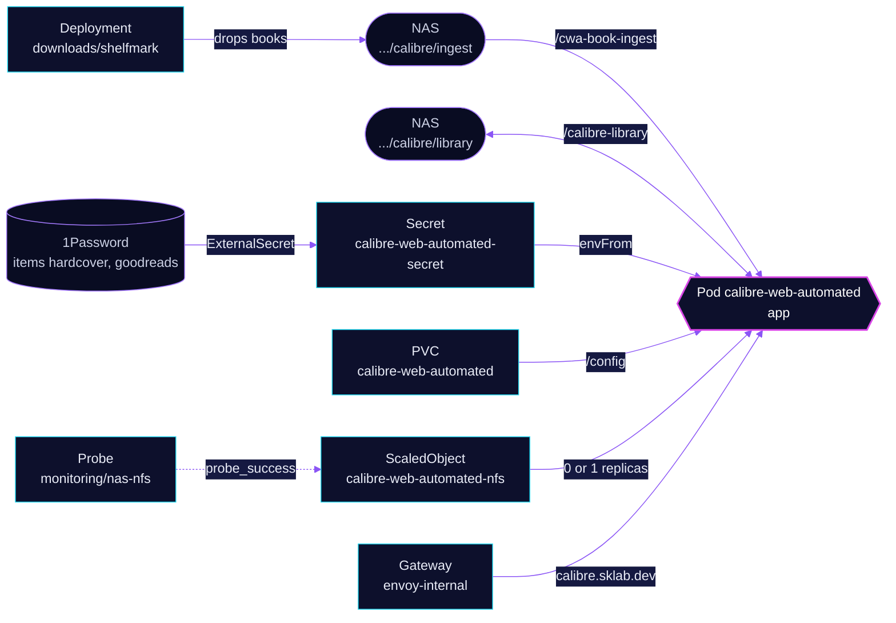

<!-- header: icon=library-big -->
<!-- concept: From an ingested book to a reader | folder-input Ingest | book-copy Library | server Web UI | tablet-smartphone Read -->
<p align="center"></p>

> The e-book library on the NAS: it ingests dropped books into a Calibre library and serves them on the LAN only.

**Live facts:** <https://skrumbach.github.io/home-ops/apps/media/calibre-web-automated/> (workloads, routes, storage, backups, secrets and alerts, generated on every merge)

## What it does

- **Serves the library** at `calibre.sklab.dev` on `envoy-internal` only.
- **Ingests books** dropped into `nas.sklab.dev:/mnt/storage/Media/ebooks/calibre/ingest` (mounted at `/cwa-book-ingest`)
  and files them in the library at `.../calibre/library` (mounted at `/calibre-library`).
- **Looks up metadata** with a Hardcover token and a Goodreads cookie, from Secret `calibre-web-automated-secret`.
- **Stops while the NAS is down.** KEDA scales the Deployment to 0 when the NFS export is unreachable.
- **Keeps its own state** in PVC `calibre-web-automated` (`/config`), backed up by kopiur.
- **Shares the NFS folders** with `downloads/shelfmark`, which writes to the ingest folder and reads the library.

## How it works

<p align="center"></p>

<details>
<summary><b>Resource graph</b>: every object involved, by name</summary>



</details>

1. Flux applies Kustomization `calibre-web-automated` after `kopiur-repository`, `keda`, `onepassword-store` and
   `rook-ceph-cluster`. The `kopiur/pvc` component owns PVC `calibre-web-automated` (`20Gi`). A second Kustomization,
   `calibre-web-automated-kopiur`, adds the snapshot policies, the schedules and Restore `calibre-web-automated-kopiur-dst`
   that a recreated claim is filled from.
2. The `keda/nfs-scaler` component adds ScaledObject `calibre-web-automated-nfs`. The HelmRelease sets
   `replicas: null`, so Helm never resets the count KEDA owns.
3. The container runs as root with `PUID`/`PGID` `2000`, `NETWORK_SHARE_MODE` on and an s6 read-only root. `/cache`,
   `/tmp` and `/run` are subpaths of one emptyDir.
4. KEDA queries `min(min_over_time(probe_success{job="nas-nfs"}[2m]))` every 30s. It scales to 0 after 5 minutes
   without a healthy poll, and back to 1 after 2 minutes of clean probes.

## Settings that matter

All values are in [`app/helmrelease.yaml`](app/helmrelease.yaml) unless noted.

| Setting | Value | Why |
|---|---|---|
| `NETWORK_SHARE_MODE` | `"true"` | Skips or soft-fails privileged actions that should not exist anyway. |
| `S6_YES_I_WANT_A_WORLD_WRITABLE_RUN_BECAUSE_KUBERNETES`, `S6_READ_ONLY_ROOT` | `"1"`, `"1"` | The manifest records no reason beyond the variable names. |
| `PUID`, `PGID` env list | explicit `name`/`value` entries | The image needs `PUID`/`PGID`, not `UID`/`GID`; the app-template may strip a `P` prefix, so the list form is explicit. |
| Probes | `GET /login :8083`; startup 30 failures at 10s | Up to 330s for the first start before liveness counts. |
| `resources` | requests `50m` and `200Mi`; limit `600Mi` | The manifest records no reason for the size. |
| `healthChecks` on Kustomization `calibre-web-automated` | the Deployment, with `wait` unset | Flux honours `healthChecks` only when `wait` is false. |
| `dependsOn` of `calibre-web-automated-kopiur` | `kopiur-repository` only | Deliberately not the app: a greenfield cluster would deadlock. |
| `KOPIUR_CAPACITY`, `KOPIUR_SCHEDULE_R2` | `20Gi`, `H 15 * * *` | Claim size; the offsite hour sits outside the ceph slots (01/05/09/13/17/21). |

## Operate it

```bash
flux -n media get ks calibre-web-automated calibre-web-automated-kopiur
flux -n media get hr calibre-web-automated
kubectl -n media get deploy,pods -l app.kubernetes.io/name=calibre-web-automated -o wide
kubectl -n media get scaledobject calibre-web-automated-nfs
kubectl -n media get snapshotpolicy,snapshotschedule,restore,pvc
```

Zero pods while the NAS is down is expected. Restores:
[`restore.md`](../../../../../.agents/skills/incident-runbooks/references/restore.md).

## Invariants

- Leave `replicas` off the Deployment (`replicas: null`). KEDA owns it, and Helm must not reset it.
- `calibre-web-automated-kopiur` never depends on `calibre-web-automated`.
- The Kustomization keeps `wait` unset: it owns a kopiur claim.

Upstream: [Calibre-Web Automated](https://github.com/crocodilestick/calibre-web-automated)
