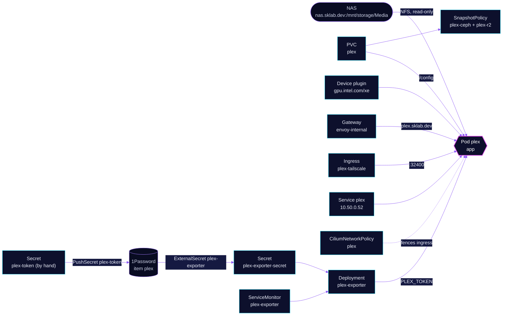

<!-- header: icon=clapperboard -->
<!-- concept: From the NAS library to a screen | hard-drive Library | cpu Transcode | network Serve | tv Watch -->
<p align="center"></p>

> The media server: it streams the NAS library to the LAN and the tailnet, and is not on the public gateway.

**Live facts:** <https://skrumbach.github.io/home-ops/apps/media/plex/> (workloads, routes, storage, backups, secrets and alerts, generated on every merge)

## What it does

- **Streams the library** from the NFS export `nas.sklab.dev:/mnt/storage/Media`, mounted read-only at `/data/nas-media`.
- **Serves the UI** at `plex.sklab.dev` on `envoy-internal` only, and directly on LoadBalancer `10.50.0.52:32400`
  (Service `plex`).
- **Reaches the tailnet** through Ingress `plex-tailscale` on the `ts-ingress` ProxyGroup, TCP 32400 only.
- **Keeps its metadata** in PVC `plex`, backed up by kopiur to `ceph` and `r2`. Cache, logs, crash reports, codecs,
  drivers and updates are skipped.
- **Exports metrics** through Deployment `plex-exporter`, scraped by ServiceMonitor `plex-exporter` every 30s.
- **Answers other apps** on `plex.media.svc:32400`: Seerr, Wizarr, Sonarr and Radarr.

## Why it is built this way

| Choice | Why |
|---|---|
| **Internal gateway only** | Owner decision, 2026-11-12. Remote viewers use the tailnet Ingress, not the Cloudflare tunnel. |
| **CiliumNetworkPolicy `plex` with default-deny ingress** | `ALLOWED_NETWORKS` (`10.0.0.0/8`) contains the pod CIDR `10.42.0.0/16`, so any pod would read Plex unauthenticated. Plex cannot subtract a CIDR, so the network fences it. |
| **Token pushed to 1Password** | PushSecret `plex-token` upserts the server's token into field `PLEX_TOKEN` of item `plex`. `plex-exporter` and Wizarr read it back from there, so Git holds no token. |
| **One PVC with ignore rules** | Matching a library and regenerating artwork takes hours, so `Metadata` and `Media` stay in the backup. What Plex rebuilds on its own is skipped. |

## How it works

<p align="center"></p>

<details>
<summary><b>Resource graph</b>: every object involved, by name</summary>



</details>

1. Flux applies Kustomization `plex` after `onepassword-store`, `intel-device-plugin-gpu`, `rook-ceph-cluster` and
   `kopiur-repository`. The `kopiur/pvc` component owns PVC `plex`, so a recreated claim is filled from the newest
   ceph snapshot. The HelmRelease waits for `rook-ceph-cluster`.
2. The `app` container starts as root with `PLEX_UID`/`PLEX_GID` `2000` and `fsGroup: 2000`. It mounts `/config`
   (the PVC), `/transcode` (a 20Gi emptyDir), `/tmp` and the read-only NFS media. It requests one `gpu.intel.com/xe`.
3. `ADVERTISE_IP` tells clients two addresses: `https://plex.sklab.dev:443` and `http://10.50.0.52:32400`.
4. Ingress to the pod is default-denied. The policy admits `world`, `remote-node` and `host`, the `envoy-internal`
   proxies, the Tailscale ProxyGroup pods (TCP 32400), `plex-exporter`, Wizarr, Seerr, Sonarr and Radarr (the last
   four on 32400), and CoreDNS replies.
5. The exporter reads the token from Secret `plex-exporter-secret` and scrapes `http://plex.media.svc.cluster.local:32400`.
   The `plex` item in vault `Homelab` is filled by PushSecret `plex-token` from a Secret made once by hand.

## Settings that matter

All values are in [`app/helmrelease.yaml`](app/helmrelease.yaml) unless noted.

| Setting | Value | Why |
|---|---|---|
| `spec.timeout` | `15m` | Strategy is Recreate with a large config PVC that takes minutes to mount; the 5m default caused `MissingRollbackTarget` stalls. |
| `limits.memory` | `16Gi` | 8Gi OOM-looped nightly from 2026-11-03: the butler's loudness analysis decodes every pending 4K TrueHD/DTS/EAC3 track at once. Idle use is under 1Gi. |
| `requests.memory` | `512Mi` | A limit with no request would reserve the whole limit on the node. |
| `limits."gpu.intel.com/xe"` | `1` | One iGPU from the `intel-device-plugin-gpu` pool. The B70 is not used here. |
| `ALLOWED_NETWORKS` | `10.0.0.0/8,172.16.0.0/12,192.168.0.0/16` | Private ranges are allowed without sign-in; see the policy above. |
| `runAsUser`, `runAsGroup` | `0`, with `PLEX_UID`/`PLEX_GID` `2000` | The manifest records no reason for root. The added capabilities are `CHOWN`, `SETUID`, `SETGID`, `FOWNER`, `DAC_OVERRIDE`. |
| `persistence.transcode` | emptyDir, `sizeLimit: 20Gi` | Scratch space, lost on restart. The manifest records no reason for the size. |
| `KOPIUR_CAPACITY`, `KOPIUR_CACHE_CAPACITY` (overlay) | `20Gi`, `10Gi` | Claim size and the kopiur cache. |
| `KOPIUR_SCHEDULE_R2` (overlay) | `H 15 * * *` | The offsite copy runs daily in hour 15. Ceph keeps the component default. |
| `spec.files.ignoreRules` ([`app/kustomization.yaml`](app/kustomization.yaml)) | the five kopiur defaults plus `Cache/`, `Logs/`, `Crash Reports/`, `Codecs/`, `Drivers/`, `Updates/` | An explicit list replaces kopiur's defaults, so the defaults are repeated. The patch lives here because a patch in the overlay is dropped by `cluster-apps`. |

## Operate it

```bash
flux -n media get ks plex
flux -n media get hr plex
kubectl -n media get pods -l app.kubernetes.io/name=plex -o wide
kubectl -n media get snapshotpolicy,snapshotschedule,restore,pvc
kubectl -n media get ciliumnetworkpolicy plex
kubectl -n media get ingress plex-tailscale
kubectl -n media get secret plex-exporter-secret -o jsonpath='{.data.PLEX_TOKEN}' | base64 -d | wc -c   # 0 means an empty token
```

Restores: [`restore.md`](../../../../../.agents/skills/incident-runbooks/references/restore.md).

### When an alert fires

| Alert | Fires when | First look |
|---|---|---|
| `TargetDown` for `plex-exporter` | Prometheus cannot scrape the exporter, or `/metrics` returns 500 | Check the decoded length of `PLEX_TOKEN` above. An empty token makes the exporter return 500. |
| `OOMKilled` | a container was OOM-killed in the last 10 minutes | `kubectl -n media describe pod`; a nightly loop points at the butler (see the memory limit above). |

## Invariants

- DO NOT "fix" the three `plex-exporter` probes to target `/metrics`. `/` returns 200 while `/metrics` returns 500,
  and that is load-bearing: the pod stays Ready, Prometheus keeps scraping, records `up=0` and `TargetDown` fires
  honestly. Probing `/metrics` would make the pod NotReady, drop the target entirely, and silence the alert.
- `SecretSynced` does not mean the value is non-empty. Check the decoded length of `PLEX_TOKEN`.
- Secret `plex-token` is created once, by hand, from `PlexOnlineToken` in the running server's `Preferences.xml`. It is
  deliberately not committed.
- Keep ingress default-denied. A new in-cluster consumer needs its own rule, on port 32400 only.

Upstream: [Plex support](https://support.plex.tv/) •
[Tailscale Kubernetes Ingress](https://tailscale.com/kb/1439/kubernetes-operator-cluster-ingress)
