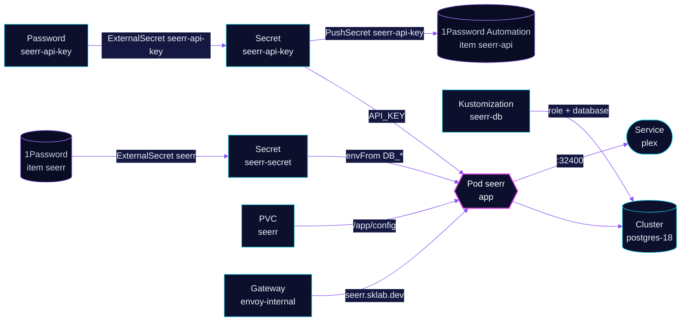

<!-- header: icon=ticket -->
<!-- concept: From a request to the library | search Discover | ticket Request | database Store | film Library -->
<p align="center"></p>

> The request portal: people ask for movies and shows here, on the LAN only, against Plex and a shared Postgres.

**Live facts:** <https://skrumbach.github.io/home-ops/apps/media/seerr/> (workloads, routes, storage, backups, secrets and alerts, generated on every merge)

## What it does

- **Takes requests** at `seerr.sklab.dev` on `envoy-internal` only (since 2026-11-12, an owner decision).
- **Scans Plex** libraries over `http://plex.media.svc:32400`, which the `plex` network policy admits for Seerr.
- **Stores its data** in database `seerr` on the shared `postgres-18` cluster, through Secret `seerr-secret`.
- **Owns one API key**, made by Password generator `seerr-api-key` and recorded in 1Password item `seerr-api`
  (vault `Automation`). Wizarr reads it from Secret `seerr-api-key`; the `ai/toolhive` MCP server `seerr-mcp` reads
  it from the 1Password item.
- **Keeps its settings** in PVC `seerr` (`/app/config`), backed up by kopiur to `ceph` and `r2`.

## Why it is built this way

| Choice | Why |
|---|---|
| **GitOps owns the API key** | The manifest comment: Seerr adopts it through the `API_KEY` env var, so GitOps owns the key instead of `settings.json`. |
| **Key generated once, never refreshed** | ExternalSecret `seerr-api-key` uses `refreshPolicy: CreatedOnce`. A regenerated key reaches Seerr and the MCP server only on their next restart. |
| **Alphanumeric key** | It travels in the `X-Api-Key` header. |

## How it works

<p align="center"></p>

<details>
<summary><b>Resource graph</b>: every object involved, by name</summary>



</details>

1. Flux applies Kustomization `seerr-db` first (`wait: true`, health-checked on `DatabaseRole` and `Database`), then
   `seerr` after `onepassword-store`, `rook-ceph-cluster` and `kopiur-repository`. The `kopiur/pvc` component owns
   PVC `seerr`.
2. ExternalSecret `seerr` extracts item `seerr` and builds `DB_TYPE`, `DB_HOST`, `DB_PORT`, `DB_USER`, `DB_PASS` and
   `DB_NAME`. The host `postgres-18-rw.database.svc.cluster.local` is hard-coded in the manifest.
3. The `app` container runs as uid/gid `2000` with a read-only root filesystem. `/app/config` is the PVC, `/tmp` an emptyDir.
4. The generator makes the key once. PushSecret `seerr-api-key` writes it to 1Password, with `deletionPolicy: None`
   so pruning never deletes the item.

## Settings that matter

All values are in [`app/helmrelease.yaml`](app/helmrelease.yaml) unless noted.

| Setting | Value | Why |
|---|---|---|
| `API_KEY` | from Secret `seerr-api-key`, key `SEERR_API_KEY` | GitOps owns the admin key (see above). |
| Probes | `GET /api/v1/status :5055`; startup 30 failures at 5s | Up to 150s for the first start before liveness counts. |
| `limits.memory` | `1Gi`, request `256Mi` | The manifest records no reason for the size. |
| Password generator | 48 characters, 12 digits, no symbols | Header-safe key ([`app/password.yaml`](app/password.yaml)). |
| `KOPIUR_CAPACITY`, `KOPIUR_SCHEDULE_R2` (overlay) | `2Gi`, `H 15 * * *` | Claim size; the offsite copy runs daily in hour 15. Ceph keeps the component default. |

## Operate it

```bash
flux -n media get ks seerr seerr-db
flux -n media get hr seerr
kubectl -n media get pods -l app.kubernetes.io/name=seerr -o wide
kubectl -n media get externalsecret seerr seerr-api-key
kubectl -n database get databaserole,database seerr
kubectl -n media get snapshotpolicy,snapshotschedule,restore,pvc
```

Restores: [`restore.md`](../../../../../.agents/skills/incident-runbooks/references/restore.md).

## Invariants

- ExternalSecret `seerr-api-key` is generated once and never refreshed. Deleting it mints a new key, which
  `pushsecret-api-key.yaml` writes over the 1Password field. Seerr and the seerr MCP pick it up on their next restart.
- Removing `seerr-db` never drops the role or the database (`retain`). Dropping them is a manual step of retirement.

Upstream: [Seerr](https://docs.seerr.dev/)
