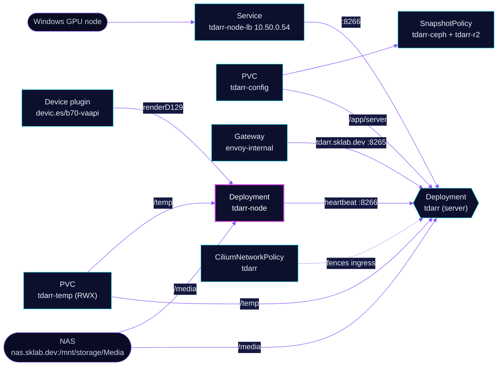

<!-- header: icon=film -->
<!-- concept: From a library file to an AV1 file | folder-open Library | list-checks Queue | cpu GPU worker | hard-drive Output -->
<p align="center"></p>

> Library transcoding to AV1: a server queues the work and a worker on the Arc Pro B70 in talos-3 runs it through VA-API.

**Live facts:** <https://skrumbach.github.io/home-ops/apps/media/tdarr/> (workloads, routes, storage, backups, secrets and alerts, generated on every merge)

## What it does

- **Queues work** on the `tdarr` server: web UI at `tdarr.sklab.dev` on `envoy-internal` (port 8265) and the node
  protocol on port 8266. The server runs no transcodes itself (`internalNode: "false"`).
- **Transcodes on the B70** in the `tdarr-node` worker: two GPU workers (AV1 via QSV) and one CPU worker.
- **Takes outside workers** through Service `tdarr-node-lb` at `10.50.0.54:8266`, for the Windows GPU node.
- **Reads and writes the library** on the NFS export `nas.sklab.dev:/mnt/storage/Media`, mounted at `/media`.
- **Keeps its database** in PVC `tdarr-config` (`/app/server`), backed up by kopiur to `ceph` and `r2`.

## Why it is built this way

| Choice | Why |
|---|---|
| **One worker, not a DaemonSet** | The server runs no internal node, so one worker is enough. A DaemonSet would strand Pending pods on any node without the B70. |
| **`devic.es/b70-vaapi`, not `devic.es/b70`** | Same card, mounted under its kernel names (`card1`, `renderD129`). VA-API needs them; the renamed `b70` group cannot provide them. |
| **A CPU transcode worker beside the GPU ones** | A GPU-only node turns any VA-API regression into a silent, total outage: every job fails with `transcodeError` and nothing else can take it. The cost is speed, not correctness. |
| **`auth: "false"` on the server** | Tdarr 3.x defaults to auth and 401s every node without an API key. The external Windows node cannot take a key from Git, so the 2.x open behaviour stays. The network policy is the only gate. |
| **A raw Service for `tdarr-node-lb`** | A second `service:` in the chart would rename the primary Service to `tdarr-app`, which breaks the HTTPRoute and the nodes' `tdarr.media.svc.cluster.local` lookup. |
| **Worker CPU capped at 4** | Unbounded, the CPU worker held about 15 of talos-3's 20 cores and starved the control plane. See the CPU row below. |

## How it works

<p align="center"></p>

<details>
<summary><b>Resource graph</b>: every object involved, by name</summary>



</details>

1. Flux applies Kustomization `tdarr` after `intel-device-plugin-gpu`, `rook-ceph-cluster` and `kopiur-repository`.
   The `kopiur/pvc` component owns PVC `tdarr-config` (claim name set by `KOPIUR_CLAIM`). PVC `tdarr-temp`
   is a plain manifest and is not backed up.
2. The server starts with `serverIP` `0.0.0.0`, `serverPort` `8266`, `webUIPort` `8265`.
3. The worker is scheduled on talos-3 by its `devic.es/b70-vaapi` limit. It tolerates the `PreferNoSchedule` taint
   `home-operations.com/dedicated`, so the score penalty does not count against the only node it can run on.
4. The worker dials `tdarr.media.svc.cluster.local:8266`. Its `/app/configs` is an emptyDir, so the four worker-limit
   env vars are reseeded on every start and UI toggles do not survive a restart.
5. Readiness and startup ask the server (`/api/v2/get-nodes` on 8265) whether this pod's `nodeName` has a process
   heartbeat younger than 3 minutes. Liveness only checks that the `Tdarr_Node` process exists. A server API blip
   marks the pod NotReady instead of restarting the GPU worker.

## Settings that matter

All values are in [`app/helmrelease.yaml`](app/helmrelease.yaml) unless noted.

| Setting | Value | Why |
|---|---|---|
| `transcodegpuWorkers` | `2` | Two GPU workers share the B70. |
| `transcodecpuWorkers` | `1` | Keeps one CPU worker (see above). |
| `healthcheckgpuWorkers` | `0`, must stay | Tdarr builds the GPU health check with `-hwaccel nvdec -hwaccel_output_format cuda`, which never works on Intel: every hevc or av1 file fails "device type cuda needed". The CPU health check does the same job. |
| `healthcheckcpuWorkers` | `1` | On 2026-11-12 the thorough check of one 4K 10-bit AV1 file passed 7 GB RSS in 30s and grew until the `12Gi` limit killed the container, about every 6 minutes. That file's check was skipped in Tdarr. If a 4K AV1 check does it again, set this to `0`. |
| worker `limits.cpu` | `4` | Chat decode fell 64 to 40 t/s at 12 CPUs. At 6, prefill was 1853 t/s against 2079 with tdarr stopped; at 4 it was 1951 (+5%). |
| worker `limits.memory`, `requests` | `12Gi`; `2` CPU, `2Gi` | The requests keep the node from reserving the whole limit. |
| server `limits.memory` | `2Gi` | The manifest records no reason. |
| `spec.timeout` | `15m` | The worker's startup probe allows up to 5 minutes for the server heartbeat; the 5m default rolled the 3.x upgrade back mid-start. |
| `persistence.configs` | emptyDir at `/app/configs` | Not persisted on purpose; see step 4. |
| PVC `tdarr-temp` ([`app/pvc.yaml`](app/pvc.yaml)) | `ceph-filesystem-rwx`, `200Gi`, RWX | Disposable scratch shared by both pods. The default `csi` subvolumegroup is broken by Ceph Tentacle v20.2.1 subvolume corruption, so the claim stays on this class until a fixed release lands. |
| `spec.files.ignoreRules` ([`app/kustomization.yaml`](app/kustomization.yaml)) | the five kopiur defaults plus `/Tdarr/Backups/` | Those are Tdarr's own rolling zip backups of DB2; kopiur already keeps DB2's history. |
| `KOPIUR_CAPACITY`, `KOPIUR_CACHE_CAPACITY`, `KOPIUR_SCHEDULE_R2` (overlay) | `5Gi`, `10Gi`, `H 15 * * *` | Claim size, cache, and the daily offsite hour. |

## Operate it

```bash
flux -n media get ks tdarr
flux -n media get hr tdarr
kubectl -n media get pods -l app.kubernetes.io/name=tdarr -o wide
kubectl -n media logs deploy/tdarr-tdarr-node -c app --tail=50
kubectl -n media get ciliumnetworkpolicy tdarr
kubectl -n media get snapshotpolicy,snapshotschedule,restore,pvc
kubectl get nodes -o custom-columns=NAME:.metadata.name,B70:.status.allocatable.devic\.es/b70
# needs exec: the VA-API check after any GPU change
kubectl -n media exec deploy/tdarr-tdarr-node -c app -- vainfo --display drm --device /dev/dri/renderD129
```

Restores: [`restore.md`](../../../../../.agents/skills/incident-runbooks/references/restore.md).

### When an alert fires

| Alert | Fires when | First look |
|---|---|---|
| `KubePodNotReady` | the worker's server heartbeat is older than 3 minutes | Server logs, then the `vainfo` check above. |
| `ContainerRestartingChronically` | 20 or more restarts in 24h and still restarting | Memory kills: see `healthcheckcpuWorkers`. |
| `OOMKilled` | a container was OOM-killed in the last 10 minutes | The worker's `12Gi` limit and the health check row. |
| `B70GpuLost` | `devic.es/b70` on talos-3 stays at 0 for 5 minutes | The card left the PCIe bus. Power the dock first (`gpu-loss.yaml`). |

## Invariants

- **NEVER rename a DRM device node with `generic-device-plugin`'s `mountPath`, and never ship a GPU change without the
  VA-API check:** `kubectl -n media exec deploy/tdarr-tdarr-node -c app -- vainfo --display drm --device /dev/dri/renderD129`.
  VA-API consumers use `devic.es/b70-vaapi`. No DRA migration, never `adminAccess: true`.
- Keep the worker's CPU limit low. llama.cpp launches SYCL work from CPU threads on the same node, so a busy CPU
  worker slows chat decode and prefill (see the CPU row).
- `healthcheckgpuWorkers` stays `"0"` on Intel.
- Ingress to the server stays fenced by the network policy. A new outbound in-cluster peer needs a reply rule
  (cilium/cilium#47913).
- Do not add a second `service:` entry to the HelmRelease (see `tdarr-node-lb`).

## Known gaps

- **The world rule on 8266 is still open.** [`app/ciliumnetworkpolicy.yaml`](app/ciliumnetworkpolicy.yaml) marks the
  `world` entry on port 8266 "HOLD: replace with `fromCIDR: [<node-ip>/32]` before merging". It is merged and still
  admits any LAN source. With `auth: "false"`, that is an open API.
- **The overlay depends on the wrong device plugin.** [`kubernetes/apps/main/media/tdarr.yaml`](../../../main/media/tdarr.yaml)
  waits for `intel-device-plugin-gpu`, but neither container requests `gpu.intel.com/xe`. The worker requests
  `devic.es/b70-vaapi`, served by Kustomization `generic-device-plugin`.

Upstream: [Tdarr docs](https://docs.tdarr.io/)
