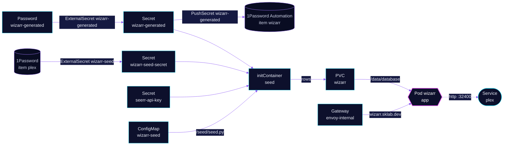

<!-- header: icon=user-plus -->
<!-- concept: From a seed to a Plex invite | key-round Secrets | sprout Seed | server Media server | mail Invite -->
<p align="center"></p>

> Plex invitations: a seed init container provisions the admin, the Plex server and the Seerr link, so no setup wizard.

**Live facts:** <https://skrumbach.github.io/home-ops/apps/media/wizarr/> (workloads, routes, storage, backups, secrets and alerts, generated on every merge)

## What it does

- **Invites people to Plex** from `wizarr.sklab.dev` on `envoy-internal` only. The public invite host `join.sklab.dev`
  was removed on 2026-11-13.
- **Seeds itself** on every pod start. The init container `seed` migrates the database, then `resources/seed.py`
  writes the admin account, the Plex server, the Seerr connection and an API key named `hermes`.
- **Generates its credentials** once: the admin password and the API key, recorded in 1Password item `wizarr`
  (vault `Automation`).
- **Keeps invites, servers and libraries** in a SQLite database on PVC `wizarr` (`/data/database`), backed up by
  kopiur to `ceph` and `r2`.

## Why it is built this way

| Choice | Why |
|---|---|
| **A seed script, not the setup wizard** | Wizarr has no env-based provisioning. The admin, media server, integrations and API keys are database rows, so the script writes the same rows through Wizarr's own models, from GitOps secrets. |
| **Seed runs on the app image** | It always matches the database schema. |
| **Admin created only when missing** | A password changed in the UI is left alone. The Plex token and the Seerr key follow rotation. |
| **Strategy `Recreate`** | One replica with an RWO database PVC: a rolling update would deadlock on Multi-Attach. |
| **Libraries and invite design stay in the UI** | The seed does not write them. |

## How it works

<p align="center"></p>

<details>
<summary><b>Resource graph</b>: every object involved, by name</summary>



</details>

1. Flux applies Kustomization `wizarr` after `onepassword-store`, `rook-ceph-cluster` and `kopiur-repository`.
   The `kopiur/pvc` component owns PVC `wizarr`. The ConfigMap `wizarr-seed` is generated from
   `resources/seed.py` with a fixed name and Flux substitution disabled.
2. The `seed` container runs `flask db upgrade`, then `seed.py`. A missing env var aborts the seed with a `KeyError`
   before any row is written, so the pod does not start.
3. The script creates the admin if it is missing, sets the legacy `admin_username` setting (Wizarr redirects every page
   to `/setup` until it exists), upserts the `Plex` media server and the `Seerr` connection (type `overseerr`,
   `provision_plex_users` on), and adds the `hermes` key by its SHA-256 hash.
4. The `app` container serves on port `5690`. The Plex policy admits Wizarr on 32400, because the app polls Plex and
   shares libraries with its own token.

## Settings that matter

All values are in [`app/helmrelease.yaml`](app/helmrelease.yaml) unless noted.

| Setting | Value | Why |
|---|---|---|
| `PLEX_URL`, `SEERR_URL` | `http://plex.media.svc.cluster.local:32400`, `http://seerr.media.svc.cluster.local:5055` | In-cluster addresses, not the public hostnames. |
| `PLEX_TOKEN` | Secret `wizarr-seed-secret` (item `plex`, vault `Homelab`) | Shared with the exporter; an empty value still reports `SecretSynced`. |
| `SEERR_API_KEY` | Secret `seerr-api-key`, from `media/seerr` | The key is read straight from the in-namespace Secret. |
| `forceRename` | `wizarr-admin` | Keeps the route name from when there were two routes. |
| Mounts for `seed` and `app` | `/data/database`, `/tmp`, `/.cache` | Both containers run with a read-only root filesystem. |
| `limits.memory` | `512Mi`, request `128Mi` | The manifest records no reason for the size. |
| `KOPIUR_CAPACITY`, `KOPIUR_SCHEDULE_R2` (overlay) | `1Gi`, `H 15 * * *` | Claim size; the offsite copy runs daily in hour 15. Ceph keeps the component default. |

## Operate it

```bash
flux -n media get ks wizarr
flux -n media get hr wizarr
kubectl -n media get pods -l app.kubernetes.io/name=wizarr -o wide
kubectl -n media logs -l app.kubernetes.io/name=wizarr -c seed        # prints "[wizarr-seed] ..."
kubectl -n media get externalsecret wizarr-seed wizarr-generated
kubectl -n media get pushsecret wizarr-generated
kubectl -n media get snapshotpolicy,snapshotschedule,restore,pvc
```

Restores: [`restore.md`](../../../../../.agents/skills/incident-runbooks/references/restore.md).

## Invariants

- ExternalSecret `wizarr-generated` is generated once and never refreshed. The seed creates the admin only when it
  is missing, so deleting the ExternalSecret changes the 1Password copy but not an existing admin password (reset it
  in the Wizarr UI).
- `SecretSynced` does not mean the value is non-empty: check the decoded length of `PLEX_TOKEN`.
- Re-runs of the seed are safe. A missing env var aborts it before any row is written.

Upstream: [Wizarr](https://github.com/wizarrrr/wizarr)
