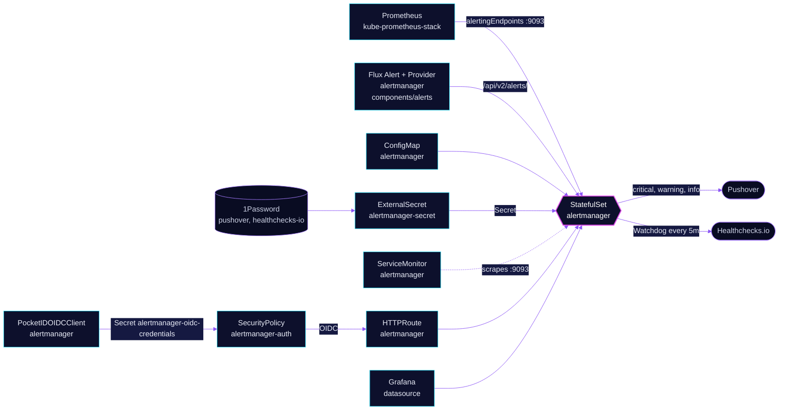

<!-- header: icon=bell-ring -->
<!-- concept: From a firing alert to a buzz on the phone | flame Fire | merge Group | route Route | smartphone Notify -->
<p align="center"></p>

> Groups and routes every Prometheus alert and Flux failure to Pushover by severity, and a heartbeat to Healthchecks.io.

**Live facts:** <https://skrumbach.github.io/home-ops/apps/monitoring/alertmanager/> (workloads, routes, storage, backups, secrets and alerts, generated on every merge)

## What it does

- **Receives alerts** from Prometheus (`alertingEndpoints` in [kube-prometheus-stack](../kube-prometheus-stack/README.md))
  and from Flux. The `alerts` component adds a Flux `Provider` and `Alert` named `alertmanager` to every overlay
  that includes it. They post Flux error events (HelmRelease, Kustomization, OCIRepository and others) to
  `/api/v2/alerts/` on this Service.
- **Routes by severity.** `critical` becomes Pushover priority 2 (siren, acknowledge required), `warning` and
  unlabelled priority 0, `info` and `notify` priority -2 (silent). Resolved notifications on the first two are priority -1.
- **Sends the Watchdog heartbeat** to Healthchecks.io every 5 minutes, so silence there means the alert chain is
  down.
- **Serves a UI** at `alertmanager.sklab.dev` on `envoy-internal`, behind Pocket ID (group `admins`).
- **Feeds Grafana** as a datasource, over the in-cluster Service.

The same `alerts` component also adds Flux `Provider` and `Alert` `github-status`, which posts Kustomization
errors to GitHub commit status. That path does not go through Alertmanager.

## Why it is built this way

| Choice | Why |
|---|---|
| **Standalone app-template, not the stack's Alertmanager** | kube-prometheus-stack sets `alertmanager.enabled: false`. This app owns the config, the secret mounts and the route. |
| **Config is a plain file, secrets are mounted** | `resources/alertmanager.yml` becomes ConfigMap `alertmanager` through a generator. Tokens and the ping URL are read from files under `/etc/secrets` (`token_file`, `user_key_file`, `url_file`), so no Flux substitution touches the config, and the generator sets `kustomize.toolkit.fluxcd.io/substitute: disabled`. |
| **Gate at Envoy, not in Alertmanager** | Alertmanager has no login. `SecurityPolicy` `alertmanager-auth` covers the browser route only. Prometheus, Grafana and the Flux Provider use the Service and bypass it. |
| **Gatus probes the Service** | The OIDC gate answers with a redirect, so a route check would measure the sign-in page. |
| **Fail loud** | The root receiver is `pushover-warning`. An alert with no severity label still notifies. |
| **Critical repeats every 6h, expires at 30m** | At priority 2 a sustained critical costs four acknowledge-required pages a day. `repeat_interval` on the critical route is the single dial. |
| **`namespace` in `group_by`** | Each notification is about one namespace, which is what a phone reader needs first. |

## How it works

<p align="center"></p>

<details>
<summary><b>Resource graph</b>: every object involved, by name</summary>



</details>

1. Flux applies `app/` after `onepassword-store`. The HelmRelease also waits for `rook-ceph-cluster`, because
   the StatefulSet has a 50Mi `ceph-block` volume at `/alertmanager` for silences and notification state.
2. ExternalSecret `alertmanager-secret` (ClusterSecretStore `onepassword`, refresh 5m) pulls `pushover_api_token`
   and `pushover_api_userkey` from 1Password item `pushover`, and `healthchecks_ping_url` from item
   `healthchecks-io`. Reloader restarts the StatefulSet when the ConfigMap or Secret changes.
3. Alerts arrive and are grouped by `alertname` and `namespace`.
4. The route tree picks a receiver: `InfoInhibitor` goes to `null`, `Watchdog` to `healthchecks-io`, then
   `severity` `critical`, `warning` and `info|notify` to `pushover-critical`, `pushover-warning` and
   `pushover-low`.
5. Inhibit rules mute a lower severity when a higher one fires with the same `alertname` and `namespace`, and
   mute `info` in a namespace while `InfoInhibitor` fires.

| Severity | Receiver | Pushover priority | `group_wait` | `repeat_interval` |
|---|---|---|---|---|
| `critical` | `pushover-critical` | 2, `retry` 5m, `expire` 30m, sound `siren` | 30s | 6h |
| `warning`, none | `pushover-warning` | 0 | 1m (30s on the root route) | 12h |
| `info`, `notify` | `pushover-low` | -2, `ttl` 24h | 5m | 24h |

## Settings that matter

| Setting | Value | Why |
|---|---|---|
| `ServiceMonitor` relabel `job` | `kube-prometheus-stack-alertmanager` | Load-bearing: the chart's `alertmanager.rules` match that job. The Service-name default scrapes fine and leaves them inert. |
| ExternalSecret `healthchecks_ping_url` `deletionPolicy` | unset (Retain) | On purpose, per the manifest comment. |
| `securityContext` | non-root 65534, read-only root, drop `ALL` | Alertmanager writes only to `/alertmanager`; config and secrets are read-only mounts. |
| `resources.limits.memory` | `99M` | Every limit has a request. The manifest records no reason for the number. |
| `notify` severity | routed to `pushover-low` | A home-ops-local severity for "an event worth recording", not a problem. |
| `reloader.stakater.com/auto` | `"true"` | Restarts on ConfigMap or Secret change. |

## Operate it

```bash
flux -n monitoring get ks alertmanager
flux -n monitoring get hr alertmanager
kubectl -n monitoring get statefulset,pod,pvc -l app.kubernetes.io/name=alertmanager
kubectl -n monitoring get externalsecret alertmanager-secret
kubectl -n monitoring get securitypolicy alertmanager-auth -o jsonpath='{.status}'
kubectl -n monitoring get alerts.notification.toolkit.fluxcd.io,providers.notification.toolkit.fluxcd.io -A
```

Active alerts and silences are in the UI at `https://alertmanager.sklab.dev`. The route table is
[`app/resources/alertmanager.yml`](app/resources/alertmanager.yml).

## Invariants

- **Do not remove the `job` relabel** in `app/servicemonitor.yaml`; it keeps the chart's alertmanager rules live.
- **`critical` is the only class that may wake someone** (comment in `app/resources/alertmanager.yml`).
- **A policy that fails to translate makes the route answer 500**, and a policy whose `targetRef` matches no route
  leaves that route open (comment in `app/securitypolicy.yaml`).
- **Deleting `PocketIDOIDCClient` `alertmanager` deletes the client in Pocket ID.**

## Known gaps

- **Comments cite a skill that does not exist.** `app/resources/alertmanager.yml` says "Skill observability" in
  four places. `.agents/skills/` holds only `incident-runbooks`.

Upstream: [Alertmanager docs](https://prometheus.io/docs/alerting/latest/alertmanager/) •
[Pushover API](https://pushover.net/api)
