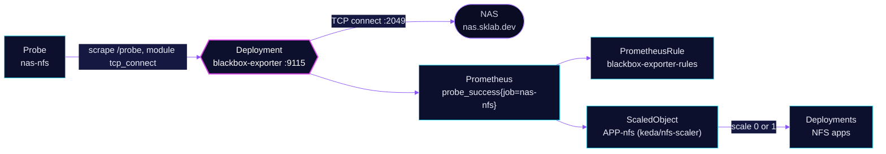

<!-- header: icon=activity -->
<!-- concept: From a TCP probe to an alert and a scale-down | clock Schedule | plug Probe | server NAS port | bell-ring Alert | scaling Scale -->
<p align="center"></p>

> Probes the NAS NFS port from inside the cluster, so an NFS outage raises an alert and scales the NFS apps down.

**Live facts:** <https://skrumbach.github.io/home-ops/apps/monitoring/blackbox-exporter/> (workloads, routes, storage, backups, secrets and alerts, generated on every merge)

## What it does

- **Probes** `nas.sklab.dev:2049` with a TCP connect every 30s, through Probe `nas-nfs`. It answers one question: does
  the NAS accept NFS connections from inside the cluster?
- **Alerts** through PrometheusRule `blackbox-exporter-rules`: `NASNFSExportDown` when the probe fails, and
  `NASNFSProbeMissing` when the series is gone.
- **Drives scale-down** of the apps that mount the NAS. The `keda/nfs-scaler` component reads
  `probe_success{job="nas-nfs"}` and scales those Deployments to zero while the export is down (see
  [keda](../keda/README.md)).
- **Monitors itself** through the chart's `serviceMonitor.selfMonitor`, which scrapes the exporter's own `/metrics`
  for probe errors and config reloads.

## Why it is built this way

| Choice | Why |
|---|---|
| **`tcp_connect` only, no ICMP** | The `tcp_connect` module is the only one, so the container needs no `NET_RAW` capability and runs with all capabilities dropped. |
| **Probe from inside the cluster** | The alert text and the scale-down both concern pods that cannot mount the export. A NAS that answers on the LAN can still fail from the cluster (DNS or routing, see the steps below). |

## How it works

<p align="center"></p>

<details>
<summary><b>Resource graph</b>: every object involved, by name</summary>



</details>

1. Flux applies Kustomization `blackbox-exporter`. Its health check is the Deployment `blackbox-exporter`.
2. Probe `nas-nfs` points the Prometheus Operator at `blackbox-exporter.monitoring.svc.cluster.local:9115` with module
   `tcp_connect` and one static target, `nas.sklab.dev:2049`. The Probe sets `jobName: nas-nfs`, so the series is
   `probe_success{job="nas-nfs"}`.
3. The exporter opens a TCP connection and reports 1 or 0. Prometheus keeps the series.
4. `NASNFSExportDown` fires when `probe_success` has been 0 for 5m. `NASNFSProbeMissing` fires when the series is
   absent for 15m, because the first rule can never fire without it.
5. The ScaledObject from `components/keda/nfs-scaler` queries the same series. The six apps that include it are listed
   in the [keda README](../keda/README.md).

## Settings that matter

| Setting | Value | Why |
|---|---|---|
| `config.modules.tcp_connect` | `prober: tcp`, `timeout: 5s`, `preferred_ip_protocol: ip4` | The one module. The manifest records no reason for `ip4`. |
| Probe `interval`, `scrapeTimeout` ([`app/probe.yaml`](app/probe.yaml)) | `30s`, `10s` | The KEDA `pollingInterval` is also 30s, because polling faster re-reads the same sample. |
| `jobName` | `nas-nfs` | The alert rules and the ScaledObject select on `job="nas-nfs"`. |
| `serviceMonitor.selfMonitor.enabled` | `true` | Scrapes the exporter's own `/metrics`. |
| `NASNFSExportDown` `for` | `5m` | The ScaledObject `cooldownPeriod` (300s) uses the same window. |

## Operate it

```bash
flux -n monitoring get ks blackbox-exporter
kubectl -n monitoring get deploy blackbox-exporter
kubectl -n monitoring get probe nas-nfs
kubectl -n monitoring get prometheusrule blackbox-exporter-rules
```

### When an alert fires

From [`app/prometheusrule.yaml`](app/prometheusrule.yaml), whose header comment names this file as the runbook.

| Alert | Fires when | First look |
|---|---|---|
| `NASNFSExportDown` (critical) | the NAS refused or timed out TCP 2049 for 5 minutes | Pods that mount the export hang in `ContainerCreating` or block on I/O. See the steps below. |
| `NASNFSProbeMissing` (warning) | no `probe_success{job="nas-nfs"}` series for 15 minutes | The exporter Deployment is down, or the Probe was renamed or removed. Check `kubectl -n monitoring get deploy blackbox-exporter` and `kubectl -n monitoring get probe nas-nfs`. |

For `NASNFSExportDown`:

1. Is it the NAS or the path? From a workstation on the LAN: `nc -z nas.sklab.dev 2049`. Open from the LAN but
   failing in-cluster points at DNS or routing from the nodes, not the NAS.
2. Check the TrueNAS NFS service and the pool. Nothing in the cluster can fix a stopped NFS service.
3. After the NAS is back the alert resolves on its own. Pods stuck on a stale mount may need a restart.

## Invariants

- `tcp_connect` is the only module (no ICMP, so no `NET_RAW`).
- Keep that job name stable: alert rules select on it.
- Nothing in the cluster can fix a stopped NFS service.

Upstream: [blackbox_exporter](https://github.com/prometheus/blackbox_exporter) •
[Probe CRD](https://prometheus-operator.dev/docs/api-reference/api/#monitoring.coreos.com/v1.Probe)
