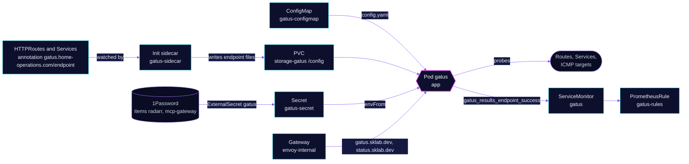

<!-- header: icon=activity -->
<!-- concept: From a route annotation to a status page and an alert | tag Annotate | search Discover | activity Probe | bell-ring Alert -->
<p align="center"></p>

> The status page and health prober: it checks every annotated route and a few fixed targets, and feeds alerts.

**Live facts:** <https://skrumbach.github.io/home-ops/apps/monitoring/gatus/> (workloads, routes, storage, backups, secrets and alerts, generated on every merge)

## What it does

- **Probes endpoints it discovers.** The `gatus-sidecar` init container (a native sidecar) watches HTTPRoutes,
  Gateways and Services. A route's annotation `gatus.home-operations.com/endpoint` holds the YAML of its check
  (URL, conditions, and usually a `group`).
- **Probes a fixed list** from [`app/resources/config.yaml`](app/resources/config.yaml): ICMP to `1.1.1.1`,
  `8.8.8.8` and `9.9.9.9` (group `connectivity`), the Radarr import queue, the Hermes gateway, the ToolHive MCP
  session, Home Assistant, in-cluster echo and kromgo, the Tdarr node port, `postgres-18` and `emqx`.
- **Serves the status page** at `gatus.sklab.dev` and `status.sklab.dev` on `envoy-internal`.
- **Exports results** as `gatus_results_endpoint_success` (`metrics: true`, a ServiceMonitor). The alert rules in
  `app/prometheusrule.yaml` page on that series, and the Grafana `gatus` board reads it.
- **Keeps its history** in SQLite on PVC `storage-gatus`. The overlay includes no kopiur component, so the
  history is not backed up.

## Why it is built this way

| Choice | Why |
|---|---|
| **Annotations on routes, not a central list** | Each app declares its own check next to its route. Most checks need no edit here. The fixed list holds only what has no route. |
| **In-cluster checks, matched on the body** | A status-only probe of a gated route can stay green through an outage, and some UIs answer 200 for any path. The config probes the in-cluster Service and matches a body field (Hermes, Home Assistant, echo, kromgo). |
| **The `(in-cluster)` suffix** | `Echo (in-cluster)` and `Kromgo (in-cluster)` must not collide with the auto-discovered `external/echo` and `external/kromgo`. A collision panics Gatus at startup. |
| **Secrets reach the config through env** | `gatus-secret` is mounted with `envFrom`. The ConfigMap has Flux substitution disabled, so `${RADARR_API_KEY}`, `${MCP_GATEWAY_URL}` and `${MCP_GATEWAY_TOKEN}` are left for Gatus to expand. |

## How it works

<p align="center"></p>

<details>
<summary><b>Resource graph</b>: every object involved, by name</summary>



</details>

1. Kustomization `gatus` ([overlay](../../../main/monitoring/gatus.yaml)) applies `app/` after `onepassword-store`
   and `rook-ceph-cluster`. The `configMapGenerator` turns `resources/config.yaml` into `gatus-configmap`.
2. The sidecar runs with `--auto-httproute`, `--enable-httproute` and `--enable-service`. Its ClusterRole
   `gatus` allows only `get`, `watch` and `list` on Services, Gateways and HTTPRoutes. It writes the endpoint
   files into the shared claim, which Gatus reads as its config directory (`GATUS_CONFIG_PATH: /config`).
3. `config.yaml` is mounted over `/config/config.yaml` from the ConfigMap, read-only. `reloader.stakater.com/auto`
   restarts the pod when the ConfigMap or `gatus-secret` changes.
4. Gatus probes each endpoint on its interval and stores results in `/config/sqlite.db`.
5. Group decides who is paged (see the alert table). Most annotations set `group:`. The `echo` and `kromgo` routes
   are on `envoy-external` and set none; the config comments name their discovered checks `external/echo` and
   `external/kromgo`.

## Settings that matter

| Setting | Value | Why |
|---|---|---|
| `storage` | `sqlite`, `/config/sqlite.db`, `caching: true` | Results survive a restart. |
| PVC `storage-gatus` | `512Mi`, `ceph-block` | The history of about 60 endpoints stays well under 50Mi. A PVC cannot shrink in place: do not size it down without a delete and recreate. |
| `defaultPodOptions.securityContext.fsGroup` | `65532` | The non-root sidecar must write the shared claim, or route discovery stops silently. |
| `automountServiceAccountToken` | `true` | app-template v5 defaults it to false, and the sidecar needs the token to watch the API. |
| `gatus-sidecar` `resources.memory` | request and limit `64Mi` | Equal on purpose: a limit with no request reserves the whole limit. As a native sidecar (`restartPolicy: Always`) its request adds to the pod total. |
| `app` `resources.memory` | `128Mi` request, `256Mi` limit | About 2.7 times the 14-day peak, with room for the discovered set to grow. |
| `app` capabilities | `NET_RAW` added, all others dropped | Needed for the ICMP checks. |
| Check `Radarr Import Queue` | interval `15m`, `warnings` and `errors` false | Radarr shows a stuck queue item only in its own UI. This turns it into `RadarrImportQueueBlocked`. |
| Check `Hermes Gateway` | port `8642`, `/health`, body `status == ok` | The dashboard on `9119` returns 200 for unknown paths, so it would stay green through a gateway failure. |
| Check `ToolHive MCP Session` | POST `initialize`, timeout `25s`, interval `5m` | `/health` stays 200 while the handshake hangs. A fast embedding failure can still return 200. |
| Check `Tdarr Server` | `tcp://...:8266`, group `media` | The UI on `8265` is already probed. The node port answers 302 to the UI and can be dead while the UI is healthy. Group `media` keeps it out of the critical `external` group. |

## Operate it

```bash
flux -n monitoring get ks gatus
flux -n monitoring get hr gatus
kubectl -n monitoring get pods -l app.kubernetes.io/name=gatus -o wide
kubectl -n monitoring logs deploy/gatus -c gatus-sidecar --tail=50   # discovery
kubectl -n monitoring logs deploy/gatus -c app --tail=50             # probes
kubectl -n monitoring get externalsecret gatus
kubectl -n monitoring exec deploy/gatus -c app -- ls /config         # exec: files the sidecar wrote
```

### When an alert fires

| Alert | Fires when | First look |
|---|---|---|
| `GatusEndpointDown` | an endpoint in group `external` fails for 5m (critical) | The status page; then the app behind the public route. |
| `GatusServiceDown` | any endpoint outside `external` and `connectivity`, except `Radarr Import Queue` and `Hermes Gateway`, fails for 10m | The status page, group and name from the alert. |
| `RadarrImportQueueBlocked` | the Radarr queue has a warning or error for 30m | Radarr, Activity, Queue: Manual Import the stuck item. |
| `HermesGatewayDown` | `Hermes Gateway` fails for 10m (critical) | `kubectl -n ai exec deploy/hermes -c app -- hermes gateway status`. |

## Invariants

- **Do not drop the exclusions on `GatusServiceDown`.** Connectivity targets, `Radarr Import Queue` and
  `Hermes Gateway` have their own alerts, or measure the WAN, not an app.
- **A fixed check that matches an auto-discovered name needs a different name.** Gatus panics at startup on a
  duplicate.
- **Never size `storage-gatus` down.** A claim cannot shrink in place.

Upstream: [Gatus](https://github.com/TwiN/gatus) • [gatus-sidecar](https://github.com/home-operations/gatus-sidecar)
