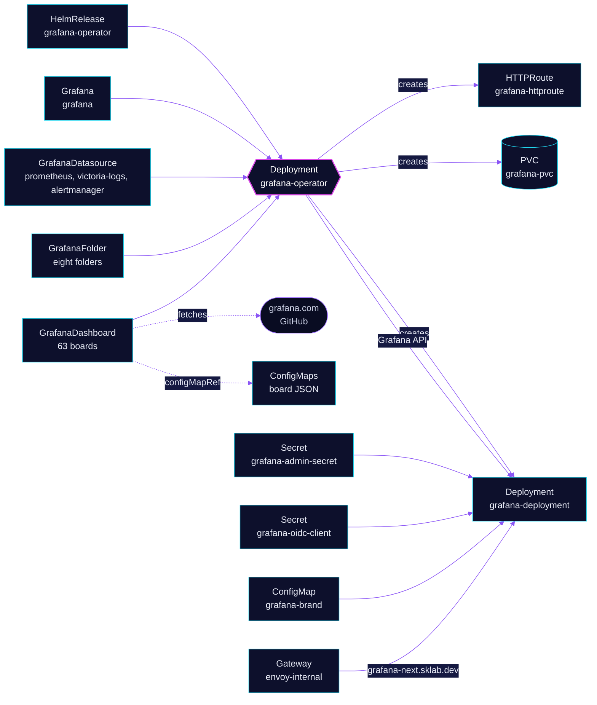

<!-- header: icon=layout-dashboard -->
<!-- concept: From a resource in Git to a board in Grafana | git-branch Git | cog Operator | folder Folder | layout-dashboard Board -->
<p align="center"></p>

> Runs a second Grafana from custom resources, next to the chart-based one, until it takes over.

**Live facts:** <https://skrumbach.github.io/home-ops/apps/monitoring/grafana-operator/> (workloads, routes, storage, backups, secrets and alerts, generated on every merge)

## What it does

- **Runs the operator.** HelmRelease `grafana-operator` installs the controller and its CRDs
  (`grafana.integreatly.org`).
- **Runs a Grafana instance** from `Grafana` `grafana` at `grafana-next.sklab.dev` on `envoy-internal`, with
  the same sign-in, theme and brand files as [`monitoring/grafana`](../grafana/README.md).
- **Declares what Grafana shows.** Three `GrafanaDatasource`, eight `GrafanaFolder` and 63
  `GrafanaDashboard` objects. The operator writes each one through Grafana's API and reports the result in
  the object's status.
- **Is a trial.** [`monitoring/grafana`](../grafana/README.md) still serves `grafana.sklab.dev` and nothing
  about it changes. This instance exists to compare the two before the chart is removed.

## Why it is built this way

| Choice | Why |
|---|---|
| **A second instance, not a switch** | The move cannot be tested outside the cluster. Next to the running Grafana, a mistake here costs nothing. |
| **One object per board** | `kubectl get grafanadashboard` shows which board failed and why, and a board is added without a Grafana restart. The chart downloads its boards in an init container at every pod start. |
| **Boards chosen one by one** | `configMapRef` names one ConfigMap. kube-prometheus-stack ships 23 boards; `k8s-resources-multicluster` is left out. The sidecar loads every labelled ConfigMap or none. |
| **A PVC for Grafana's data** | With an emptyDir the operator would have to write every board again after each restart. The claim keeps `grafana.db`. Nothing in it is missing from Git, so it has no backup. |
| **Admin login from `grafana-admin-secret`** | The operator calls Grafana's API with the admin user over basic auth, read from the two env values. The Secret is the one the chart uses, so the break-glass login is the same. |
| **Sign-in through the chart's Pocket ID client** | `PocketIDOIDCClient` `grafana` carries a second callback URL for this hostname. No second client, no second secret. |

## How it works

<p align="center"></p>

<details>
<summary><b>Resource graph</b>: every object involved, by name</summary>



</details>

1. Kustomization `grafana-operator` ([overlay](../../../main/monitoring/grafana-operator.yaml)) installs the
   chart and waits for it. `crds: CreateReplace` applies the chart's CRDs on install and on every upgrade.
2. Kustomization `grafana-operator-instance` applies `instance/` after `grafana-operator` and `grafana`. The
   operator turns `Grafana` `grafana` into Deployment `grafana-deployment`, Service `grafana-service`,
   ConfigMap `grafana-ini`, PVC `grafana-pvc` and HTTPRoute `grafana-httproute`.
3. Init container `brand` puts the SKLAB files over Grafana's own, as in the chart.
4. The operator creates the datasources and folders through Grafana's API, signed in as the admin user.
5. Kustomization `grafana-operator-boards` applies `boards/`. For each `GrafanaDashboard` the operator
   fetches the JSON (grafana.com, a URL, or a ConfigMap in this namespace), replaces each mapped
   `${INPUT}` with a datasource uid and writes the board into its folder.
6. `spec.preferences.homeDashboardUid` makes `home-dashboard` the landing board.

## Settings that matter

| Setting | Value | Why |
|---|---|---|
| `install.crds`, `upgrade.crds` ([`app/helmrelease.yaml`](app/helmrelease.yaml)) | `CreateReplace` | The chart keeps its CRDs in a `crds/` subchart, which Helm installs once and never updates. On the first install this also replaces the ten CRDs left in the cluster since 2025-10. |
| `spec.version` ([`instance/grafana.yaml`](instance/grafana.yaml)) | the image the grafana chart runs | The operator's own default is newer. Init container `brand` names the same image: the directory it copies must be the one of the running version. One Renovate manager reads both lines. |
| `spec.disableDefaultAdminSecret` | `true` | The admin user comes from `grafana-admin-secret`, not from a Secret the operator generates. |
| `auth.basic` | not set (on) | The operator signs in with basic auth. The chart-based Grafana has it off. |
| `deployment.spec.strategy` | `Recreate` | `grafana-pvc` is ReadWriteOnce. |
| pod `fsGroup` | `10001` | The operator runs Grafana as 10001:10001 on a read-only root; the group makes the claim writable. |
| volume `grafana-data` | `grafana-pvc` | Replaces the operator's emptyDir of the same name. |
| `GrafanaDatasource` `uid` | `prometheus`, `victoria-logs`, `alertmanager` | Boards and the `datasources` mappings name a datasource by uid. |
| `GrafanaDatasource` `victoria-logs` `plugins` | `victoriametrics-logs-datasource` | The operator adds it to `GF_INSTALL_PLUGINS`. |
| `GrafanaDashboard` `home` `folder` | `General` | Grafana's root. Without a folder the operator files a board under a folder named after the namespace. |
| Reloader annotations | none | The operator rewrites the Deployment on every reconcile and strips what Reloader injects. It restarts Grafana itself when a referenced Secret or ConfigMap changes. |
| `GrafanaFolder` `uid` | the folder's name | A board in another namespace can only reach a folder through `folderUID`. |
| Prometheus `timeInterval` | `1m` | Must match `scrapeInterval` in kube-prometheus-stack, or `rate()` panels are empty. |

## Operate it

```bash
flux -n monitoring get ks grafana-operator grafana-operator-instance grafana-operator-boards
kubectl -n monitoring get grafanas.grafana.integreatly.org grafana   # `get grafana` is External Secrets' generator kind
kubectl -n monitoring get grafanadatasource,grafanafolder
kubectl -n monitoring get grafanadashboard                    # one row per board
kubectl -n monitoring describe grafanadashboard keda          # why one board failed
kubectl -n monitoring logs deploy/grafana-operator --tail=50
kubectl -n monitoring logs deploy/grafana-deployment -c grafana --tail=50
kubectl -n monitoring logs deploy/grafana-deployment -c brand
```

## Invariants

- **Do not give this instance `grafana.sklab.dev` while the chart still has it.** A hostname attaches to one
  route.
- **A `datasources` entry maps to a datasource uid, and only replaces `${INPUT}` with braces.**
- **`configMapRef` reads this namespace only.** A board that lives as a ConfigMap in another namespace needs
  its `GrafanaDashboard` there, with `allowCrossNamespaceImport: true` and `folderUID`.
- **A board from grafana.com is a `url:` entry.** A `grafanaCom:` entry misses the operator's content cache
  and is downloaded again on every sync.
- **Merge after the brand change.** ConfigMaps `grafana-brand` and `grafana-home-dashboard` come from
  [`monitoring/grafana`](../grafana/README.md); without them the pod waits on a missing volume.
- **Deleting a `GrafanaDashboard`, `GrafanaFolder` or `GrafanaDatasource` deletes it in Grafana.**
- **Name the Grafana kind in full.** `kubectl get grafana` resolves to `grafanas.generators.external-secrets.io`
  in this cluster; the instance is `grafanas.grafana.integreatly.org`.

## Known gaps

- **A fresh instance needs about a quarter of an hour.** On the first run (2026-11-22) the operator restarted
  Grafana once to install the VictoriaLogs plugin. Folders and boards that tried during that restart report
  `NoMatchingInstance` and are applied at their next sync, ten minutes later. All 8 folders and 63 boards
  were in within 15 minutes, with no manual step.
- **Boards from other namespaces are missing:** cilium and Hubble, coder, the ARC controller, the GPU node,
  CloudNativePG, Dragonfly, Renovate, External Secrets and tuppr.
- **No image renderer, no ServiceMonitor for this Grafana, no service account for `ai/grafana-mcp`.** They
  stay with the chart-based instance until the takeover.
- **Renovate bumps board revisions in the grafana HelmRelease only.** The copies here can fall behind.
- **A changed board ConfigMap shows up after the next sync,** up to ten minutes: the operator does not watch
  ConfigMaps it does not own.
- **A change to the two brand PNGs alone does not restart Grafana.** They are `binaryData`, which the operator
  does not hash. Restart `grafana-deployment` by hand.
- **Seven datasource references name a uid that does not exist** (`PBFA97CFB590B2093`, three in
  `envoy-gateway` and four in `ceph-osd`). Those queries return nothing on either instance.

Upstream: [grafana-operator docs](https://grafana.github.io/grafana-operator/docs/) •
[API reference](https://grafana.github.io/grafana-operator/docs/api/)
