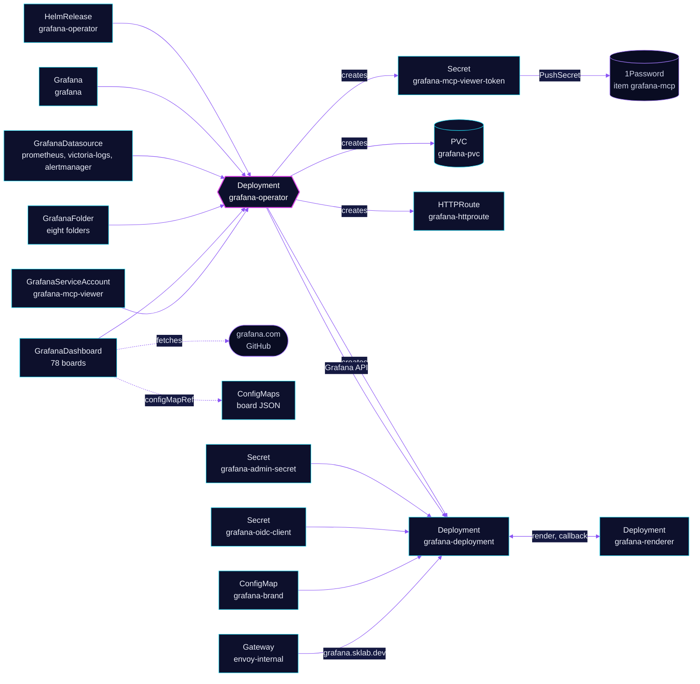

<!-- header: icon=layout-dashboard -->
<!-- concept: From a resource in Git to a board in Grafana | git-branch Git | cog Operator | folder Folder | layout-dashboard Board -->
<p align="center"></p>

> Runs Grafana from custom resources: the instance, its datasources, folders and every board.

**Live facts:** <https://skrumbach.github.io/home-ops/apps/monitoring/grafana-operator/> (workloads, routes, storage, backups, secrets and alerts, generated on every merge)

## What it does

- **Runs the operator.** HelmRelease `grafana-operator` installs the controller and its CRDs
  (`grafana.integreatly.org`).
- **Runs Grafana** from `Grafana` `grafana` at `grafana.sklab.dev` on `envoy-internal`: Pocket ID sign-in for
  group `admins`, the built-in `tron` theme, and the SKLAB brand files. Its login, Pocket ID client, brand
  files and landing board come from [`monitoring/grafana`](../grafana/README.md).
- **Declares what Grafana shows.** Three `GrafanaDatasource`, eight `GrafanaFolder` and 78
  `GrafanaDashboard` objects: 63 in [`boards/`](boards/), 14 in [`app-boards/`](app-boards/) for boards that
  other apps ship as ConfigMaps in their own namespace, and one the renovate-operator chart creates itself.
  The operator writes each one through Grafana's API and reports the result in the object's status.
- **Renders images** with its own renderer, Deployment `grafana-renderer`.
- **Keeps a Viewer service account** for the Grafana MCP server: `GrafanaServiceAccount` `grafana-mcp-viewer`
  writes its token to Secret `grafana-mcp-viewer-token`, and PushSecret `grafana-mcp-viewer-token` publishes
  it to 1Password item `grafana-mcp`, where `ai/grafana-mcp` reads it.

## Why it is built this way

| Choice | Why |
|---|---|
| **The operator, not the grafana chart** | The chart ran here until 2026-11-22: it downloaded its boards in an init container at every pod start and loaded labelled ConfigMaps through a sidecar, all or none. |
| **One object per board** | `kubectl get grafanadashboard -A` shows which board failed and why, and a board is added without a Grafana restart. |
| **Boards chosen one by one** | `configMapRef` names one ConfigMap. kube-prometheus-stack ships 23 boards; `k8s-resources-multicluster` is left out. |
| **Brand files mounted over Grafana's own** | Grafana OSS has no white-label setting and loads no custom theme or stylesheet. The fixed names in `public/img/` (loading mark, favicon, touch icon) are `subPath` mounts. The UI loads its logo and sign-in background under names with a build hash that changes with every release, so init container `brand` copies that directory into an emptyDir and overwrites the files by pattern. |
| **A PVC for Grafana's data** | With an emptyDir the operator would have to write every board again after each restart. The claim keeps `grafana.db`. Nothing in it is missing from Git, so it has no backup. |
| **Admin login from `grafana-admin-secret`** | The operator calls Grafana's API with the admin user over basic auth, read from the two env values. The same Secret is the break-glass login. |
| **App boards in this app, not next to each app** | A `GrafanaDashboard` inside the cilium or external-secrets Kustomization would make that Kustomization fail whenever the operator's CRDs are missing, which is the state of a cluster rebuild. Here, only `grafana-operator-app-boards` can fail. |
| **Renderer locked to Grafana** | It is a headless browser that fetches what it is told to. NetworkPolicy `grafana-renderer` admits the Grafana pods and DNS replies, nothing else. |
| **Token through 1Password** | `ai/grafana-mcp` runs in another namespace and shares no Secret with this one. The PushSecret hands the token over through 1Password item `grafana-mcp`. |

## How it works

<p align="center"></p>

<details>
<summary><b>Resource graph</b>: every object involved, by name</summary>



</details>

1. Kustomization `grafana-operator` ([overlay](../../../main/monitoring/grafana-operator.yaml)) installs the
   chart and waits for it. `crds: CreateReplace` applies the chart's CRDs on install and on every upgrade.
2. Kustomization `grafana-operator-instance` applies `instance/` after `grafana-operator` and `grafana`. The
   operator turns `Grafana` `grafana` into Deployment `grafana-deployment`, Service `grafana-service`,
   ConfigMap `grafana-ini`, PVC `grafana-pvc` and HTTPRoute `grafana-httproute`.
3. Init container `brand` copies Grafana's static image directory into the `brand-static` emptyDir,
   overwrites `grafana_icon.*.svg` and `g8_login_dark.*.svg` with the files of ConfigMap `grafana-brand` and
   adds `sklab-header.svg`.
4. The operator creates the datasources and folders through Grafana's API, signed in as the admin user.
5. Kustomization `grafana-operator-boards` applies `boards/`. For each `GrafanaDashboard` the operator
   fetches the JSON (grafana.com, a URL, or a ConfigMap in this namespace), replaces each mapped
   `${INPUT}` with a datasource uid and writes the board into its folder.
6. Kustomization `grafana-operator-app-boards` applies `app-boards/` with no `targetNamespace`: each object
   sits in the namespace of the ConfigMap it reads, reaches this Grafana through
   `allowCrossNamespaceImport` and names its folder by `folderUID`.
7. `spec.preferences.homeDashboardUid` makes `home-dashboard` the landing board.
8. Kustomization `grafana-operator-renderer` runs the renderer. Grafana calls `rendering.server_url`, and the
   renderer loads the panel back from `rendering.callback_url`.
9. The operator creates service account `grafana-mcp-viewer` and its token. The PushSecret copies the token
   to 1Password every 5 minutes; ExternalSecret `toolhive-grafana` (namespace `ai`) reads it from there.
10. Gatus checks `/api/health` and the `database` field in the body, through the route annotation.

## Settings that matter

| Setting | Value | Why |
|---|---|---|
| `install.crds`, `upgrade.crds` ([`app/helmrelease.yaml`](app/helmrelease.yaml)) | `CreateReplace` | The chart keeps its CRDs in a `crds/` subchart, which Helm installs once and never updates. On the first install this also replaces the ten CRDs left in the cluster since 2025-10. |
| `spec.version` ([`instance/grafana.yaml`](instance/grafana.yaml)) | pinned | The operator's own default moves with every operator release. Init container `brand` names the same image: the directory it copies must be the one of the running version. One Renovate manager reads both lines. |
| `spec.disableDefaultAdminSecret` | `true` | The admin user comes from `grafana-admin-secret`, not from a Secret the operator generates. |
| `auth.basic` | not set (on) | The operator signs in with basic auth. |
| `auth.generic_oauth` `role_attribute_path`, `role_attribute_strict` | `contains(groups[*], 'admins') && 'GrafanaAdmin' \|\| ''`, `true` | Only `admins` sign in. Without strict mode, everyone else would land as Viewer. |
| `auth.generic_oauth` `scopes` | `openid email profile groups offline_access` | Pocket ID releases group names only with the `groups` scope. `offline_access` gives the refresh token `use_refresh_token` needs. |
| `users.default_theme` | `tron` | The built-in theme closest to the SKLAB palette. Each user can pick another in their profile. |
| `plugins.preinstall_auto_update` | `false` | Core-plugin auto-update writes outside the plugins dir and fails on a read-only root. |
| `deployment.spec.strategy` | `Recreate` | `grafana-pvc` is ReadWriteOnce. |
| pod `fsGroup` | `10001` | The operator runs Grafana as 10001:10001 on a read-only root; the group makes the claim writable. |
| volume `grafana-data` | `grafana-pvc` | Replaces the operator's emptyDir of the same name. |
| `GrafanaDatasource` `uid` | `prometheus`, `victoria-logs`, `alertmanager` | Boards and the `datasources` mappings name a datasource by uid. |
| `GrafanaDatasource` `victoria-logs` `plugins` | `victoriametrics-logs-datasource` | The operator adds it to `GF_INSTALL_PLUGINS`. |
| `GrafanaDashboard` `unifi-uap` `plugins` | `grafana-clock-panel` | The one board with a panel that is not built in. Renovate does not track this pin. |
| Gatus annotation `name` | `grafana` | Without it the endpoint takes the route's name, `grafana-httproute`. |
| `GrafanaDashboard` `home` `folder` | `General` | Grafana's root. Without a folder the operator files a board under a folder named after the namespace. |
| Reloader annotations | none | The operator rewrites the Deployment on every reconcile and strips what Reloader injects. It restarts Grafana itself when a referenced Secret or ConfigMap changes. |
| `GrafanaFolder` `uid` | the folder's name | A board in another namespace can only reach a folder through `folderUID`. |
| `rendering.server_url`, `rendering.callback_url` | `grafana-renderer:8081/render`, `grafana-service:3000` | The renderer of this instance, and the address it loads panels from. |
| `GrafanaServiceAccount` `role` | `Viewer` | The rule of the `grafana-mcp` ExternalSecret: never Editor or Admin. |
| ServiceMonitor `grafana-service` job | relabelled to `grafana` | The Service is `grafana-service`; the series keep the job name they had under the chart. |
| PushSecret `refreshInterval` | `5m` | A re-minted token reaches 1Password within that time. ExternalSecret `toolhive-grafana` reads it on the same cadence. |
| `DS_EXPRESSION` mapping ([`app-boards/`](app-boards/)) | `__expr__` | The uid of Grafana's built-in expression datasource, which the CloudNativePG and Dragonfly boards ask for. |
| Prometheus `timeInterval` | `1m` | Must match `scrapeInterval` in kube-prometheus-stack, or `rate()` panels are empty. |

## Operate it

```bash
flux -n monitoring get ks grafana-operator grafana-operator-instance grafana-operator-boards
kubectl -n monitoring get grafanas.grafana.integreatly.org grafana   # `get grafana` is External Secrets' generator kind
kubectl -n monitoring get grafanadatasource,grafanafolder
kubectl -n monitoring get grafanadashboard                    # one row per board
kubectl get grafanadashboard -A                               # with the boards of other namespaces
kubectl -n monitoring get grafanaserviceaccount grafana-mcp-viewer
kubectl -n monitoring get pods -l app=grafana-renderer
kubectl -n monitoring describe grafanadashboard keda          # why one board failed
kubectl -n monitoring logs deploy/grafana-operator --tail=50
kubectl -n monitoring logs deploy/grafana-deployment -c grafana --tail=50
kubectl -n monitoring logs deploy/grafana-deployment -c brand
```

## Invariants

- **Do not re-add grafana.com board 16611.** The Cilium board comes from the cilium chart's ConfigMap
  (`app-boards/`), with the same uid.
- **Do not add grafana.com boards for CloudNativePG or Dragonfly.** Their charts ship their own; ids
  15944, 15945, 21053 and 21054 are the unrelated Dragonfly P2P project.
- **A board is added only when this Prometheus publishes what it queries.** Boards for Ollama, Qdrant and
  SMARTctl sat here with no such workload in the cluster.
- **Never set `panels.disable_sanitize_html`.** The landing board needs no raw HTML, and fetched boards would
  get to run script in an admin session.
- **The service account stays `Viewer`.** The MCP server must not be able to write.
- **One board per uid.** The renovate-operator chart creates `GrafanaDashboard` `renovate-operator-dashboard`
  itself as soon as the CRD exists; its `instanceSelector`, `folderUID` and `allowCrossNamespaceImport` are set
  in that app's HelmRelease. A second object for the same board in `app-boards/` would fight it.
- **`spec.version` and the image of init container `brand` are one version, tag and digest.** The init
  container copies Grafana's static image directory; from another version, the UI asks for file names that
  are not in the copy and every logo and icon breaks. Check both lines in a Renovate bump before merging.
- **Changing the admin password in 1Password does not change it in Grafana.** Grafana reads
  `GF_SECURITY_ADMIN_PASSWORD` only when it creates its database, and the database is on `grafana-pvc`. After
  a change the operator signs in with the new value, gets 401, and boards, folders and the service account
  stop syncing with no alert. Set the same password in Grafana (`grafana cli admin reset-admin-password`,
  needs `exec`) or delete the claim and let the operator fill a new database.
- **A `datasources` entry maps to a datasource uid, and only replaces `${INPUT}` with braces.**
- **`configMapRef` reads the namespace of its `GrafanaDashboard`.** A board that lives as a ConfigMap in another
  namespace goes into [`app-boards/`](app-boards/), with its namespace, `allowCrossNamespaceImport: true` and
  `folderUID`.
- **A NetworkPolicy peer of the renderer has no `ports`.** The reply to the renderer's own request arrives on
  an ephemeral port (cilium/cilium#47913).
- **A board from grafana.com is a `url:` entry.** A `grafanaCom:` entry misses the operator's content cache
  and is downloaded again on every sync.
- **The pod needs `monitoring/grafana`.** ConfigMap `grafana-brand` and the two Secrets come from there;
  without them the pod waits on a missing volume or env source.
- **Deleting a `GrafanaDashboard`, `GrafanaFolder` or `GrafanaDatasource` deletes it in Grafana.**
- **Name the Grafana kind in full.** `kubectl get grafana` resolves to `grafanas.generators.external-secrets.io`
  in this cluster; the instance is `grafanas.grafana.integreatly.org`.

## Known gaps

- **A fresh instance needs about a quarter of an hour.** On the first run (2026-11-22) the operator restarted
  Grafana once to install the VictoriaLogs plugin. Folders and boards that tried during that restart report
  `NoMatchingInstance` and are applied at their next sync, ten minutes later. All 8 folders and 63 boards
  were in within 15 minutes, with no manual step.
- **Two Hubble boards are left out,** `hubble-dns-namespace` and `hubble-l7-http-metrics-by-workload`: mostly
  empty without L7 visibility on a pod.
- **A changed board ConfigMap shows up after the next sync,** up to ten minutes: the operator does not watch
  ConfigMaps it does not own.
- **A change to the two brand PNGs alone does not restart Grafana.** They are `binaryData`, which the operator
  does not hash. Restart `grafana-deployment` by hand.
- **Seven datasource references name a uid that does not exist** (`PBFA97CFB590B2093`, three in
  `envoy-gateway` and four in `ceph-osd`). Those queries return nothing on either instance.

Upstream: [grafana-operator docs](https://grafana.github.io/grafana-operator/docs/) •
[API reference](https://grafana.github.io/grafana-operator/docs/api/)
