<!-- header: icon=key-round -->
<!-- concept: From a wiped Grafana to a working token | rotate-ccw Restart | search Probe | key-round Mint | upload Publish -->
<p align="center"></p>

> A CronJob that re-creates Grafana's Viewer service account and token after a restart, for the Grafana MCP server.

**Live facts:** <https://skrumbach.github.io/home-ops/apps/monitoring/grafana-sa-provisioner/> (workloads, routes, storage, backups, secrets and alerts, generated on every merge)

## What it does

- **Heals one token.** CronJob `grafana-sa-provisioner` (`*/5 * * * *`) keeps a valid token for the Viewer service
  account `grafana-mcp-viewer`, the one `ai/grafana-mcp` uses.
- **Probes first.** It reads the last token from Secret `grafana-sa-provisioner-token` and calls
  `GET /api/org`. A valid token means exit with no writes.
- **Otherwise mints a new one.** It logs in as admin with the env from `grafana-admin-secret`, finds or creates
  the Viewer service account, revokes its old tokens, mints one, and writes it to the Secret.
- **Publishes it.** PushSecret `grafana-sa-provisioner-token` copies the value to 1Password item
  `grafana-mcp`, field `GRAFANA_SERVICE_ACCOUNT_TOKEN`.

## Why it is built this way

| Choice | Why |
|---|---|
| **A CronJob, not a one-time setup** | `monitoring/grafana` keeps no state. A pod restart wipes service accounts and tokens, so something must re-create them with no human action. |
| **Viewer role only** | The script creates the account with role `Viewer`, never Editor or Admin (the `grafana-mcp` ExternalSecret comment records the same rule). |
| **Form login, not HTTP Basic** | `GF_AUTH_BASIC_ENABLED` is false in `monitoring/grafana`, so Basic auth is rejected. |
| **Pure Python standard library** | The script talks to the Grafana and Kubernetes APIs directly. No extra image, no `kubectl`. It runs on `python:alpine` with a read-only root. |
| **5 minute schedule** | The steady state is one `GET /api/org`. The period is also the ceiling on how fast a restarted Grafana gets a working token back. |

## How it works

```mermaid
%%{init: {'theme':'base','themeVariables':{'primaryColor':'#0D102C','primaryTextColor':'#E9ECF7','primaryBorderColor':'#22D8F0','lineColor':'#8B55F5','secondaryColor':'#151941','tertiaryColor':'#090C22','edgeLabelBackground':'#151941'}}}%%
flowchart LR
  adm["Secret<br/>grafana-admin-secret"] -->|env admin user, password| cj{{"CronJob<br/>grafana-sa-provisioner"}}
  cm["ConfigMap<br/>grafana-sa-provisioner-configmap<br/>reconcile.py"] --> cj
  cj -->|probe, login, mint token| graf["Service<br/>grafana"]
  cj -->|get, patch, create| tok["Secret<br/>grafana-sa-provisioner-token"]
  tok --> ps["PushSecret<br/>grafana-sa-provisioner-token"]
  ps -->|field GRAFANA_SERVICE_ACCOUNT_TOKEN| op[("1Password<br/>item grafana-mcp")]
  op -->|ExternalSecret toolhive-grafana, 5m| es["Secret<br/>toolhive-grafana"]
  es -->|Reloader| mcp(["MCPServer<br/>grafana-mcp"])
  classDef accent fill:#0D102C,stroke:#D946E6,stroke-width:2px,color:#FFFFFF
  classDef ext fill:#090C22,stroke:#A57BFF,color:#CDD2E6
  class cj accent
  class op ext
```

<p align="center"></p>

<details>
<summary><b>Resource graph</b>: every object involved, by name</summary>



</details>

1. Kustomization `grafana-sa-provisioner` ([overlay](../../../main/monitoring/grafana-sa-provisioner.yaml)) applies
   `app/` after `grafana` and `onepassword-store`. The `configMapGenerator` turns `resources/reconcile.py` into
   `grafana-sa-provisioner-configmap`, with Flux substitution disabled.
2. Each run follows the steps under [What it does](#what-it-does). Only the failing branch writes anything.
3. The consumer ExternalSecret `toolhive-grafana` in `ai` refreshes every 5 minutes, not the 1h default, so a
   fresh token does not sit unused in 1Password. Reloader rolls `grafana-mcp` when Secret `toolhive-grafana`
   changes.

## Settings that matter

| Setting | Value | Why |
|---|---|---|
| `concurrencyPolicy`, `backoffLimit` | `Forbid`, `0` | One run at a time, no retry inside a run: the next schedule is the retry. |
| `ttlSecondsAfterFinished` | `86400` | With `failedJobsHistory: 3` a one-off failed Job is evicted only by three more failures, so it latches `KubeJobFailed`. The TTL ages it out; a recurring failure still re-fires. |
| `resources` | 10m CPU, 64Mi request, 128Mi limit | The manifest records no reason. |
| `GRAFANA_ADMIN_USER`, `GRAFANA_ADMIN_PASSWORD` | `secretKeyRef` into `grafana-admin-secret` | The ServiceAccount cannot read that Secret through the API, so it is mounted as env. |
| Role `grafana-sa-provisioner-secrets` | `create` on `secrets`; `get`, `patch` on `grafana-sa-provisioner-token` | RBAC cannot scope `create` by name, so the job can create any Secret in `monitoring`. `get` and `patch` are pinned to the one Secret it touches. |
| Alert `GrafanaSAProvisionerFailing` | `absent(...)` or last success older than `3600`s, for 5m | Not `or vector(0)`: `vector(0)` has no labels, survives the union and the alert never clears. |

## Operate it

```bash
flux -n monitoring get ks grafana-sa-provisioner
kubectl -n monitoring get cronjob,job -l app.kubernetes.io/name=grafana-sa-provisioner
kubectl -n monitoring logs -l app.kubernetes.io/name=grafana-sa-provisioner --tail=50
kubectl -n monitoring get secret grafana-sa-provisioner-token
kubectl -n monitoring get pushsecret grafana-sa-provisioner-token
kubectl -n ai get externalsecret toolhive-grafana
```

### When an alert fires

| Alert | Fires when | First look |
|---|---|---|
| `GrafanaSAProvisionerFailing` | the CronJob has not succeeded in over an hour | The job logs above. A 401 from admin login means `grafana-admin-secret` has drifted from live Grafana: restart the Grafana pod. |

## Invariants

- `monitoring/grafana` uses `emptyDir` SQLite (`persistence.enabled: false`).
  A pod restart wipes admin-created service accounts and tokens.
- `GF_SECURITY_ADMIN_USER` / `PASSWORD` apply only when Grafana bootstraps a
  fresh database. A UI password change stays drifted until that restart.
- This job cannot repair admin drift. If admin login 401s, the job fails and
  `GrafanaSAProvisionerFailing` pages. The fix is a Grafana pod restart.
- This CronJob (`*/5 * * * *`) heals only the Viewer token `ai/grafana-mcp`
  uses.
- The ServiceAccount may `create` any Secret in `monitoring` and may
  `get`/`patch` only `grafana-sa-provisioner-token`. It does not read
  `grafana-admin-secret` through the API. That secret is mounted as env.

Upstream: [Grafana service accounts](https://grafana.com/docs/grafana/latest/administration/service-accounts/)
