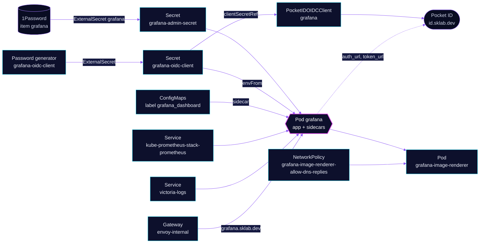

<!-- header: icon=layout-dashboard -->
<!-- concept: From a metric or log line to a dashboard on screen | database Sources | layout-dashboard Boards | fingerprint Sign-in | door-open Route -->
<p align="center"></p>

> The dashboard UI over Prometheus, Alertmanager and VictoriaLogs, signed in through Pocket ID.

**Live facts:** <https://skrumbach.github.io/home-ops/apps/monitoring/grafana/> (workloads, routes, storage, backups, secrets and alerts, generated on every merge)

## What it does

- **Draws the dashboards** at `grafana.sklab.dev` on `envoy-internal`. Datasources are `Prometheus`
  (`kube-prometheus-stack-prometheus`), `Alertmanager` and `VictoriaLogs` (the only log store).
- **Loads boards from three places.** The HelmRelease downloads grafana.com and GitHub boards into folders
  and carries the landing board `home-dashboard`. Two ConfigMap sets under [`app/dashboards/`](app/dashboards/)
  (`ceph`, `litellm`) are picked up by the dashboard sidecar. Other apps ship boards the same way, by label.
- **Signs people in with Pocket ID.** Operator object `PocketIDOIDCClient` `grafana` registers the client.
  Only members of the Pocket ID group `admins` get in, as Grafana server admins.
- **Renders images** with the chart's `imageRenderer` subchart.
- **Keeps no state.** `persistence.enabled: false`: the database is an emptyDir, so a restart starts fresh.
  `monitoring/grafana-sa-provisioner` re-creates the one service account that other apps need.

## Why it is built this way

| Choice | Why |
|---|---|
| **Client secret generated in the cluster** | `externalsecret-oidc.yaml` makes the secret with a `Password` generator, once (`refreshPolicy: CreatedOnce`). Nothing sits in 1Password and nothing rotates it. The operator pushes the same value to Pocket ID. |
| **Secret read as an env override** | `GF_AUTH_GENERIC_OAUTH_CLIENT_SECRET` beats `grafana.ini`, so the secret stays out of the ConfigMap and no Grafana variable token has to survive Flux substitution. |
| **Local admin form kept** | It is the break-glass login. `disable_login_form` is unset; retire it only after SSO is proven. |
| **Dashboards from folders, sidecar and downloads together** | The sidecar reads every namespace (`searchNamespace: ALL`), so each app can ship its own board next to its manifests. |
| **Read-only root filesystem** | Only `/var/lib/grafana`, `/var/lib/grafana-search` (chart emptyDirs) and `/tmp` are writable. |

## How it works

<p align="center"></p>

<details>
<summary><b>Resource graph</b>: every object involved, by name</summary>



</details>

1. Kustomization `grafana` ([overlay](../../../main/monitoring/grafana.yaml)) applies `app/` after
   `onepassword-store`. It builds the two dashboard ConfigMap sets with `disableNameSuffixHash` and the labels
   `grafana_dashboard: "true"` plus the folder annotation (`Storage`, `AI/ML`).
2. The chart starts Grafana with the admin Secret (`admin.existingSecret`), the OIDC Secret (`envFromSecrets`)
   and its provisioning: one file provider per folder, the datasource sidecar and the dashboard sidecar. Reloader restarts the pod when `grafana-admin-secret`, `grafana-oidc-client` or the
   `grafana` ConfigMap changes.
3. A person opens `https://grafana.sklab.dev` and picks "Pocket ID". Grafana uses PKCE and asks for the
   `groups` scope. `role_attribute_path` maps `admins` to `GrafanaAdmin`. Everyone else gets an empty role,
   and `role_attribute_strict` denies the login.
4. Pocket ID also holds the gate: `allowedUserGroups` lists group `admins` (namespace `security`), so other
   accounts stop there.
5. Gatus checks `/api/health` and the `database` field in the body, through the route annotation.

## Settings that matter

All values are in [`app/helmrelease.yaml`](app/helmrelease.yaml) unless noted.

| Setting | Value | Why |
|---|---|---|
| `grafana.ini` `auth.generic_oauth.client_id` | `grafana` | Must match `spec.clientID` in [`app/pocketidoidcclient.yaml`](app/pocketidoidcclient.yaml), which is immutable once created. |
| `scopes` | `openid email profile groups offline_access` | Pocket ID releases group names only with the `groups` scope. `offline_access` gives the refresh token `use_refresh_token` needs. |
| `role_attribute_path`, `role_attribute_strict` | `contains(groups[*], 'admins') && 'GrafanaAdmin' \|\| ''`, `true` | Only `admins` sign in. Without strict mode, everyone else would land as Viewer. |
| `clientSecretOverlap` (PocketIDOIDCClient) | `1h` | After a new secret value, the old one stays valid while the pod restarts. |
| Datasource `Prometheus` `timeInterval` | `1m` | Must match `scrapeInterval` in kube-prometheus-stack. Unset, Grafana assumes 15s, `$__rate_interval` resolves to 1m (one scrape) and `rate()` panels are empty. |
| `GF_AUTH_BASIC_ENABLED` | `false` | The manifest records no reason. It is why Grafana has no homepage widget, which only speaks basic auth. |
| `GF_FEATURE_TOGGLES_ENABLE` | `publicDashboards` | The manifest records no reason. |
| `plugins` | `victoriametrics-logs-datasource <version>` | Space, not `@`: Grafana 12 reads `GF_INSTALL_PLUGINS` entries as id, then an optional version. Renovate does not track it. |
| `plugins.preinstall_auto_update` | `false` | Core-plugin auto-update writes outside the plugins dir and fails on a read-only root. |
| `envFromSecrets` Secret | not optional | An optional Secret that appears after the pod started is never picked up, because Reloader ignores creation. |
| `resources` | 50m / 128Mi request, 512Mi limit | The manifest records no reason. |
| `topologySpreadConstraints` | `nodeTaintsPolicy: Honor`, `DoNotSchedule` | Grafana has no toleration for the talos-3 taint, which is `PreferNoSchedule`; the scheduler score keeps it off that node. |
| `deleteDatasources` | `Loki`, `Tempo`, plus `Alertmanager` and `Prometheus` | Loki and Tempo are retired and listed only so Grafana drops them. `VictoriaLogs` is never listed. |

## Operate it

```bash
flux -n monitoring get ks grafana
flux -n monitoring get hr grafana
kubectl -n monitoring get pods -l app.kubernetes.io/name=grafana -o wide
kubectl -n monitoring logs deploy/grafana -c grafana --tail=50
kubectl -n monitoring get pocketidoidcclient grafana
kubectl -n monitoring get externalsecret grafana grafana-oidc-client
kubectl -n monitoring get cm -l grafana_dashboard=true     # dashboards the sidecar loads
kubectl get cm -A -l grafana_dashboard=true                 # the same, from every namespace
```

## Invariants

- **A literal `${...}` in a dashboard breaks the Kustomization.** Flux treats it as a variable. In the
  HelmRelease write `$${datasource}`. In a ConfigMap set `kustomize.toolkit.fluxcd.io/substitute: disabled`,
  as the two `dashboards/*/kustomization.yaml` files do.
- **Do not re-add gnetId 16611.** The Cilium board comes from the cilium HelmRelease
  (`kube-system/cilium-dashboard`). The same UID would lock `sidecarProvider` out of writes.
- **Do not duplicate the CloudNativePG and Dragonfly boards.** Their charts install their own (UID collision).
- **Do not set `GF_DASHBOARDS_DEFAULT_HOME_DASHBOARD_PATH`.** It overrides `grafana.ini`, the sidecar
  directory has no `home.json`, and `/api/dashboards/home` returns 500.
- **Do not disable or replace the chart's `grafana-image-renderer-ingress` NetworkPolicy.** The additive
  `grafana-image-renderer-allow-dns-replies` OR-combines with it, and it admits DNS replies with no `ports`,
  because a reply arrives on an ephemeral port.
- **Never list `VictoriaLogs` under `deleteDatasources`.**
- **Deleting `PocketIDOIDCClient` `grafana` deletes the client in Pocket ID.**

Upstream: [Grafana docs](https://grafana.com/docs/grafana/latest/) •
[Generic OAuth](https://grafana.com/docs/grafana/latest/setup-grafana/configure-security/configure-authentication/generic-oauth/)
