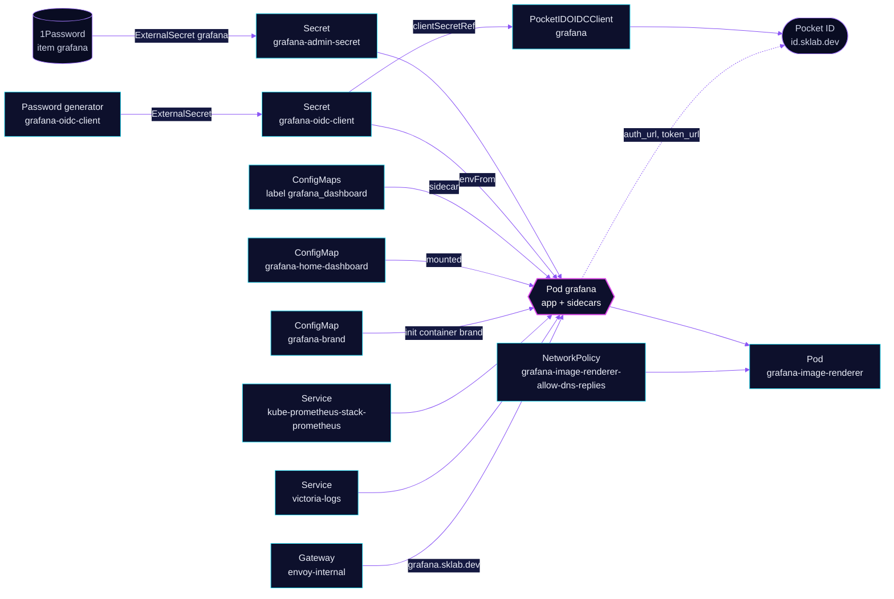

<!-- header: icon=layout-dashboard -->
<!-- concept: From a metric or log line to a dashboard on screen | database Sources | layout-dashboard Boards | fingerprint Sign-in | door-open Route -->
<p align="center"></p>

> The dashboard UI over Prometheus, Alertmanager and VictoriaLogs, signed in through Pocket ID.

**Live facts:** <https://skrumbach.github.io/home-ops/apps/monitoring/grafana/> (workloads, routes, storage, backups, secrets and alerts, generated on every merge)

## What it does

- **Draws the dashboards** at `grafana.sklab.dev` on `envoy-internal`. Datasources are `Prometheus`
  (`kube-prometheus-stack-prometheus`), `Alertmanager` and `VictoriaLogs` (the only log store).
- **Files boards into eight folders.** The HelmRelease downloads grafana.com and GitHub boards, one provider
  per folder: `Kubernetes`, `Platform`, `Network`, `Storage`, `Databases`, `AI`, `Apps` and `Observability`.
  The dashboard sidecar picks up ConfigMaps by label: the two sets under [`app/dashboards/`](app/dashboards/)
  (`ceph`, `litellm`) and the boards other apps ship. A ConfigMap joins a folder by naming its title in the
  `grafana_folder` annotation.
- **Opens on the cluster overview.** [`app/dashboards/home/home.json`](app/dashboards/home/home.json) is the
  landing board, alone in `General` and mounted from its own ConfigMap: eight state tiles (nodes, alerts,
  Flux, Ceph, backups, Gatus), six graphs, the firing alerts, the Flux objects that are not ready and links
  into every folder. A tile whose series are missing shows `No data` in amber, never a green zero.
- **Wears the SKLAB look.** The hexagon logo, favicon and sign-in background in
  [`app/resources/`](app/resources/) replace Grafana's own, and the built-in `tron` theme is the default.
- **Signs people in with Pocket ID.** Operator object `PocketIDOIDCClient` `grafana` registers the client.
  Only members of the Pocket ID group `admins` get in, as Grafana server admins.
- **Renders images** with the chart's `imageRenderer` subchart.
- **Keeps no state.** `persistence.enabled: false`: the database is an emptyDir, so a restart starts fresh.
  `monitoring/grafana-sa-provisioner` re-creates the one service account that other apps need.

## Why it is built this way

| Choice | Why |
|---|---|
| **Client secret generated in the cluster** | `externalsecret-oidc.yaml` makes the secret with a `Password` generator, once (`refreshPolicy: CreatedOnce`). Nothing sits in 1Password and nothing rotates it. The operator pushes the same value to Pocket ID. |
| **Secret read as an env override** | `GF_AUTH_GENERIC_OAUTH_CLIENT_SECRET` beats `grafana.ini`, so the secret stays out of the ConfigMap and no Grafana variable token has to survive Flux substitution. |
| **Local admin form kept** | It is the break-glass login. `disable_login_form` is unset; retire it only after SSO is proven. |
| **Dashboards from downloads and the sidecar together** | The sidecar reads every namespace (`searchNamespace: ALL`), so each app can ship its own board next to its manifests. |
| **Brand files mounted over Grafana's own** | Grafana OSS has no white-label setting and loads no custom theme or stylesheet. The logo, favicon and sign-in background are plain files, so they can be replaced. Colours cannot: `tron` is the built-in theme closest to the palette. |
| **An init container copies the static image directory** | The UI loads its logo and sign-in background under names with a build hash that changes with every Grafana release. Container `brand` copies the directory into an emptyDir and overwrites the files by pattern, so a Grafana bump keeps the brand. |
| **Landing board mounted, not found by the sidecar** | `dashboardsConfigMaps` puts `home.json` on disk before Grafana starts. A sidecar board arrives later and `/api/dashboards/home` would return 500 until then. |
| **Board header is an image** | A text panel keeps an `` whose `src` starts with `/` and drops most CSS, so the header is [`sklab-header.svg`](app/resources/sklab-header.svg), served from Grafana's static directory. It has no `viewBox`: it keeps its height at any panel width. |
| **Read-only root filesystem** | Only `/var/lib/grafana`, `/var/lib/grafana-search` (chart emptyDirs) and `/tmp` are writable. |

## How it works

<p align="center"></p>

<details>
<summary><b>Resource graph</b>: every object involved, by name</summary>



</details>

1. Kustomization `grafana` ([overlay](../../../main/monitoring/grafana.yaml)) applies `app/` after
   `onepassword-store`. It builds the two dashboard ConfigMap sets with `disableNameSuffixHash` and the labels
   `grafana_dashboard: "true"` plus the folder annotation (`Storage`, `AI`), the landing board ConfigMap
   `grafana-home-dashboard` and the brand ConfigMap `grafana-brand`.
2. Init container `download-dashboards` fetches the boards the HelmRelease lists. Init container `brand` copies
   Grafana's static image directory into the `brand-static` emptyDir, overwrites `grafana_icon.*.svg` and
   `g8_login_dark.*.svg` with the brand files and adds `sklab-header.svg`.
3. The chart starts Grafana with the admin Secret (`admin.existingSecret`), the OIDC Secret (`envFromSecrets`)
   and its provisioning: one file provider per folder, the datasource sidecar and the dashboard sidecar.
   Reloader restarts the pod when `grafana-admin-secret`, `grafana-oidc-client`, the `grafana` ConfigMap or
   `grafana-brand` changes.
4. A person opens `https://grafana.sklab.dev` and picks "Pocket ID". Grafana uses PKCE and asks for the
   `groups` scope. `role_attribute_path` maps `admins` to `GrafanaAdmin`. Everyone else gets an empty role,
   and `role_attribute_strict` denies the login.
5. Pocket ID also holds the gate: `allowedUserGroups` lists group `admins` (namespace `security`), so other
   accounts stop there.
6. Gatus checks `/api/health` and the `database` field in the body, through the route annotation.

## Settings that matter

All values are in [`app/helmrelease.yaml`](app/helmrelease.yaml) unless noted.

| Setting | Value | Why |
|---|---|---|
| `grafana.ini` `auth.generic_oauth.client_id` | `grafana` | Must match `spec.clientID` in [`app/pocketidoidcclient.yaml`](app/pocketidoidcclient.yaml), which is immutable once created. |
| `scopes` | `openid email profile groups offline_access` | Pocket ID releases group names only with the `groups` scope. `offline_access` gives the refresh token `use_refresh_token` needs. |
| `role_attribute_path`, `role_attribute_strict` | `contains(groups[*], 'admins') && 'GrafanaAdmin' \|\| ''`, `true` | Only `admins` sign in. Without strict mode, everyone else would land as Viewer. |
| `clientSecretOverlap` (PocketIDOIDCClient) | `1h` | After a new secret value, the old one stays valid while the pod restarts. |
| Datasource `Prometheus` `timeInterval` | `1m` | Must match `scrapeInterval` in kube-prometheus-stack. Unset, Grafana assumes 15s, `$__rate_interval` resolves to 1m (one scrape) and `rate()` panels are empty. |
| `grafana.ini` `users.default_theme` | `tron` | The built-in theme closest to the SKLAB palette (near-black navy, cyan accent). Each user can pick another in their profile. |
| `grafana.ini` `dashboards.default_home_dashboard_path` | `/var/lib/grafana/dashboards/home/home.json` | The file `dashboardsConfigMaps.home` mounts. |
| `extraConfigmapMounts` | three entries, one per file | The chart names each volume after its entry, so one entry cannot carry three `subPath` mounts. They cover the fixed names in `public/img/` (loading mark, favicon, touch icon). |
| `extraInitContainers` `brand` image | the chart's Grafana image | The directory it copies must be the one of the running version. |
| `GF_AUTH_BASIC_ENABLED` | `false` | The manifest records no reason. It is why Grafana has no homepage widget, which only speaks basic auth. |
| `GF_FEATURE_TOGGLES_ENABLE` | `publicDashboards` | The manifest records no reason. |
| `plugins` | `victoriametrics-logs-datasource <version>` | Space, not `@`: Grafana 12 reads `GF_INSTALL_PLUGINS` entries as id, then an optional version. Renovate does not track it. |
| `plugins.preinstall_auto_update` | `false` | Core-plugin auto-update writes outside the plugins dir and fails on a read-only root. |
| `envFromSecrets` Secret | not optional | An optional Secret that appears after the pod started is never picked up, because Reloader ignores creation. |
| `resources` | 50m / 128Mi request, 512Mi limit | The manifest records no reason. |
| `topologySpreadConstraints` | `nodeTaintsPolicy: Honor`, `DoNotSchedule` | Grafana has no toleration for the talos-3 taint, which is `PreferNoSchedule`; the scheduler score keeps it off that node. |
| `deleteDatasources` | `Loki`, `Tempo`, plus `Alertmanager` and `Prometheus` | Loki and Tempo are retired and listed only so Grafana drops them. `VictoriaLogs` is never listed. |

## Operate it

```bash
flux -n monitoring get ks grafana
flux -n monitoring get hr grafana
kubectl -n monitoring get pods -l app.kubernetes.io/name=grafana -o wide
kubectl -n monitoring logs deploy/grafana -c grafana --tail=50
kubectl -n monitoring get pocketidoidcclient grafana
kubectl -n monitoring get externalsecret grafana grafana-oidc-client
kubectl -n monitoring get cm -l grafana_dashboard=true     # dashboards the sidecar loads
kubectl get cm -A -l grafana_dashboard=true                 # the same, from every namespace
kubectl -n monitoring logs deploy/grafana -c brand          # the init container that puts the brand files in
```

## Invariants

- **No `*.png`, `*.jpg` or `*.gif` file in a generator.** Flux's GitRepository leaves them out of the artifact
  by default, so the Kustomization fails on the missing file. The two brand PNGs are stored as `.bin` and get
  their name back from the generator key.
- **A literal `${...}` in a dashboard breaks the Kustomization.** Flux treats it as a variable. In the
  HelmRelease write `$${datasource}`. In a ConfigMap set `kustomize.toolkit.fluxcd.io/substitute: disabled`,
  as the three `dashboards/*/kustomization.yaml` files do.
- **A board is added only when this Prometheus publishes what it queries.** Boards for Ollama, Qdrant and
  SMARTctl sat here with no such workload in the cluster.
- **A folder is one title in two places.** A provider's `folder` in the HelmRelease and the `grafana_folder`
  annotation of a ConfigMap meet in one folder only when the titles are equal. Keep `/` out of a title: for
  `AI/ML` the provider made a folder `AI/ML` while the sidecar filed its boards under `ML`.
- **Never set `panels.disable_sanitize_html`.** The landing board needs no raw HTML, and downloaded boards
  would get to run script in an admin session.
- **Do not re-add gnetId 16611.** The Cilium board comes from the cilium HelmRelease
  (`kube-system/cilium-dashboard`). The same UID would lock `sidecarProvider` out of writes.
- **Do not duplicate the CloudNativePG and Dragonfly boards.** Their charts install their own (UID collision).
- **Do not set `GF_DASHBOARDS_DEFAULT_HOME_DASHBOARD_PATH`.** It overrides `grafana.ini`, the sidecar
  directory has no `home.json`, and `/api/dashboards/home` returns 500.
- **Do not disable or replace the chart's `grafana-image-renderer-ingress` NetworkPolicy.** The additive
  `grafana-image-renderer-allow-dns-replies` OR-combines with it, and it admits DNS replies with no `ports`,
  because a reply arrives on an ephemeral port.
- **Never list `VictoriaLogs` under `deleteDatasources`.**
- **Deleting `PocketIDOIDCClient` `grafana` deletes the client in Pocket ID.**

## Known gaps

- **Grafana still says "Grafana".** The page title and "Welcome to Grafana" are compiled into the frontend;
  only Grafana Enterprise can change them.
- **Third-party boards keep their own colours.** Only the landing board uses the SKLAB palette.
- **Two chart-shipped boards are mostly empty.** `Hubble / DNS Overview` and `Hubble L7 HTTP Metrics by Workload`
  come with the cilium chart's Hubble set, which is all or nothing; their series need L7 visibility on a pod.
- **No board yet for** spegel, hindsight, the Pocket ID operator, descheduler or Reloader. They are scraped.

Upstream: [Grafana docs](https://grafana.com/docs/grafana/latest/) •
[Generic OAuth](https://grafana.com/docs/grafana/latest/setup-grafana/configure-security/configure-authentication/generic-oauth/)
