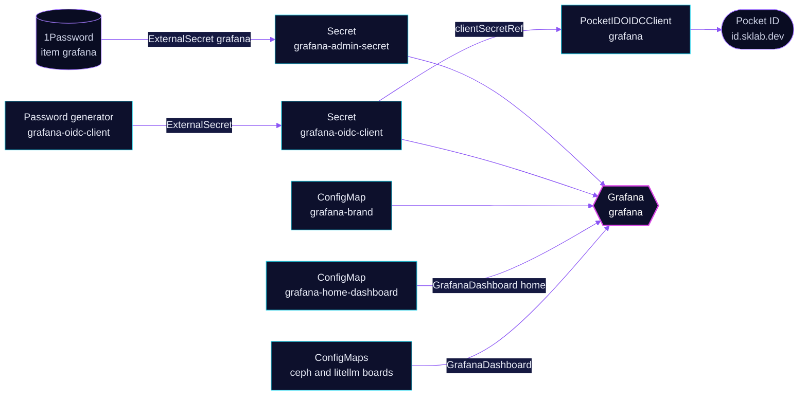

<!-- header: icon=layout-dashboard -->
<!-- concept: What Grafana takes from this app | key-round Login | fingerprint Sign-in | sparkles Brand | layout-dashboard Boards -->
<p align="center"></p>

> The inputs of the Grafana instance: its admin login, its Pocket ID client, the SKLAB brand files and the board JSON kept in Git.

**Live facts:** <https://skrumbach.github.io/home-ops/apps/monitoring/grafana/> (workloads, routes, storage, backups, secrets and alerts, generated on every merge)

## What it does

Grafana itself runs from [`monitoring/grafana-operator`](../grafana-operator/README.md). This app holds what that
instance takes from outside itself, and no workload.

- **The admin login.** ExternalSecret `grafana` reads 1Password item `grafana` into Secret
  `grafana-admin-secret`. It is the break-glass login, and the login the operator uses for Grafana's API.
- **The Pocket ID client.** `PocketIDOIDCClient` `grafana` registers the client; ExternalSecret
  `grafana-oidc-client` generates its secret in the cluster.
- **The SKLAB look.** ConfigMap `grafana-brand` from [`app/resources/`](app/resources/): the hexagon logo,
  favicon, touch icon, sign-in background and the header of the landing board.
- **The landing board.** ConfigMap `grafana-home-dashboard` from
  [`app/dashboards/home/home.json`](app/dashboards/home/home.json): eight state tiles (nodes, alerts, Flux,
  Ceph, backups, Gatus), six graphs, the firing alerts, the Flux objects that are not ready and links into
  every folder. A tile whose series are missing shows `No data` in amber, never a green zero.
- **Two sets of board JSON,** `ceph` and `litellm` under [`app/dashboards/`](app/dashboards/), as ConfigMaps.

## Why it is built this way

| Choice | Why |
|---|---|
| **Its own app, apart from the operator** | These objects predate the operator and stayed in the Flux Kustomization that created them. Moving one to another Kustomization deletes and re-creates it, and deleting `PocketIDOIDCClient` `grafana` deletes the client in Pocket ID. |
| **Client secret generated in the cluster** | `externalsecret-oidc.yaml` makes the secret with a `Password` generator, once (`refreshPolicy: CreatedOnce`). Nothing sits in 1Password and nothing rotates it. The operator pushes the same value to Pocket ID. |
| **Brand files as plain files** | Grafana OSS has no white-label setting and loads no custom theme or stylesheet. Logo, favicon and sign-in background are files and can be replaced. Colours cannot: the instance uses the built-in `tron` theme. |
| **Board header is an image** | A text panel keeps an `` whose `src` starts with `/` and drops most CSS, so the header is [`sklab-header.svg`](app/resources/sklab-header.svg), served from Grafana's static directory. It has no `viewBox`: it keeps its height at any panel width. |

## How it works

<p align="center"></p>

<details>
<summary><b>Resource graph</b>: every object involved, by name</summary>



</details>

1. Kustomization `grafana` ([overlay](../../../main/monitoring/grafana.yaml)) applies `app/` after
   `onepassword-store`. Kustomization `grafana-operator-instance` depends on it.
2. The Grafana pod reads `grafana-admin-secret` and `grafana-oidc-client` as env, and mounts `grafana-brand`.
3. `GrafanaDashboard` objects in `monitoring/grafana-operator` read the board ConfigMaps by name and key.
4. A person opens `https://grafana.sklab.dev` and picks "Pocket ID". Pocket ID admits group `admins`
   (`allowedUserGroups`, namespace `security`).

## Settings that matter

| Setting | Value | Why |
|---|---|---|
| `clientID` ([`app/pocketidoidcclient.yaml`](app/pocketidoidcclient.yaml)) | `grafana` | Must match `auth.generic_oauth.client_id` of the Grafana CR. Immutable once created. |
| `clientSecretOverlap` | `1h` | After a new secret value, the old one stays valid while the pod restarts. |
| `callbackUrls` | `https://grafana.sklab.dev/login/generic_oauth` | The one hostname Grafana serves. |
| generator files `fav32.bin`, `apple-touch-icon.bin` ([`app/kustomization.yaml`](app/kustomization.yaml)) | keys `fav32.png`, `apple-touch-icon.png` | Flux leaves `*.png` out of the artifact; the key gives the file its name back. |
| `kustomize.toolkit.fluxcd.io/substitute` on every generated ConfigMap | `disabled` | Board JSON and SVG carry `${...}` and `$__rate_interval`, which are Grafana's, not Flux's. |

## Operate it

```bash
flux -n monitoring get ks grafana
kubectl -n monitoring get externalsecret grafana grafana-oidc-client
kubectl -n monitoring get pocketidoidcclient grafana
kubectl -n monitoring get cm grafana-brand grafana-home-dashboard
```

## Invariants

- **No `*.png`, `*.jpg` or `*.gif` file in a generator.** Flux's GitRepository leaves them out of the artifact
  by default, so the Kustomization fails on the missing file. The two brand PNGs are stored as `.bin` and get
  their name back from the generator key.
- **A literal `${...}` in a board breaks the Kustomization.** Flux treats it as a variable. Set
  `kustomize.toolkit.fluxcd.io/substitute: disabled`, as the three `dashboards/*/kustomization.yaml` files do.
- **Deleting `PocketIDOIDCClient` `grafana` deletes the client in Pocket ID.** Do not move it to another Flux
  Kustomization.
- **These names are read elsewhere.** `grafana-admin-secret`, `grafana-oidc-client`, `grafana-brand` and
  `grafana-home-dashboard` are named in the Grafana CR and in `GrafanaDashboard` `home`.
- **The header of the landing board is drawn, not written.** It is a fluid variant of the README header
  (`scripts/docs/pictures.py`): no `viewBox`, text as outlines.

## Known gaps

- **Grafana still says "Grafana".** The page title and "Welcome to Grafana" are compiled into the frontend;
  only Grafana Enterprise can change them.
- **Third-party boards keep their own colours.** Only the landing board uses the SKLAB palette.

Upstream: [Grafana docs](https://grafana.com/docs/grafana/latest/) •
[Generic OAuth](https://grafana.com/docs/grafana/latest/setup-grafana/configure-security/configure-authentication/generic-oauth/)
