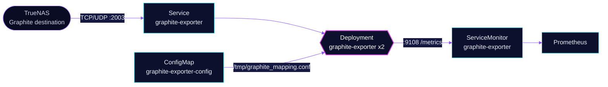

<!-- header: icon=database-zap -->
<!-- concept: From TrueNAS Graphite lines to Prometheus series | server NAS | send Graphite | file-cog Mapping | chart-line Series -->
<p align="center"></p>

> Turns the TrueNAS Graphite stream into Prometheus metrics through a vendored name mapping.

**Live facts:** <https://skrumbach.github.io/home-ops/apps/monitoring/graphite-exporter/> (workloads, routes, storage, backups, secrets and alerts, generated on every merge)

## What it does

- **Listens** for Graphite lines on TCP and UDP port 2003 of Service `graphite-exporter` (type `LoadBalancer`). The
  NAS is meant to send to that address.
- **Maps** dotted Graphite names to labelled Prometheus series with
  [`graphite_mapping.conf`](app/resources/graphite_mapping.conf), vendored from
  [truenas-graphite-to-prometheus](https://github.com/Supporterino/truenas-graphite-to-prometheus). It covers
  memory, services, disk SMART and operations, CPU, processes, uptime, load, file descriptors, ZFS and network.
- **Exposes** the series on port `9108`, scraped every minute through a ServiceMonitor.

No sample has reached it yet: `graphite_last_processed_timestamp_seconds` stays 0 because the NAS has never sent a
sample. The three TrueNAS dashboards that queried these series (`cpu_temperature`, `disk_await`, `zfs_*` and the rest
of the graphite-mapped names) are retired. Nothing in Git configures the NAS side (no match for Graphite or port 2003
under `terraform/`).

## How it works

<p align="center"></p>

<details>
<summary><b>Resource graph</b>: every object involved, by name</summary>



</details>

1. Flux applies Kustomization `graphite-exporter`. Kustomize builds ConfigMap `graphite-exporter-config` from
   `resources/graphite_mapping.conf` (no name hash, and Flux variable substitution is disabled on it, because the
   mapping holds `${1}` style references).
2. The HelmRelease (the `app-template` chart) runs two replicas. The container starts with
   `--graphite.mapping-config=/tmp/graphite_mapping.conf` and `--graphite.listen-address=:2003`.
3. Each mapping rule is a regex on the Graphite name. The rules expect the prefix `truenas`, for example
   `truenas\.(.*)\.system\.ram\.(.*)`, and set `job: "truenas"` and `instance` from the first capture.
4. The ConfigMap is mounted read-only with a `subPath`. The Deployment carries `reloader.stakater.com/auto: "true"`,
   so a mapping change restarts the pods.

## Settings that matter

| Setting | Value | Why |
|---|---|---|
| `controllers.graphite-exporter.replicas` | `2` | The manifest records no reason. |
| `resources` | requests 10m CPU, 48Mi; limit 128Mi memory | Request is about three times the 14-day peak, per the manifest comment. |
| `service.app.type` | `LoadBalancer`, ports `2003` TCP and UDP, `9108` metrics | The NAS sends from outside the cluster. No address is pinned. |
| `kustomize.toolkit.fluxcd.io/substitute` | `disabled` on the generated ConfigMap | The mapping holds `${1}` references, which Flux would try to substitute. |
| `serviceMonitor` endpoint | `:9108/metrics`, `interval: 1m`, `honorLabels: true` | `honorLabels` keeps the `job` and `instance` labels the mapping sets. |

## Operate it

```bash
flux -n monitoring get ks graphite-exporter
kubectl -n monitoring get deploy graphite-exporter -o wide
kubectl -n monitoring get svc graphite-exporter        # EXTERNAL-IP is the address to give TrueNAS
kubectl -n monitoring get servicemonitor graphite-exporter
```

To see whether the NAS has sent anything, query `graphite_last_processed_timestamp_seconds` in Prometheus. It is 0
until the first sample arrives.

Point the TrueNAS Graphite destination at this exporter's LoadBalancer, port 2003. No IP is pinned; look up the live
EXTERNAL-IP with `kubectl -n monitoring get svc graphite-exporter`.

## Invariants

- Mappings expect Graphite prefix `truenas` (see `match: 'truenas\.(.*)\....'`).

### TrueNAS 25.04 / exporter config v2.1

Upstream warns that from exporter config **v2.1** you must also install their `netdata.conf` on the TrueNAS host
because TrueNAS 25.04 dropped default metrics. This cluster vendors the mapping file only. It does **not** vendor
`netdata.conf`. Do not bump the mapping to v2.1 without adding that host file, and do not put the TrueNAS boards back
until a sample has actually arrived (`graphite_last_processed_timestamp_seconds` > 0).

Bumping the mapping is a separate change; this Readme only records the gap.

Upstream: [graphite_exporter](https://github.com/prometheus/graphite_exporter) •
[truenas-graphite-to-prometheus](https://github.com/Supporterino/truenas-graphite-to-prometheus)
