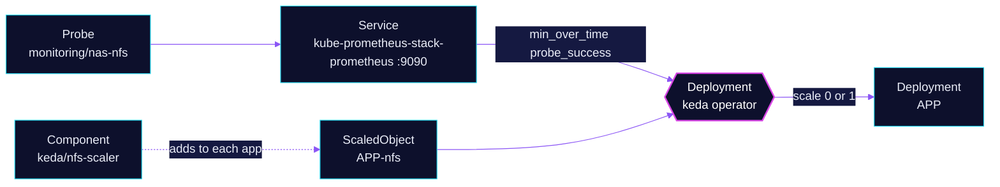

<!-- header: icon=scaling -->
<!-- concept: From a Prometheus signal to a replica count | activity Signal | scaling Scaler | layers Replicas | server NAS apps -->
<p align="center"></p>

> Event-driven autoscaler: it takes the NAS-apps Deployments to zero while the NFS export is down.

**Live facts:** <https://skrumbach.github.io/home-ops/apps/monitoring/keda/> (workloads, routes, storage, backups, secrets and alerts, generated on every merge)

## What it does

- **Runs the KEDA control plane:** the operator, the metrics server and the admission webhooks, each with its own
  ServiceMonitor.
- **Scales on one signal today.** The only ScaledObject in Git comes from the shared component
  [`kubernetes/components/keda/nfs-scaler`](../../../../components/keda/nfs-scaler/scaledobject.yaml). It scales a
  Deployment to 0 while Probe `nas-nfs` fails and back to 1 when it recovers. The probe is
  [`blackbox-exporter`](../blackbox-exporter/README.md).
- **Serves six apps** that include that component (named below).

The consumers are the Flux Kustomizations that list `components/keda/nfs-scaler` and `dependsOn` `keda`:

| Namespace | Apps |
|---|---|
| `downloads` | `bazarr`, `lidarr`, `radarr`, `shelfmark`, `sonarr` |
| `media` | `calibre-web-automated` |

## Why it is built this way

| Choice | Why |
|---|---|
| **Scale to zero, not wait on a hung mount** | The `NASNFSExportDown` alert text says pods that mount the export hang in `ContainerCreating` or on I/O. Scaling down avoids that state. |
| **Min over 2 minutes for scale-up** | `min(min_over_time(probe_success{job="nas-nfs"}[2m]))` brings an app back only after 2m of clean probes, not on the first success while the NAS is still booting. |
| **A missing series changes nothing** | `ignoreNullValues: "false"`: no series (exporter or Prometheus down) is an error, which KEDA treats as "change nothing", never as 0 and a scale-down. |
| **Consumers leave `replicas` unset** | Each consumer HelmRelease sets `replicas: null` with the comment "Left off the Deployment: KEDA owns it", so Helm never resets the count. |

## How it works

<p align="center"></p>

<details>
<summary><b>Resource graph</b>: every object involved, by name</summary>



</details>

1. At bootstrap the CRDs come from `bootstrap/helmfile/crds.yaml` (release `keda`, applied out of band before Flux). Flux
   Kustomization `keda` then installs the chart. It `dependsOn` `prometheus-operator-crds` because the ServiceMonitor
   CRDs must exist before the chart installs, and it sets `wait: true`, so each consumer `dependsOn` it as a gate.
2. A consumer overlay adds the component. `${APP}` becomes the app name, so the ScaledObject is `<app>-nfs` and
   targets Deployment `<app>`.
3. The Prometheus trigger asks `http://kube-prometheus-stack-prometheus.monitoring.svc.cluster.local:9090` every 30s
   (`pollingInterval`). The threshold is `1` and `activationThreshold` is `0.5`, so a result of 0 deactivates the
   scaler.
4. After `cooldownPeriod: 300` with no healthy poll, KEDA scales the Deployment to 0. `maxReplicaCount` is 1.
5. `restoreToOriginalReplicaCount: true`: deleting the ScaledObject puts the Deployment back to its replica count.

## Settings that matter

| Setting | Value | Why |
|---|---|---|
| `resources.operator` | requests 100m CPU, 128Mi; limit 512Mi | The manifest comment: "OOM-killed at 256Mi on 2026-11-12 and back at 163Mi within hours." |
| Overlay `dependsOn` | `prometheus-operator-crds` | The overlay comment: "ServiceMonitor CRDs must exist before the chart installs." |
| Overlay `wait` | `true` | Lets each consumer `dependsOn` `keda` as a gate. |
| ScaledObject `pollingInterval` | `30` | Matches the Probe interval, because polling faster only re-reads the same sample. |
| ScaledObject `cooldownPeriod` | `300` | The same window as `NASNFSExportDown` (5m). |

## Operate it

```bash
flux -n monitoring get ks keda
kubectl -n monitoring get deploy,pods                      # operator, metrics server, webhooks
kubectl get scaledobject -A
kubectl -n downloads get scaledobject radarr-nfs -o yaml   # conditions: Active, Ready, Fallback
```

To pause every ScaledObject during maintenance (a write, so it needs the admin kubeconfig and owner approval):
`just kube keda suspend`, then `just kube keda resume`. The recipe sets or removes the annotation
`autoscaling.keda.sh/paused` on all of them.

Upstream: [KEDA docs](https://keda.sh/docs/) • [Prometheus scaler](https://keda.sh/docs/latest/scalers/prometheus/)
