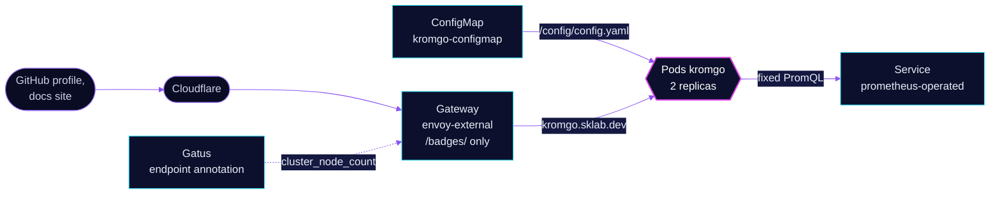

<!-- header: icon=badge-info -->
<!-- concept: From a fixed query to a public badge | database Metric | filter Aggregate | badge-info Badge | globe Public -->
<p align="center"></p>

> Public, read-only badges with live cluster numbers, each from one fixed Prometheus query.

**Live facts:** <https://skrumbach.github.io/home-ops/apps/monitoring/kromgo/> (workloads, routes, storage, backups, secrets and alerts, generated on every merge)

## What it does

- **Turns queries into badges.** Each entry in [`app/resources/config.yaml`](app/resources/config.yaml) is one
  badge: an `id`, a PromQL query against `prometheus-operated`, and an expression that formats the result.
  The groups are cluster facts (versions, node and pod counts, CPU, memory, age, uptime, firing alerts), the
  AI gateway over 7 days, the Arc Pro B70 GPU on talos-3, and the llama-server on `ai/vllm`.
- **Serves them to anyone.** The route is on `envoy-external` at `kromgo.sklab.dev`, with no authentication.
  The `github.com/skrumbach` profile workflow reads the badges anonymously.
- **Allows cross-origin reads.** The route sets `Access-Control-Allow-Origin: *`, so the documentation site on
  another origin can read the badges from the browser.

## Why it is built this way

| Choice | Why |
|---|---|
| **Public, no SecurityPolicy** | The profile workflow reads badges anonymously. The data is fixed and anonymous, so open access is safe; the manifest says so in a comment in `helmrelease.yaml` and again in `kustomization.yaml`. |
| **Only `/badges/` is routed** | The gallery, graphs and health paths never reach the internet. The route rule matches the `PathPrefix` `/badges/` only, and `scripts/ci/external-routes-test.py` pins the same allow-list. |
| **Fixed queries only** | Kromgo answers only the queries in the config. Query parameters never reach PromQL. |
| **Gallery off, graphs not served** | The config rule is to serve neither graphs (range data) nor a gallery on the public route. |
| **Two replicas with a budget** | One badge replica stays up through a node drain: `minAvailable: 1`, `maxSkew: 1` across hostnames. |

## How it works

<p align="center"></p>

<details>
<summary><b>Resource graph</b>: every object involved, by name</summary>



</details>

1. Kustomization `kromgo` ([overlay](../../../main/monitoring/kromgo.yaml)) applies `app/`. The
   `configMapGenerator` builds `kromgo-configmap` from `resources/config.yaml`, mounted read-only at
   `/config/config.yaml`. Reloader restarts the pods when it changes.
2. A request for `/badges/<id>` reaches `envoy-external`. The route forwards only that prefix and adds the
   CORS header.
3. Kromgo runs the query for that `id`, caches the result (`cache.maxAge: 300`) and draws the badge. With
   `?format=json` it returns the result as JSON.
4. Gatus probes `https://kromgo.sklab.dev/badges/cluster_node_count?format=json` from the route annotation and
   checks that the body `id` is `cluster_node_count`. A second, in-cluster check on `/readyz` is in
   `monitoring/gatus`.

## Settings that matter

| Setting | Value | Why |
|---|---|---|
| `KROMGO_PROMETHEUS_URL` | `http://prometheus-operated.monitoring.svc.cluster.local:9090` | Direct to Prometheus, in cluster. |
| `KROMGO_METRICS_ENABLED` | `"false"` | Nothing scrapes it, and the main port is the only one served. |
| `cache` | `enabled: true`, `maxAge: 300` | The manifest records no reason. |
| `gallery.enabled`, `defaults.badge.gallery.hidden` | `false`, `true` | No gallery. See the invariants. |
| `resources.memory` | `32Mi` request, `64Mi` limit | About 4 times the 14-day peak, for two replicas. |
| Probes | `GET /readyz` on `8080`, every 10s | Liveness and readiness share one spec. |
| Counter queries | `or vector(0)` (AI counters, alert count) | Sparse counters read `0` for an idle week, not "no data". |
| `llm_decode_tps_24h` `valueExpr` | `"idle"` on NaN | A live value is empty whenever the server is idle, so it averages tokens over busy seconds across 24h. |
| `ai_local_share_7d` | excludes `chat-local-classifier` | The auto-router's classifier call would count every routed request as local twice. |

## Operate it

```bash
flux -n monitoring get ks kromgo
flux -n monitoring get hr kromgo
kubectl -n monitoring get pods -l app.kubernetes.io/name=kromgo -o wide
kubectl -n monitoring get httproute kromgo
curl -s 'https://kromgo.sklab.dev/badges/cluster_node_count?format=json'
```

## Invariants

- **Kromgo 0.16 returns every label of the result sample in `?format=json`, so every query must aggregate
  away all labels except the one a badge displays.** Keep the badge allow-list short, every metric under a
  label-dropping aggregation, and serve no graphs (range data) or gallery. The route only forwards `/badges/`.
- **No dollar-brace variable in `config.yaml`.** Flux substitutes this file.
- **No SecurityPolicy, on purpose.** Kromgo is public. `scripts/ci/external-routes-test.py` pins
  `kromgo.sklab.dev` to `/badges/`.
- **No model names but the loaded chat model, no keys, spend or prompts** in any badge.

Upstream: [kromgo](https://github.com/home-operations/kromgo)
