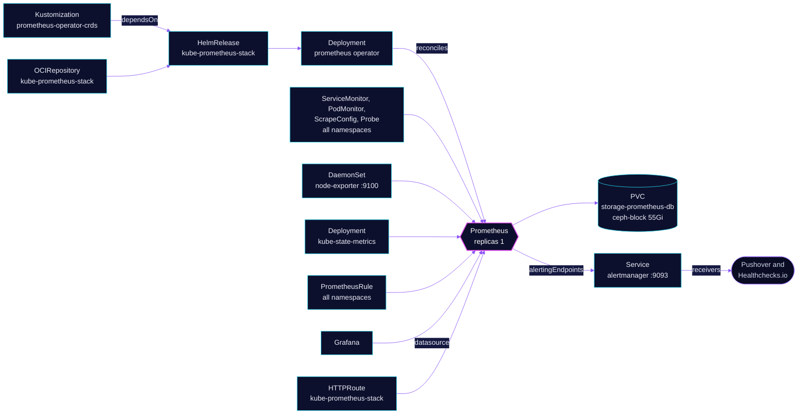

<!-- header: icon=activity -->
<!-- concept: From a scrape to a page on the phone | radar Scrape | database Store | search-check Evaluate | bell-ring Route | smartphone Notify -->
<p align="center"></p>

> The cluster's metrics store: Prometheus, the operator that runs it, node-exporter and the stock Kubernetes alert rules.

**Live facts:** <https://skrumbach.github.io/home-ops/apps/monitoring/kube-prometheus-stack/> (workloads, routes, storage, backups, secrets and alerts, generated on every merge)

## What it does

- **Runs Prometheus.** One replica scrapes every ServiceMonitor, PodMonitor, Probe, ScrapeConfig and
  PrometheusRule in the cluster, whatever its namespace, every minute, and keeps 14 days on a Ceph volume.
- **Runs the Prometheus operator.** The operator turns those objects into Prometheus configuration. It does not
  install their CRDs; see [prometheus-operator](../prometheus-operator/README.md).
- **Scrapes the platform.** API server, kubelet, etcd on the three node IPs, and node-exporter on every node.
  kube-state-metrics is a separate app ([kube-state-metrics](../kube-state-metrics/README.md)).
- **Ships the stock alert rules,** minus three it replaces with fixed copies in [`app/alerts/`](app/alerts/),
  plus cluster-specific rules (GPU loss, node memory pressure, OOM kills, node network, silent-failure gaps).
- **Sends firing alerts to Alertmanager** at `alertmanager.monitoring:9093`; see [alertmanager](../alertmanager/README.md).
  Grafana and the KEDA NFS scaler read Prometheus at `kube-prometheus-stack-prometheus.monitoring:9090`.
- **Serves a UI** at `kube-prometheus-stack.sklab.dev` on `envoy-internal`. The route has no SecurityPolicy.

## Why it is built this way

| Choice | Why |
|---|---|
| **The chart ships no CRDs** | `crds.enabled: false`. `prometheus-operator-crds` owns them and gates this app with `dependsOn`, so a chart upgrade or uninstall never touches the CRDs. |
| **The chart's Alertmanager and Grafana are off** | Both run as their own apps with their own config and routes. |
| **kube-state-metrics is off here** | It runs as its own app. The manifest records no reason. |
| **`*SelectorNilUsesHelmValues: false`** | Prometheus picks up monitors and rules from every namespace and without a release label. Apps ship their own `ServiceMonitor` and `PrometheusRule` next to their manifests. |
| **Replacement rules in `app/alerts/`** | A chart rule that misbehaves is switched off in `defaultRules.disabled` and replaced by a copy that keeps name, severity, `for` and `runbook_url` and changes one thing. |
| **etcd by node IP** | Talos runs etcd as a host service with plain-http metrics on 2381. The Service has no pods, so `endpoints` lists the three node IPs. The VIP is never a target. |

## How it works

<p align="center"></p>

<details>
<summary><b>Resource graph</b>: every object involved, by name</summary>



</details>

1. Flux Kustomization `kube-prometheus-stack` waits for `prometheus-operator-crds`, then applies `app/`: the
   HelmRelease, its OCIRepository and the `alerts` directory. The HelmRelease also waits for `rook-ceph-cluster`,
   because Prometheus needs its `ceph-block` volume.
2. The chart installs the operator and node-exporter. The operator creates the Prometheus StatefulSet.
3. Prometheus scrapes every target each minute and writes to the TSDB. The `timeInterval` of the Grafana datasource
   has to match.
4. It evaluates the chart rules and the rules in `app/alerts/` plus every `PrometheusRule` other apps ship.
5. Firing alerts go to the `alertmanager` Service, which picks the receiver by `severity`.

## Settings that matter

Values are in [`app/helmrelease.yaml`](app/helmrelease.yaml). The chart is pinned in
[`app/ocirepository.yaml`](app/ocirepository.yaml) and Renovate bumps it.

| Setting | Value | Why |
|---|---|---|
| `crds.enabled` | `false` | `prometheus-operator/crds` owns the CRDs. |
| `alertmanager.enabled`, `grafana.enabled`, `kubeStateMetrics.enabled` | `false` | Each runs as its own app. |
| `cleanPrometheusOperatorObjectNames` | `true` | The manifest records no reason. |
| `defaultRules.disabled` | `KubeJobFailed`, `KubeContainerWaiting`, `KubeAggregatedAPIErrors` | One latches, one fires on terminal pods, one never returns a series. Replacements are in `app/alerts/kubernetes-apps-recency.yaml` and `app/alerts/apiserver-aggregation.yaml`. |
| `customRules.PrometheusDuplicateTimestamps.severity` | `critical` | Silently discarded samples degrade every alert over the target, so this is a monitoring failure. About 5M samples were dropped over 8 days without anyone noticing. |
| `kubeEtcd.endpoints`, `service.port`, `serviceMonitor.scheme` | `10.10.10.11-13`, `2381`, `http` | Talos serves etcd metrics as plain http (`listen-metrics-urls` in `talos/machineconfig.yaml.j2`). |
| `kubeEtcd.serviceMonitor.authorization` | `null` | Stops the chart sending the Prometheus ServiceAccount token to etcd in cleartext. |
| `instance` relabelings (etcd, node-exporter) | node name, `talos-1`... | Alerts can say `instance="talos-1"`. |
| `prometheus-node-exporter.service.port` | `9100` | Pinned at the chart default because Cilium's `ceph-lan-isolation` denies `world` on 9100. Keep the two in sync. |
| `kubeControllerManager`, `kubeScheduler`, `kubeProxy` | `enabled: false` | The manifest records no reason. |
| `prometheusSpec.scrapeInterval` | `1m` | Must match the interval in the Grafana chart. |
| `prometheusSpec.retention`, `retentionSize` | `14d`, `50GB` | `storageSpec` asks for 55Gi on `ceph-block`, so the size cap stays under the volume. The manifest records no reason for the numbers. |
| `prometheusSpec.resources.limits.memory` | `8Gi` | 3Gi OOM-killed the pod during TSDB head compaction, a self-reinforcing crash loop. 8Gi absorbs the spike. |
| `prometheusSpec.replicas` | `1` | One replica. No Thanos Query exists. |
| `prometheusSpec.replicaExternalLabelName` | `__replica__` | Without it every alert gains a `prometheus_replica` label. |
| `prometheusSpec.enableFeatures` | `auto-gomaxprocs`, `memory-snapshot-on-shutdown`, `new-service-discovery-manager` | The manifest records no reason. |
| `prometheusSpec.walCompression` | `true` | The manifest records no reason. |
| `prometheusSpec.alertingEndpoints` | `monitoring/alertmanager:9093`, API `v2` | The only link to Alertmanager. The chart's own Alertmanager is off. |
| `kubeApiServer` and `kubelet` `metricRelabelings` | drop request-duration buckets, `uid`, `id`, `name` | Cardinality. |

## Operate it

```bash
flux -n monitoring get ks kube-prometheus-stack prometheus-operator-crds
flux -n monitoring get hr kube-prometheus-stack
kubectl -n monitoring get prometheus,pods,pvc -l app.kubernetes.io/instance=kube-prometheus-stack
kubectl -n monitoring get servicemonitor,podmonitor,scrapeconfig,probe -A
kubectl -n monitoring get prometheusrule -A
```

Targets and rule state are in the Prometheus UI at `https://kube-prometheus-stack.sklab.dev` (Status, Targets and
Alerts). Logs go to VictoriaLogs; the `PrometheusDuplicateTimestamps` annotation holds the LogsQL query that names
the offending target.

### When an alert fires

| Alert | Fires when | First look |
|---|---|---|
| `PrometheusDuplicateTimestamps` | Prometheus drops samples with the same timestamp and a different value | The counter has no target label. Read the Prometheus log in VictoriaLogs with the query in the rule annotation before the pod is replaced. |
| `Watchdog` | the heartbeat rule, firing by design | Not a fault. Alertmanager routes it to Healthchecks.io every 5 minutes; silence there means this chain is broken. |
| Rules in `app/alerts/` | see the site | Each rule's annotation carries its own recovery steps. |

## Known gaps

- **Two empty directories are included.** `app/prometheusrules/kustomization.yaml` and
  `app/scrapeconfigs/kustomization.yaml` both set `resources: []`, and `app/kustomization.yaml` includes them.
  They render nothing.

Upstream: [kube-prometheus-stack chart](https://github.com/prometheus-community/helm-charts/tree/main/charts/kube-prometheus-stack) •
[Prometheus docs](https://prometheus.io/docs/)
