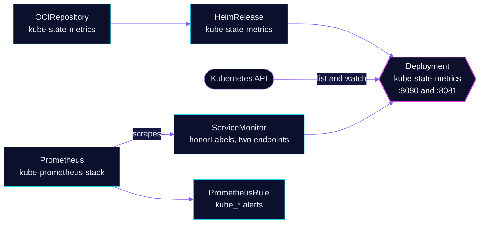

<!-- header: icon=boxes -->
<!-- concept: From API objects to metrics | eye Watch | chart-column Convert | radar Scrape | bell-ring Alert -->
<p align="center"></p>

> Turns Kubernetes object state (pods, Jobs, nodes) into metrics, so alerts can see what the API says.

**Live facts:** <https://skrumbach.github.io/home-ops/apps/monitoring/kube-state-metrics/> (workloads, routes, storage, backups, secrets and alerts, generated on every merge)

## What it does

- **Exports object state.** It watches the API server and serves `kube_*` series: pod phase and waiting reason,
  Job status, node allocatable resources, PVC and CronJob timestamps.
- **Feeds the alert rules.** The Kubernetes rules in [kube-prometheus-stack](../kube-prometheus-stack/README.md)
  and rules in other apps (`gpu-loss`, `fstrim`, the PVC checks, `victoria-logs`, the CNPG offsite mirror) query
  its `kube_*` series.
- **Reports on itself.** Self-monitoring is on, so a broken list or watch can alert.

## Why it is built this way

| Choice | Why |
|---|---|
| **A separate app, not the chart's subchart** | kube-prometheus-stack sets `kubeStateMetrics.enabled: false`, so this app owns the Deployment and its ServiceMonitor. The manifest records no further reason. |
| **`selfMonitor.enabled: true`** | Its own health is on a separate telemetry port (8081), not the 8080 `http` port. Without the container port, Service port and second ServiceMonitor endpoint, the `KubeStateMetrics*` rules can never fire. |
| **Requests, no memory limit** | The pod was BestEffort, first evicted under node pressure. A request fixes that. No limit on purpose, so a large cluster is never OOM-killed by one. |

## How it works

<p align="center"></p>

<details>
<summary><b>Resource graph</b>: every object involved, by name</summary>



</details>

1. Flux applies the HelmRelease with `fullnameOverride: kube-state-metrics`, so the Deployment, Service and
   `job` label all carry that name.
2. The chart creates a ServiceMonitor (`prometheus.monitor.enabled`) with two endpoints: metrics on 8080 and the
   self-monitoring port 8081.
3. Prometheus scrapes both. The replacement rules in kube-prometheus-stack and the PVC checks select
   `job="kube-state-metrics"`.

## Settings that matter

Values are in [`app/helmrelease.yaml`](app/helmrelease.yaml). The chart is pinned in
[`app/ocirepository.yaml`](app/ocirepository.yaml) and Renovate bumps it.

| Setting | Value | Why |
|---|---|---|
| `fullnameOverride` | `kube-state-metrics` | Fixes the name that the rules' `job="kube-state-metrics"` selectors depend on. The manifest records no reason. |
| `resources.requests` | `10m` CPU, `128Mi` memory | Was BestEffort. Live working set was about 74Mi at the time of writing. |
| `resources.limits` | none | A sharded or large cluster is never OOM-killed by a limit. |
| `prometheus.monitor.honorLabels` | `true` | The manifest records no reason. |
| `selfMonitor.enabled` | `true` | Opens port 8081 so the `KubeStateMetrics*` rules can fire. |

## Operate it

```bash
flux -n monitoring get ks kube-state-metrics
flux -n monitoring get hr kube-state-metrics
kubectl -n monitoring get deploy,svc,servicemonitor kube-state-metrics
kubectl -n monitoring top pod -l app.kubernetes.io/name=kube-state-metrics
```

Check the series in the Prometheus UI: `up{job="kube-state-metrics"}`.

### When an alert fires

The `KubeStateMetrics*` rules come from the kube-prometheus-stack chart. Their expressions are not in this repository, so check the rule text in the Prometheus UI.

| Alert | Fires when | First look |
|---|---|---|
| `KubeStateMetrics*` | the exporter's own health series report a fault | Pod logs of `kube-state-metrics`, then its RBAC and the API server. |

Upstream: [kube-state-metrics docs](https://github.com/kubernetes/kube-state-metrics/tree/main/docs)
