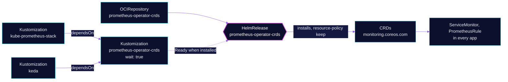

<!-- header: icon=file-cog -->
<!-- concept: From a CRD to a running monitor | package-open Install | shield-check Keep | gauge Gate | radar Scrape -->
<p align="center"></p>

> Installs the Prometheus operator CRDs from their own chart, apart from the stack that runs the operator.

**Live facts:** <https://skrumbach.github.io/home-ops/apps/monitoring/prometheus-operator/> (workloads, routes, storage, backups, secrets and alerts, generated on every merge)

## What it does

- **Installs the CRDs** (`ServiceMonitor`, `PodMonitor`, `PrometheusRule`, `Prometheus`, and the rest of the
  `monitoring.coreos.com` group) from the `prometheus-operator-crds` chart. It runs no pods.
- **Gates the apps that use them.** Flux Kustomization `prometheus-operator-crds` sets `wait: true`, and
  `kube-prometheus-stack` and `keda` list it in `dependsOn`.
- **Protects them on uninstall.** The CRDs carry `helm.sh/resource-policy: keep`.

The operator itself runs inside [kube-prometheus-stack](../kube-prometheus-stack/README.md). The app is named
`prometheus-operator`, its Flux Kustomization `prometheus-operator-crds`.

## Why it is built this way

| Choice | Why |
|---|---|
| **CRDs in their own chart** | kube-prometheus-stack sets `crds.enabled: false` and waits for this Kustomization, so an upgrade or uninstall of the stack never touches the CRDs. Only `kube-prometheus-stack` and `keda` wait for it; other apps that ship a `ServiceMonitor` or `PrometheusRule` do not. |
| **`wait: true` on the Kustomization** | The path holds only a CRD HelmRelease, so Ready means the chart has installed the CRDs. A dependency gate may wait; a Kustomization that owns a backup claim may not. |
| **`helm.sh/resource-policy: keep`** | Deleting a CRD deletes every ServiceMonitor, PodMonitor and PrometheusRule in the cluster. |

## How it works

<p align="center"></p>

<details>
<summary><b>Resource graph</b>: every object involved, by name</summary>



</details>

1. Flux applies `crds/`: an OCIRepository and one HelmRelease with no values except the `keep` annotation.
2. The chart installs the CRDs. The Kustomization turns Ready, with a 5 minute timeout.
3. `kube-prometheus-stack` and `keda` start only after that.

## Settings that matter

| Setting | Value | Why |
|---|---|---|
| `values.crds.annotations` | `helm.sh/resource-policy: keep` | Keeps the CRDs, and so every monitoring object, on a HelmRelease uninstall. |
| Kustomization `wait` | `true` | Holds Ready until the chart has installed the CRDs. |

## Operate it

```bash
flux -n monitoring get ks prometheus-operator-crds
flux -n monitoring get hr prometheus-operator-crds
kubectl get crd | grep monitoring.coreos.com
```

## Invariants

- **Keep `helm.sh/resource-policy: keep`.** Deleting the CRDs deletes every ServiceMonitor, PodMonitor and
  PrometheusRule in the cluster.

Upstream: [prometheus-operator-crds chart](https://github.com/prometheus-community/helm-charts/tree/main/charts/prometheus-operator-crds)
