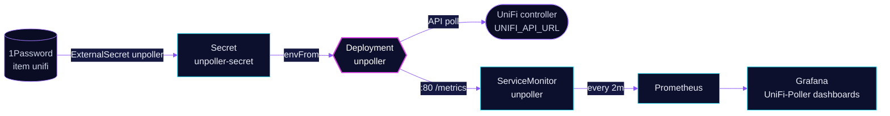

<!-- header: icon=wifi -->
<!-- concept: From the UniFi API to Grafana panels | router UniFi | key-round API key | timer Poll | chart-line Series -->
<p align="center"></p>

> Polls the UniFi controller API and exposes sites, switches, access points and clients as Prometheus metrics.

**Live facts:** <https://skrumbach.github.io/home-ops/apps/monitoring/unpoller/> (workloads, routes, storage, backups, secrets and alerts, generated on every merge)

## What it does

- **Polls** the UniFi controller at the URL in Secret `unpoller-secret`, with an API key, and serves the result on
  port 80 at `/metrics`.
- **Feeds Prometheus** through a ServiceMonitor that scrapes every 2m.
- **Feeds four Grafana dashboards** from the UniFi-Poller family, imported by `monitoring/grafana`: Client Insights,
  Network Sites, USW Insights and UAP Insights.
- **Writes nowhere else.** `UP_INFLUXDB_DISABLE` is `true`, so Prometheus is the only output.

## How it works

<p align="center"></p>

<details>
<summary><b>Resource graph</b>: every object involved, by name</summary>



</details>

1. Flux applies Kustomization `unpoller` after `external-secrets` and `onepassword-store` (namespace `security`) and
   `kube-prometheus-stack`.
2. ExternalSecret `unpoller` extracts 1Password item `unifi` through ClusterSecretStore `onepassword` and builds
   Secret `unpoller-secret`. Its template maps `UNIFI_API_URL` to `UP_UNIFI_DEFAULT_URL` and `UNIFI_API_KEY` to
   `UP_UNIFI_DEFAULT_API_KEY`.
3. The container reads that Secret with `envFrom` and polls the controller. The annotation
   `reloader.stakater.com/auto: "true"` restarts the pod when the Secret changes.
4. The ServiceMonitor scrapes Service `unpoller` on port `http` (80). The scrape interval is 2m, with the comment
   "Unifi API only polls at 2m intervals".
5. Grafana imports the four dashboards (`gnetId` 11315, 11311, 11312, 11314) and points their `DS_UNIFI_POLLER`
   input at the `Prometheus` datasource.

## Settings that matter

| Setting | Value | Why |
|---|---|---|
| `UP_UNIFI_DEFAULT_VERIFY_SSL` | `false` | The manifest records no reason. |
| `UP_PROMETHEUS_HTTP_LISTEN` | `0.0.0.0:80` | Matches the Service `http` port. |
| `UP_INFLUXDB_DISABLE` | `true` | Only Prometheus is used. |
| ServiceMonitor `interval` | `2m` | "Unifi API only polls at 2m intervals." |
| `resources` | requests 10m CPU, 64Mi; limit 128Mi memory | The manifest comment: "~2x the 14d peak. Limit 128Mi." |

## Operate it

```bash
flux -n monitoring get ks unpoller
kubectl -n monitoring get deploy unpoller
kubectl -n monitoring get externalsecret unpoller
kubectl -n monitoring logs deploy/unpoller
kubectl -n monitoring get servicemonitor unpoller
```

`SecretSynced` does not mean the Secret is non-empty, so check the keys in 1Password item `unifi` when the pod logs
errors. The same item also feeds `network/unifi-dns` and `selfhosted/homepage`.

## Invariants

- The Grafana PDU Insights dashboard (grafana.com 23027) stays out until this Prometheus has
  `unpoller_device_outlet_*` series. The comment in `monitoring/grafana` says every panel would be empty.

Upstream: [unpoller docs](https://unpoller.com/docs/install/configuration) •
[unpoller on GitHub](https://github.com/unpoller/unpoller)
