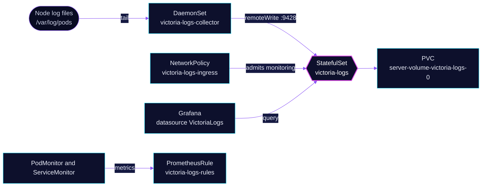

<!-- header: icon=scroll-text -->
<!-- concept: From a container log line to a query in Grafana | file-text Tail | send Ship | database Store | search Query -->
<p align="center"></p>

> The cluster's only log store: a collector on every node ships container logs to one server, kept 14 days.

**Live facts:** <https://skrumbach.github.io/home-ops/apps/monitoring/victoria-logs/> (workloads, routes, storage, backups, secrets and alerts, generated on every merge)

## What it does

- **Collects container logs** with `victoria-logs-collector`, a `vlagent` DaemonSet. It tails
  `/var/log/containers` (symlinks into `/var/log/pods`) on every node, including talos-3.
- **Stores them** in the `victoria-logs` StatefulSet on a 50Gi `ceph-block` claim for 14 days, capped at 45GiB.
- **Answers queries** from Grafana through the `VictoriaLogs` datasource, on `victoria-logs:9428`.
- **Replaced Loki and promtail.** Loki's field names differ: `namespace` is `kubernetes.pod_namespace`,
  `pod` is `kubernetes.pod_name`, `container` is `kubernetes.container_name`, `node_name` and `hostname` are
  `kubernetes.pod_node_name`, `stream` is `output_stream`, and pod labels are `kubernetes.pod_labels.<label>`.
- **Has no route and no backup.** Access is in cluster only, and the overlay says logs are not backed up.

## Why it is built this way

| Choice | Why |
|---|---|
| **Collector reads only two host paths** | On Talos the log files sit in `/var/log/pods` and `/var/log/containers` holds symlinks into it. The chart's default would mount all of `/var/log` and `/var/lib`; `/var/lib` holds etcd, kubelet volumes and secrets, so only the two log paths are mounted, read-only. |
| **Collector runs as root, with no capabilities** | The CRI log files are root-owned `0640`. Uid 0 owns them, so every capability is dropped. |
| **Journal, kernel and kubelet logs are not collected** | promtail never scraped them, so the collector does not either. |
| **Disk buffer on the node** | While the server is down, `vlagent` buffers under `/var/lib/vl-collector` (hostPath), up to `2GiB` per URL, then drops the oldest. |
| **No ingress route** | An `envoy-internal` route would need a rule admitting the `network` namespace in `victoria-logs-ingress`. Grafana, the collector and Prometheus all run in `monitoring`. |
| **No disk alert of its own** | `retentionDiskSpaceUsage` keeps the claim near 90% by design once 14 days outgrow it, so upstream's 80% alert would never clear. `KubePersistentVolumeFillingUp` already covers the claim. |

## How it works

<p align="center"></p>

<details>
<summary><b>Resource graph</b>: every object involved, by name</summary>



</details>

1. Two Flux Kustomizations in [`victoria-logs.yaml`](../../../main/monitoring/victoria-logs.yaml):
   `victoria-logs` (`app/`: server, NetworkPolicy, rules) and `victoria-logs-collector` (`collector/`). The
   server's HelmRelease depends on `rook-ceph-cluster`.
2. `victoria-logs-collector` has `dependsOn: victoria-logs`. That orders the apply and does not gate it: the
   server Kustomization has no `wait` or `healthChecks`, so the collector may start first. Harmless: `vlagent`
   buffers to disk until the server is ready.
3. Each `vlagent` tails the node's files and sends them to `http://victoria-logs.monitoring.svc.cluster.local:9428`.
   Stream fields are `kubernetes.pod_namespace`, `kubernetes.pod_name`, `kubernetes.container_name` and
   `kubernetes.pod_labels.app.kubernetes.io/name`, the closest match to Loki's `app` label.
4. The server keeps data 14 days. `retentionDiskSpaceUsage: 45GiB` drops the oldest days first if 14 days ever
   outgrow the claim, instead of filling it.
5. Grafana queries `victoria-logs.monitoring.svc.cluster.local:9428` through datasource `VictoriaLogs`. The
   NetworkPolicy admits port `9428` from the `monitoring` namespace and DNS replies from CoreDNS.

## Settings that matter

| Setting | Value | Why |
|---|---|---|
| Server `fullnameOverride` | `victoria-logs` | Names the Service, StatefulSet and claim `server-volume-victoria-logs-0`. The 2025 release `victorialogs` left an orphan claim, `server-volume-victorialogs-victoria-logs-single-server-0`, in `monitoring`; it must not be picked up again. |
| Server `retentionPeriod`, `retentionDiskSpaceUsage` | `14d`, `45GiB` | Mirrors Loki's 14 days on a 50Gi `ceph-block` claim. |
| Server `GOMAXPROCS` | `"4"` | On first start the collectors send every existing log file at once, 14 daily partitions deep. At `2Gi` on a 20-core node the server was OOM-killed 12s after each start (2026-11-12). `GOMAXPROCS` keeps its per-core buffers in proportion to the memory limit. |
| Server `resources.memory` | `256Mi` request, `4Gi` limit | `2Gi` was too small for the first-start backlog (above). |
| Collector `resources.memory` | `128Mi` request, `1Gi` limit | Not sized like promtail (about 185Mi). With no checkpoint file `vlagent` reads every log file from the start; at `256Mi` it was OOM-killed within seconds on all three nodes (2026-11-12). It has no flag to skip the backlog. |
| Collector `remoteWrite[].maxDiskUsagePerURL` | `2GiB` | Node buffer cap while the server is down. |
| Collector `tolerations` | control-plane and master `NoSchedule`, `home-operations.com/dedicated` `PreferNoSchedule` | Same set as promtail: runs on the control-plane nodes and on talos-3. |
| Collector `defaultVolumes` | `/var/log/containers`, `/var/log/pods`, read-only | See the table above. The chart still adds the writable `/var/lib/vl-collector` hostPath for checkpoints and the send buffer. |

## Operate it

```bash
flux -n monitoring get ks victoria-logs victoria-logs-collector
flux -n monitoring get hr victoria-logs victoria-logs-collector
kubectl -n monitoring get sts,ds,pvc -o wide | grep victoria-logs
kubectl -n monitoring get pods -l app.kubernetes.io/instance=victoria-logs -o wide
kubectl -n monitoring logs sts/victoria-logs --tail=50
kubectl -n monitoring logs ds/victoria-logs-collector --tail=50
```

### When an alert fires

| Alert | Fires when | First look |
|---|---|---|
| `VictoriaLogsDown` | `victoria-logs` has no ready replica for 10m | The pod and claim. New logs buffer on the nodes meanwhile. |
| `VictoriaLogsCollectorNotDelivering` | a `vlagent` has dropped packets, is retrying pushes or has a full buffer for 15m | The collector logs for the pod in the alert, then the server. |

## Invariants

- **Never pick up the orphan claim** `server-volume-victorialogs-victoria-logs-single-server-0`: keep
  `fullnameOverride: victoria-logs`.
- **Do not size the collector like promtail.** At `256Mi` it is OOM-killed before it can write a checkpoint.
- **Do not add a disk alert.** `KubePersistentVolumeFillingUp` covers the claim.
- **The API is unauthenticated.** `victoria-logs-ingress` only narrows who can write or query. No HTTPRoute:
  an `envoy-internal` route would need a `network` namespace rule in that policy.

Upstream: [VictoriaLogs docs](https://docs.victoriametrics.com/victorialogs/)
