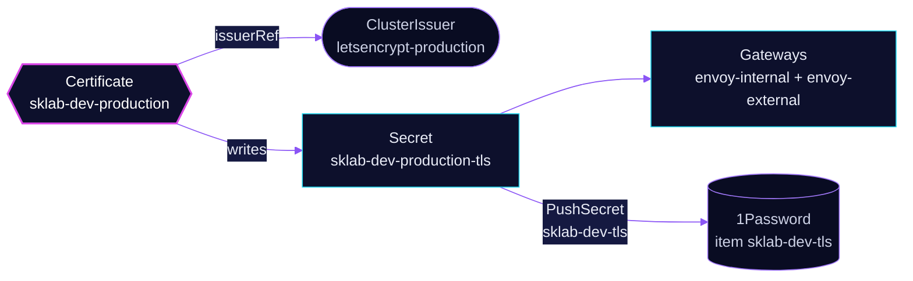

<!-- header: icon=badge-check -->
<!-- concept: From an issued certificate to a copy in the vault | file-key Certificate | shield-check Serve | upload Export | vault Vault -->
<p align="center"></p>

> Declares the wildcard certificate for `sklab.dev` and pushes a copy of it to 1Password.

**Live facts:** <https://skrumbach.github.io/home-ops/apps/network/certificates/> (workloads, routes, storage, backups, secrets and alerts, generated on every merge)

## What it does

- **Declares the certificate.** Certificate `sklab-dev-production` asks ClusterIssuer `letsencrypt-production` for the
  apex `sklab.dev` and `*.sklab.dev`, and writes Secret `sklab-dev-production-tls`. The issuer and the renewals
  belong to [`cert-manager/cert-manager`](../../cert-manager/cert-manager/README.md).
- **Feeds both Gateways.** `envoy-internal` and `envoy-external` serve `sklab-dev-production-tls` on port 443
  ([`network/envoy-gateway`](../envoy-gateway/README.md)).
- **Exports it.** PushSecret `sklab-dev-tls` copies `tls.crt` and `tls.key` of that Secret to 1Password item
  `sklab-dev-tls` through ClusterSecretStore `onepassword`. One way only: nothing in Git reads the item back.

## Why it is built this way

| Choice | Why |
|---|---|
| **The Certificate lives here, not in `cert-manager`** | It sits with its consumers, in `network`, next to the Gateways that serve it. |
| **Kustomization name `certificates-export`** | Kept from when a separate `certificates-import` restored the item. Renaming it would delete and reissue the Certificate (comment in the overlay). |
| **A push, no restore** | The restore wrote Secret `sklab-dev-tls`, which no Gateway read, and was retired. A rebuilt cluster issues a fresh certificate, one Let's Encrypt issuance. The item stays as an off-cluster copy. |

## How it works

<p align="center"></p>

<details>
<summary><b>Resource graph</b>: every object involved, by name</summary>



</details>

1. **Order.** Flux applies `certificates-export` after `onepassword-store` and `cert-manager`, which owns the
   Certificate CRD and the issuer.
2. **Issue.** cert-manager signs the Certificate and writes `sklab-dev-production-tls`. The Gateways pick it up live.
3. **Export.** The PushSecret runs the pair through a template (`b64enc`) and pushes `tls.crt` and `tls.key` to
   item `sklab-dev-tls`.

## Settings that matter

All in [`app/`](app/).

| Setting | Value | Why |
|---|---|---|
| Certificate `dnsNames` | `sklab.dev`, `*.sklab.dev` | One wildcard for every route on both Gateways. |
| Certificate `issuerRef` | ClusterIssuer `letsencrypt-production` | The only ClusterIssuer in the cluster (see the cert-manager README). |
| PushSecret template | `b64enc` on both keys | The item holds base64 text, so a restore must decode it (`decodingStrategy: Base64`). |
| PushSecret store | ClusterSecretStore `onepassword` | See the `security/external-secrets` README on push stores. |

## Operate it

```bash
flux -n network get ks certificates-export
kubectl -n network get certificate sklab-dev-production
kubectl -n network get pushsecret sklab-dev-tls
kubectl -n network get secret sklab-dev-production-tls -o jsonpath='{.data.tls\.crt}' \
  | base64 -d | openssl x509 -noout -subject -enddate
```

Upstream: [External Secrets PushSecret](https://external-secrets.io/latest/guides/pushsecret/) •
[cert-manager Certificate](https://cert-manager.io/docs/usage/certificate/)
