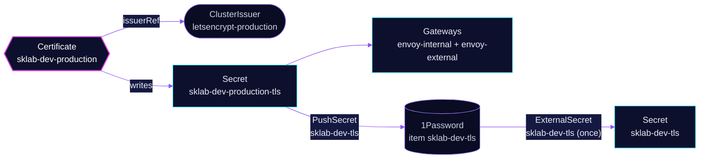

<!-- header: icon=badge-check -->
<!-- concept: From an issued certificate to a copy in the vault | file-key Certificate | upload Export | vault Vault | download Import | rotate-ccw Rebuild -->
<p align="center"></p>

> Declares the wildcard certificate for `sklab.dev` and keeps a copy of it in 1Password for a rebuilt cluster.

**Live facts:** <https://skrumbach.github.io/home-ops/apps/network/certificates/> (workloads, routes, storage, backups, secrets and alerts, generated on every merge)

## What it does

- **Declares the certificate.** Certificate `sklab-dev-production` asks ClusterIssuer `letsencrypt-production` for the
  apex `sklab.dev` and `*.sklab.dev`, and writes Secret `sklab-dev-production-tls`. The issuer and the renewals
  belong to [`cert-manager/cert-manager`](../../cert-manager/cert-manager/README.md).
- **Exports it.** PushSecret `sklab-dev-tls` copies `tls.crt` and `tls.key` of that Secret to 1Password item
  `sklab-dev-tls` through ClusterSecretStore `onepassword`.
- **Imports it.** ExternalSecret `sklab-dev-tls` reads the item back into Secret `sklab-dev-tls` (type
  `kubernetes.io/tls`), once, so a rebuilt cluster can start from a valid certificate. See [Known gaps](#known-gaps):
  the restored Secret is not the one the Gateways read.
- **Feeds both Gateways.** `envoy-internal` and `envoy-external` serve `sklab-dev-production-tls` on port 443
  ([`network/envoy-gateway`](../envoy-gateway/README.md)).

## Why it is built this way

| Choice | Why |
|---|---|
| **Two Flux Kustomizations, `certificates-import` and `certificates-export`** | `certificates-export` depends on `certificates-import` and on `cert-manager`, which owns the Certificate CRD and the issuer (comment in the overlay). The manifest records no reason for the order of the two. |
| **The Certificate lives here, not in `cert-manager`** | It sits with its consumers, in `network`, next to the Gateways that serve it. |
| **`creationPolicy: Orphan`, `refreshPolicy: CreatedOnce`** | The import creates its Secret once, and the Secret outlives the ExternalSecret. The manifest records no reason. |
| **Push the pair to 1Password** | A rebuilt cluster can start from a valid certificate instead of spending a Let's Encrypt issuance. The same reason is in the cert-manager README. |

## How it works

<p align="center"></p>

<details>
<summary><b>Resource graph</b>: every object involved, by name</summary>



</details>

1. **Order.** Flux applies `certificates-import` first, after `onepassword-store` (`wait: true`). Then
   `certificates-export`, after `certificates-import` and `cert-manager`. `envoy-gateway` also waits for
   `certificates-import`.
2. **Issue.** cert-manager signs the Certificate and writes `sklab-dev-production-tls`.
3. **Export.** The PushSecret runs the pair through a template (`b64enc`) and pushes `tls.crt` and `tls.key` to
   item `sklab-dev-tls`.
4. **Import.** The ExternalSecret extracts the same item with `decodingStrategy: Base64` into a TLS Secret. It carries
   the `cert-manager.io/*` annotations and the label `controller.cert-manager.io/fao: "true"`, so cert-manager treats
   it as one of its own.

## Settings that matter

All in [`export/`](export/) and [`import/`](import/).

| Setting | Value | Why |
|---|---|---|
| Certificate `dnsNames` | `sklab.dev`, `*.sklab.dev` | One wildcard for every route on both Gateways. |
| Certificate `issuerRef` | ClusterIssuer `letsencrypt-production` | The only ClusterIssuer in the cluster (see the cert-manager README). |
| ExternalSecret `refreshPolicy` | `CreatedOnce` | The restore runs once. |
| ExternalSecret `creationPolicy` | `Orphan` | The Secret stays if the ExternalSecret is deleted. The manifest records no reason. |
| ExternalSecret `decodingStrategy` | `Base64` | Matches the `b64enc` in the PushSecret template. |
| `cert-manager.io/certificate-name` annotation | `sklab-dev` | See [Known gaps](#known-gaps). |

## Operate it

```bash
flux -n network get ks certificates-import certificates-export
kubectl -n network get certificate sklab-dev-production
kubectl -n network get pushsecret sklab-dev-tls
kubectl -n network get externalsecret sklab-dev-tls
kubectl -n network get secret sklab-dev-production-tls -o jsonpath='{.data.tls\.crt}' \
  | base64 -d | openssl x509 -noout -subject -enddate
```

`SecretSynced` on an ExternalSecret does not mean the Secret is non-empty.

## Known gaps

- **The restore writes a Secret nobody reads.** The ExternalSecret in
  [`import/externalsecret.yaml`](import/externalsecret.yaml) restores into Secret `sklab-dev-tls`, annotated as
  Certificate `sklab-dev`. The live Certificate is `sklab-dev-production` ([`export/certificate.yaml`](export/certificate.yaml))
  and both Gateways read `sklab-dev-production-tls` ([`../envoy-gateway/app/gateway.yaml`](../envoy-gateway/app/gateway.yaml)).
  On a rebuild cert-manager therefore issues a fresh certificate and does not adopt the restored one, and
  `envoy-gateway` (`kubernetes/apps/main/network/envoy-gateway.yaml`) waits for an import the Gateways do not use.

Upstream: [External Secrets PushSecret](https://external-secrets.io/latest/guides/pushsecret/) •
[cert-manager Certificate](https://cert-manager.io/docs/usage/certificate/)
