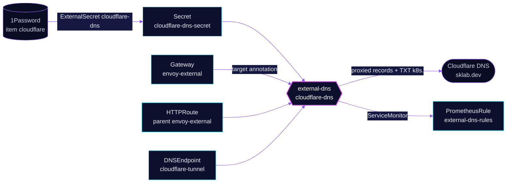

<!-- header: icon=globe -->
<!-- concept: From an external route to a proxied public record | route Route | tag Target | cloud Cloudflare | refresh-cw Sync | activity Watch -->
<p align="center"></p>

> Writes the public Cloudflare DNS records for routes on envoy-external and for DNSEndpoint objects.

**Live facts:** <https://skrumbach.github.io/home-ops/apps/network/cloudflare-dns/> (workloads, routes, storage, backups, secrets and alerts, generated on every merge)

## What it does

- **Publishes external hostnames.** It runs external-dns with the Cloudflare provider and watches two sources:
  `gateway-httproute`, limited by `--gateway-name=envoy-external` to routes attached to that Gateway, and `crd`
  with kind `DNSEndpoint`. It reads no Service and no Ingress.
- **Proxies every record.** `--cloudflare-proxied` turns the Cloudflare proxy on for each record it writes.
- **Stays inside one zone.** `domainFilters` is `sklab.dev` and `--zone-id-filter` is `CF_ZONE_ID`, so nothing
  else in the Cloudflare account is touched.
- **Owns its records.** TXT ownership records get the prefix `k8s.` and owner id `default`. `policy: sync`
  deletes a record when its route or `DNSEndpoint` goes away.
- **Is the internal half's twin.** [`network/unifi-dns`](../unifi-dns/README.md) does the same for the LAN.

## Why it is built this way

| Choice | Why |
|---|---|
| **Split from `unifi-dns`** | Public and internal records have different audiences and different providers. One instance per audience keeps an internal-only route out of Cloudflare. |
| **Only `envoy-external` routes** | A route on `envoy-internal` never becomes a public record. The Gateway filter is the gate. |
| **The Gateway decides the target** | The record points at the parent Gateway's `external-dns.kubernetes.io/target` annotation, `external.sklab.dev` on `envoy-external`. The repository convention is that a route annotation does not decide it. |
| **`DNSEndpoint` for the tunnel hostname** | `external.sklab.dev` is a CNAME to a `cfargotunnel.com` name, not an address from a route. [`cloudflare-tunnel`](../cloudflare-tunnel/README.md) ships that object and this app writes it. |

## How it works

<p align="center"></p>

<details>
<summary><b>Resource graph</b>: every object involved, by name</summary>



</details>

1. **Flux.** Kustomization `cloudflare-dns` ([overlay](../../../main/network/cloudflare-dns.yaml)) waits for
   `onepassword-store`, then applies `app/` into `network` and waits for it.
2. **Secret.** ExternalSecret `cloudflare-dns` builds Secret `cloudflare-dns-secret` from 1Password item
   `cloudflare` (`CLOUDFLARE_DNS_TOKEN` as `CF_API_TOKEN`, `CLOUDFLARE_ZONE_ID` as `CF_ZONE_ID`). Reloader
   restarts the pod when it changes.
3. **Watch.** `triggerLoopOnEvent: true` starts a sync when a source object changes, so a new route does not
   wait for the interval.
4. **Write.** For each `envoy-external` route hostname the controller writes a proxied record to the Gateway's
   target, plus a TXT ownership record. `external.sklab.dev` comes from the `DNSEndpoint` in `cloudflare-tunnel`.

## Settings that matter

Values are in [`app/helmrelease.yaml`](app/helmrelease.yaml). The chart is pinned in
[`app/ocirepository.yaml`](app/ocirepository.yaml) and Renovate bumps it.

| Setting | Value | Why |
|---|---|---|
| `sources` | `crd`, `gateway-httproute` | Public records come from routes and from explicit `DNSEndpoint` objects only. |
| `--gateway-name` | `envoy-external` | Routes on any other Gateway are ignored. |
| `--crd-source-apiversion`, `--crd-source-kind` | `externaldns.k8s.io/v1alpha1`, `DNSEndpoint` | Selects the CRD the `crd` source reads. |
| `--cloudflare-proxied` | set | Every record goes through the Cloudflare proxy. The manifest records no reason. |
| `--cloudflare-dns-records-per-page` | `1000` | The manifest records no reason. |
| `policy` | `sync` | Records are created, updated and deleted. |
| `txtPrefix`, `txtOwnerId` | `k8s.`, `default` | Ownership TXT records that tell this instance which records are its own. |
| `domainFilters`, `--zone-id-filter` | `sklab.dev`, `$(CF_ZONE_ID)` | Limits the instance to one zone. |
| `resources` | 10m / 32Mi request, 64Mi memory limit | The manifest records no reason. |

## Operate it

```bash
flux -n network get ks cloudflare-dns
flux -n network get hr cloudflare-dns
kubectl -n network get externalsecret cloudflare-dns
kubectl -n network logs deploy/cloudflare-dns --tail=50       # sync results, "All records are already up to date"
kubectl -n network get dnsendpoint
kubectl get httproute -A | grep envoy-external                # what the controller sees
```

### When an alert fires

| Alert | Fires when | First look |
|---|---|---|
| `ExternalDNSStale` | no completed sync for over 3 minutes, for 5 minutes | The rule is in this app's [`prometheusrule.yaml`](app/prometheusrule.yaml) and covers `unifi-dns` too: read `{{ $labels.job }}` to see which. Logs of that deployment, then the Cloudflare token (`SecretSynced` does not mean the fields are non-empty). |

## Invariants

- **The parent Gateway's `external-dns.kubernetes.io/target` annotation decides the record target** (see
  `AGENTS.md`), not a route annotation.
- **`policy: sync` deletes.** Removing a route or the `DNSEndpoint` removes the public record.
- **Only `envoy-external` is public.** A route moved to `envoy-internal` loses its Cloudflare record.

Upstream: [external-dns](https://kubernetes-sigs.github.io/external-dns/)
