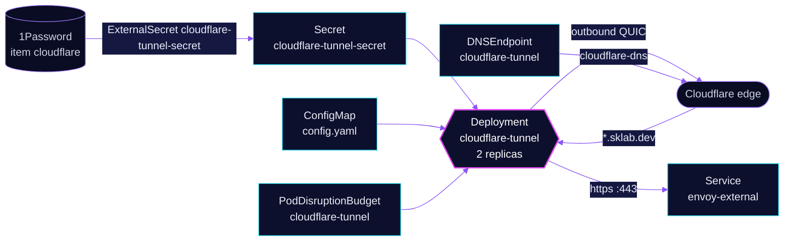

<!-- header: icon=cable -->
<!-- concept: From the internet to the external Gateway without an open port | globe Visitor | cloud Edge | cable Tunnel | door-open Gateway | server Service -->
<p align="center"></p>

> Carries public traffic from Cloudflare to the envoy-external Gateway over outbound tunnels, with no inbound port.

**Live facts:** <https://skrumbach.github.io/home-ops/apps/network/cloudflare-tunnel/> (workloads, routes, storage, backups, secrets and alerts, generated on every merge)

## What it does

- **Connects out to Cloudflare.** Two `cloudflared` replicas run `tunnel run` with the token from Secret
  `cloudflare-tunnel-secret`, using QUIC with post-quantum key exchange. Nothing listens on the internet.
- **Forwards every hostname to one place.** The ingress rule in `config.yaml` sends `*.sklab.dev` to
  `https://envoy-external.network.svc.cluster.local:443`. Anything else gets `http_status:404`.
- **Names the tunnel in DNS.** `DNSEndpoint` `cloudflare-tunnel` declares `external.sklab.dev` as a CNAME to the
  tunnel's `cfargotunnel.com` name. [`cloudflare-dns`](../cloudflare-dns/README.md) writes it to Cloudflare.
- **Stays up through a drain.** PodDisruptionBudget `cloudflare-tunnel` keeps one replica, and a soft
  anti-affinity spreads the two across nodes.

## Why it is built this way

| Choice | Why |
|---|---|
| **One wildcard rule to `envoy-external`** | Routing stays in Gateway API. Adding a public app means attaching an HTTPRoute to `envoy-external`, with no change here. |
| **`originServerName: external.sklab.dev`** | The tunnel reaches the Gateway by Service name, so `config.yaml` sets the TLS server name explicitly. The manifest records no further reason. |
| **Lenient liveness probe** | A restart drops every tunnel connection, so only a sustained `/ready` failure (about 10 minutes) restarts a pod. The manifest comment says so. |
| **Explicit memory request** | A limit-only container reserves the whole limit (256Mi). The request is 128Mi. |
| **Two replicas with a PDB** | `minAvailable: 1` keeps one pod through a drain. The manifest records no further reason. |

## How it works

<p align="center"></p>

<details>
<summary><b>Resource graph</b>: every object involved, by name</summary>



</details>

1. **Flux.** Kustomization `cloudflare-tunnel` ([overlay](../../../main/network/cloudflare-tunnel.yaml)) waits
   for `onepassword-store` and for `cloudflare-dns`, because tunnel routes need the public records it writes.
   The chart is bjw-s `app-template`.
2. **Secret.** ExternalSecret `cloudflare-tunnel-secret` reads 1Password item `cloudflare` (fields
   `TALOS_CF_TUNNEL_ID` and `TALOS_CF_TUNNEL_TOKEN`, exposed as `TUNNEL_ID` and `TUNNEL_TOKEN`). Reloader
   restarts the pods when it changes.
3. **Connect.** Each pod opens outbound QUIC connections to Cloudflare. Port 8080 (`TUNNEL_METRICS`) serves
   `/ready` for the probes and the metrics the ServiceMonitor scrapes; the Grafana `cloudflare-tunnels` dashboard
   reads those metrics.
4. **Serve.** A request for a `sklab.dev` name reaches Cloudflare, travels down the tunnel to a pod, and goes to
   `envoy-external` over HTTP/2 (`http2Origin: true`) with TCP keepalive `7200s`. The Gateway routes it by
   HTTPRoute.

## Settings that matter

Values are in [`app/helmrelease.yaml`](app/helmrelease.yaml).

| Setting | Value | Why |
|---|---|---|
| `TUNNEL_TRANSPORT_PROTOCOL` | `quic` | The manifest names `http2` as the alternative. The manifest records no other reason. |
| `TUNNEL_POST_QUANTUM` | `true` | The manifest comment: disable when using `http2`. |
| `NO_AUTOUPDATE` | `true` | The manifest records no reason. |
| `liveness` | `/ready`, 30 s period, `failureThreshold: 20` | A restart drops every tunnel connection. About 10 minutes of failure triggers it. |
| `readiness` | `/ready`, 10 s period, `failureThreshold: 3` | Three failed checks at 10 s mark a pod unready. |
| `replicas`, PDB `minAvailable` | `2`, `1` | One replica always survives a drain. |
| anti-affinity | preferred, `kubernetes.io/hostname` | Spread when possible, schedule anyway when not. |
| `securityContext` | non-root `65534`, read-only root, all capabilities dropped | The manifest records no reason. |
| `resources` | 10m CPU, 128Mi request, 256Mi limit | The request is explicit so the limit is not reserved as the request. |

## Operate it

```bash
flux -n network get ks cloudflare-tunnel
flux -n network get hr cloudflare-tunnel
kubectl -n network get deploy,pods -l app.kubernetes.io/name=cloudflare-tunnel -o wide
kubectl -n network get externalsecret cloudflare-tunnel-secret
kubectl -n network get dnsendpoint cloudflare-tunnel
kubectl -n network logs deploy/cloudflare-tunnel --tail=50     # connection and ingress errors
```

## Invariants

- **Public routes attach to `envoy-external`.** The tunnel has one rule for `*.sklab.dev`; the Gateway is what
  decides who is public.
- **The tunnel hostname is `external.sklab.dev`.** It is the `DNSEndpoint` target here, the `originServerName`
  in `config.yaml`, and the `external-dns.kubernetes.io/target` on `envoy-external`. Change them together.

Upstream: [Cloudflare Tunnel](https://developers.cloudflare.com/cloudflare-one/connections/connect-networks/)
