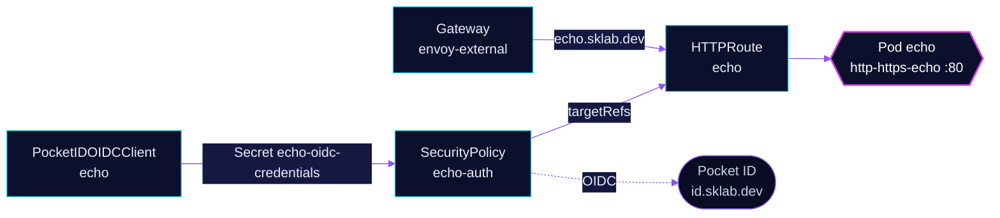

<!-- header: icon=repeat -->
<!-- concept: From a browser request to an echoed reply | globe Browser | fingerprint Sign-in | route Route | repeat Echo -->
<p align="center"></p>

> A test endpoint on the public gateway that echoes each request back, behind Pocket ID sign-in.

**Live facts:** <https://skrumbach.github.io/home-ops/apps/network/echo/> (workloads, routes, storage, backups, secrets and alerts, generated on every merge)

## What it does

- **Echoes requests.** The `http-https-echo` container returns what it received at
  `echo.sklab.dev`. It is the check that a route, TLS and the Gateway work end to end.
- **Sits on the public gateway.** The route attaches to `envoy-external`. `echo.sklab.dev` is on the `ALLOWED` list in
  `scripts/ci/external-routes-test.py` with path `/`.
- **Signs people in at Envoy.** SecurityPolicy `echo-auth` runs OIDC against Pocket ID (`id.sklab.dev`). The
  PocketIDOIDCClient `echo` admits only the group `admins`.
- **Exports metrics** (`PROMETHEUS_ENABLED`, a ServiceMonitor) and a Gatus check that expects status 200.
- **Doubles as the chart-tag reference.** `scripts/add-app/generate-app.sh` reads the app-template tag from
  [`app/ocirepository.yaml`](app/ocirepository.yaml), which Renovate keeps current.

## How it works

<p align="center"></p>

<details>
<summary><b>Resource graph</b>: every object involved, by name</summary>



</details>

1. Flux applies Kustomization `echo`. The HelmRelease (bjw-s app-template) creates the Deployment, the Service on
   port 80 and the HTTPRoute `echo`, whose hostname is `{{ .Release.Name }}.sklab.dev`.
2. The Pocket ID operator creates the client and writes its credentials to Secret `echo-oidc-credentials`, with the
   key names Envoy Gateway reads (`client-id`, `client-secret`).
3. A browser request reaches `envoy-external`. Envoy redirects it to Pocket ID. After sign-in the browser returns to
   `/oauth2/callback`, and Envoy forwards the request to the pod. `/oauth2/logout` ends the session.

## Settings that matter

| Setting | Value | Why |
|---|---|---|
| Pod `securityContext` | non-root 1000, `seccompProfile: RuntimeDefault`, read-only root, drop `ALL` | The manifest records no reason. |
| `resources.requests.memory` | `64Mi`, equal to the limit | Peak usage sits near the 64Mi limit so there is nothing to reclaim, and a limit with no request silently reserves the whole limit. |
| `LOG_IGNORE_PATH` | `/healthz` | The manifest records no reason. The probes use `/healthz`. |
| SecurityPolicy `authorizationEndpoint`, `tokenEndpoint`, `endSessionEndpoint` | explicit `id.sklab.dev` URLs | They skip discovery. Without them the controller fetches the issuer's `openid-configuration` on every translation, and a failed fetch turns the route into a 500 until the next one. |
| PocketIDOIDCClient `pkceEnabled` | `true` | Envoy's OAuth2 filter always sends an S256 challenge, and this makes Pocket ID require it. |
| `logoutCallbackUrls` | `https://echo.sklab.dev/` | Envoy's logout sends `post_logout_redirect_uri=<scheme>://<host>/`. |
| `allowedUserGroups` | `admins` (namespace `security`) | Pocket ID refuses the authorization for anyone outside the group. |

## Operate it

```bash
flux -n network get ks echo
kubectl -n network get pods | grep echo
kubectl -n network get securitypolicy echo-auth                 # Accepted True
kubectl -n network get pocketidoidcclient echo
kubectl -n network get secret echo-oidc-credentials             # exists, keys client-id and client-secret
```

## Invariants

- **A SecurityPolicy that fails to translate makes the route answer 500**, for example when the operator has not
  written `echo-oidc-credentials` yet. A policy whose `targetRef` matches no route leaves that route open.
- **Deleting the PocketIDOIDCClient deletes the client in Pocket ID.**

Upstream: [http-https-echo](https://github.com/mendhak/http-https-echo)
