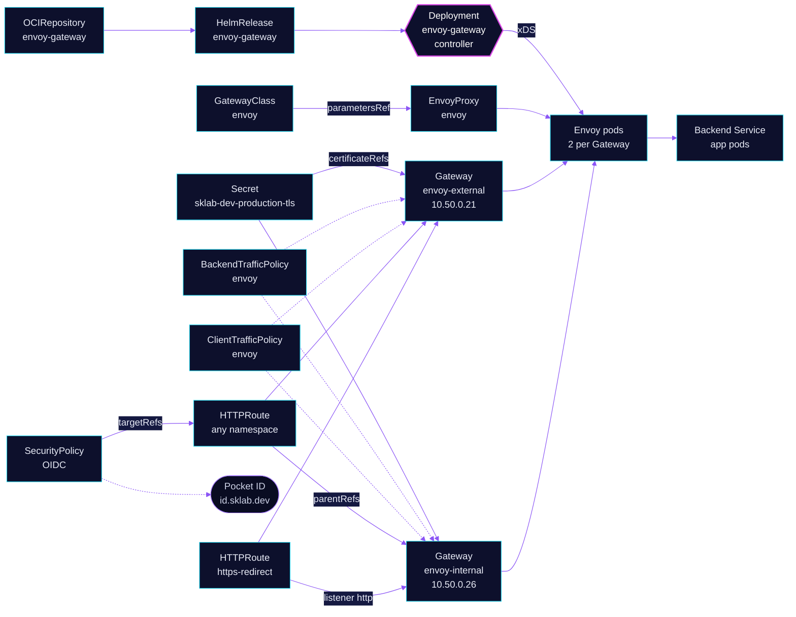

<!-- header: icon=waypoints -->
<!-- concept: From a hostname to a backend pod | globe Resolve | door-open Listen | lock Terminate | fingerprint Gate | route Route -->
<p align="center"></p>

> The Gateway API implementation: two Gateways, one public and one internal, that carry every HTTPS route in the cluster.

**Live facts:** <https://skrumbach.github.io/home-ops/apps/network/envoy-gateway/> (workloads, routes, storage, backups, secrets and alerts, generated on every merge)

## What it does

- **Runs two Gateways** in `network` from one GatewayClass `envoy`: `envoy-external` (public, LoadBalancer IP
  `10.50.0.21`) and `envoy-internal` (LAN, `10.50.0.26`). Cilium announces both IPs over BGP.
- **Terminates TLS** on port 443 of both with the wildcard Secret `sklab-dev-production-tls`, which
  `cert-manager/cert-manager` issues. Port 80 only redirects: HTTPRoute `https-redirect` answers 301 to https.
- **Takes routes from every namespace.** The `https` listeners use `allowedRoutes.namespaces.from: All`. An app
  attaches a route with `parentRefs` to `envoy-internal` or `envoy-external` and `sectionName: https`.
- **Signs people in for apps that have no login.** Fifteen `SecurityPolicy` manifests in Git attach OIDC sign-in to an app's route, for example
  `echo-auth` (Pocket ID at `id.sklab.dev`).
- **Sets the DNS target.** The `external-dns.kubernetes.io/target` annotation on each Gateway
  (`external.sklab.dev`, `internal.sklab.dev`) decides where every route's record points.
- **Exports metrics and alerts** through a ServiceMonitor (controller), a PodMonitor (proxies) and two alert rules.

## Why it is built this way

| Choice | Why |
|---|---|
| **Two Gateways, one hostname on one of them** | A hostname attaches to one Gateway only: the internal DNS provider stores one CNAME target per name (comment in `security/pocket-id`'s route). Public exposure is one `parentRef`, and a reviewed diff. |
| **A public allow-list in CI** | `scripts/ci/external-routes-test.py` fails when any route on `envoy-external` has a host or path outside its `ALLOWED` table: `flux-webhook.sklab.dev` (`/hook/`), `kromgo.sklab.dev` (`/badges/`), `echo.sklab.dev`, `id.sklab.dev`, `n8n-webhook.sklab.dev` (`/webhook`, `/rest/oauth2-credential`). A route with no hostname may only redirect. |
| **Proxies in `network`, one Deployment per Gateway** | `deploy.type: GatewayNamespace` puts each Gateway's Envoy pods next to the Gateway object. Network policies elsewhere select them with the label `gateway.envoyproxy.io/owning-gateway-name`. |
| **OIDC at Envoy, not in the app** | An app with no login of its own gets sign-in from a `SecurityPolicy` on its route. Home Assistant has none on its main route and signs in itself (see its README). |
| **`externalTrafficPolicy: Local`** | A node with no proxy pod for a Gateway does not advertise its IP, so the spread below decides which nodes announce. |
| **Hard spread across nodes** | See below: replicas of one Gateway never share a node, so a drain keeps one proxy and one announcing node. |
| **Settings on the Gateways, not per route** | `BackendTrafficPolicy` and `ClientTrafficPolicy` named `envoy` select every Gateway (`targetSelectors` on kind `Gateway`), so no app repeats them. |

## How it works

<p align="center"></p>

<details>
<summary><b>Resource graph</b>: every object involved, by name</summary>



</details>

1. **Flux.** Kustomization `envoy-gateway` ([overlay](../../../main/network/envoy-gateway.yaml)) waits for
   `certificates-import`, then applies `app/`. Its health checks are the controller Deployment, then both Gateways
   `Programmed` (a custom `healthCheckExprs`). `wait` stays false, so the listed checks are the ones honoured.
2. **Controller and proxies.** The chart runs one controller, `envoy-gateway`. For each Gateway it creates an Envoy
   Deployment in `network` (2 replicas, from `EnvoyProxy` `envoy`) and a LoadBalancer Service. The infrastructure
   annotations on the Gateway pin the IP (`lbipam.cilium.io/ips`) and the DNS name.
3. **xDS.** The controller pushes routes and listeners to the proxies. A proxy that loses the controller keeps
   serving its last config. Alert `EnvoyProxyControlPlaneDisconnected` catches that.
4. **A request.** The client resolves `*.sklab.dev` to a Gateway IP. Envoy terminates TLS (1.2 minimum, HTTP/2 and
   HTTP/3 on), matches the route by host and path, and runs its `SecurityPolicy` if one targets the route. An
   unauthenticated browser gets redirected to Pocket ID, then returns to `/oauth2/callback`.
5. **Routes are not here.** Each app owns its HTTPRoute and SecurityPolicy. The site lists every route per gateway.
6. **Public path.** Cloudflare Tunnel sends public traffic to Service `envoy-external` in `network`, port 443
   (`network/cloudflare-tunnel`). `network/cloudflare-dns` watches only `envoy-external`.

## Settings that matter

Controller values are in [`app/helmrelease.yaml`](app/helmrelease.yaml), proxy values in
[`app/envoyproxy.yaml`](app/envoyproxy.yaml). The chart tag is pinned in
[`app/ocirepository.yaml`](app/ocirepository.yaml); the proxy image is pinned in `envoyproxy.yaml` with a
Renovate comment.

| Setting | Value | Why |
|---|---|---|
| `deployment.envoyGateway.resources` | requests 100m / 256Mi, limit 1Gi memory | Must sit under `deployment.envoyGateway`. A `resources` block under `config.envoyGateway` is part of the config-file schema and is silently ignored. |
| `envoyDeployment.replicas` | `2` | Two proxies per Gateway, four in total. The PDBs `envoy-external` and `envoy-internal` keep `minAvailable: 1`. |
| Proxy `resources` | requests 100m / 256Mi, limit 1Gi memory | A limit with no memory request reserves the whole limit, so four pods would hold 4Gi. The request tracks the observed peak. |
| `topologySpreadConstraints` | `maxSkew: 1` on `kubernetes.io/hostname`, `DoNotSchedule`, `matchLabelKeys: gateway.envoyproxy.io/owning-gateway-name` | Replicas of one Gateway never share a node, because with `externalTrafficPolicy: Local` a node without an endpoint does not advertise the IP. `matchLabelKeys` counts per Gateway in the one shared spec. |
| `envoyService.externalTrafficPolicy` | `Local` | Only nodes that run a proxy of that Gateway advertise its IP. |
| `shutdown.drainTimeout`, `minDrainDuration` | `180s`, `60s` | Connections drain before a proxy exits. The manifest records no reason for these two numbers. |
| `patch` (StrategicMerge) | `terminationGracePeriodSeconds: 360`, preStop `/bin/sleep 210` | The CRD does not expose the preStop hook or the grace period, so a patch replaces the preStop the chart injects. The manifest records no reason for 210 and 360. |
| `ClientTrafficPolicy` `clientIPDetection` | `xForwardedFor.numTrustedHops: 1` | One trusted hop for `X-Forwarded-For`. The manifest records no reason. |
| `ClientTrafficPolicy` `tls` | `minVersion: "1.2"`, ALPN `h2`, `http/1.1` | The manifest records no reason. |
| `ClientTrafficPolicy` `timeout.http.requestReceivedTimeout` | `0s` | Disables the request-received timeout. The manifest records no reason. |
| `BackendTrafficPolicy` `timeout.http.requestTimeout` | `0s` | No request timeout, so long streams are not cut. The manifest records no reason. |
| `BackendTrafficPolicy` `retry` | 2 retries on `reset-before-request` | Retries only a reset before any request byte reached the backend (a stale pooled connection or a pod that just went away), so a POST is never replayed. |

## Operate it

```bash
flux -n network get ks envoy-gateway
kubectl -n network get gateway                                  # PROGRAMMED True, ADDRESS 10.50.0.21 / .26
kubectl -n network get deploy,pdb -o wide | grep envoy
kubectl get httproute -A                                        # every route, with parent and hostnames
kubectl get securitypolicy -A                                   # a policy that matches no route leaves the route open
kubectl -n network get clienttrafficpolicy,backendtrafficpolicy
python3 scripts/ci/external-routes-test.py                      # the public allow-list
```

A `SecurityPolicy` that cannot translate (for example the OIDC credentials Secret does not exist yet) makes its
route answer 500 instead of passing traffic through. A policy whose `targetRefs` matches no route leaves that route
open.

### When an alert fires

From [`app/prometheusrule.yaml`](app/prometheusrule.yaml).

| Alert | Fires when | First look |
|---|---|---|
| `EnvoyProxyControlPlaneDisconnected` | a proxy has `envoy_control_plane_connected_state == 0` for 10 m | The proxy serves frozen config. Past causes: controller crash loop, expired GatewayNamespaceMode ServiceAccount tokens, xDS auth failure. Runbook in the rule: `kubectl -n network rollout restart deploy envoy-gateway`, then `envoy-internal` and `envoy-external`. The 10 m absorbs a normal controller roll. |
| `EnvoyGatewayControllerCrashLooping` | the controller restarts 2 times in 15 m, for 5 m | Past cause: a liveness kill (exit 137, not OOM) from stale proxies flooding the auth interceptor with expired tokens. Look for a `kubejwt` "service account token has expired" storm in the controller logs. |

## Invariants

- **Public exposure is reviewed.** Every route on `envoy-external` must be on `ALLOWED` in
  `scripts/ci/external-routes-test.py`, host and path. Do not add an `envoy-external` `parentRef` without updating it.
- **One Gateway per hostname.** Never attach a hostname to both Gateways.
- **A Gateway name is referenced elsewhere.** Network policies select `gateway.envoyproxy.io/owning-gateway-name`,
  and `cloudflare-tunnel` and `cloudflare-dns` name `envoy-external`.

## Known gaps

- **`envoy-gateway` waits for a Secret the Gateways do not read.** `dependsOn: certificates-import`
  (`kubernetes/apps/main/network/envoy-gateway.yaml`) gates on the restore of Secret `sklab-dev-tls`, but both Gateways
  read `sklab-dev-production-tls`. See the known gap in [`network/certificates`](../certificates/README.md).

Upstream: [Envoy Gateway docs](https://gateway.envoyproxy.io/docs/) •
[Gateway API](https://gateway-api.sigs.k8s.io/)
