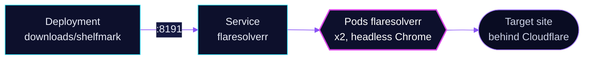

<!-- header: icon=lock-open -->
<!-- concept: From a blocked request to a cleared page | send Request | shield-alert Challenge | globe Browser | check Cleared -->
<p align="center"></p>

> A headless-browser proxy that solves Cloudflare browser checks for other apps in the cluster.

**Live facts:** <https://skrumbach.github.io/home-ops/apps/network/flaresolverr/> (workloads, routes, storage, backups, secrets and alerts, generated on every merge)

## What it does

- **Serves in-cluster callers only.** Service `flaresolverr` is ClusterIP on port 8191. The app has no route and no
  hostname.
- **Has one consumer in Git.** `downloads/shelfmark` sets its bypass URL to
  `http://flaresolverr.network.svc.cluster.local:8191`.
- **Runs two replicas** of the FlareSolverr image, which drives headless Chrome, with `CAPTCHA_SOLVER: none`.

## How it works

<p align="center"></p>

<details>
<summary><b>Resource graph</b>: every object involved, by name</summary>



</details>

1. Flux applies Kustomization `flaresolverr` (no dependencies, `retryInterval: 2m`). The HelmRelease (bjw-s app-template)
   creates the Deployment and the Service.
2. A caller sends a request to the Service on port 8191. The pod loads the target URL in Chrome and answers the caller.
3. A startup probe allows up to 5 s + 30 x 5 s for Chrome to come up. The liveness and readiness probes get `/`.

## Settings that matter

| Setting | Value | Why |
|---|---|---|
| `securityContext.readOnlyRootFilesystem` | `false` | Chrome writes profile and cache data under the image's root filesystem. |
| `resources.limits.memory` | `1536Mi` | The 30-day maximum working set was 873Mi, 85% of the former 1Gi limit (2026-11-07). |
| `resources.requests.memory` | `512Mi` | The manifest records no reason. |
| `replicas` | `2` | The manifest records no reason. |
| `CAPTCHA_SOLVER` | `none` | The manifest records no reason. |
| No `defaultPodOptions.affinity` | none | The `PreferNoSchedule` taint on talos-3 has no toleration here, so the TaintToleration score keeps the app off that node. |

## Operate it

```bash
flux -n network get ks flaresolverr
kubectl -n network get pods -o wide | grep flaresolverr
kubectl -n network top pod | grep flaresolverr                  # watch memory against the 1536Mi limit
```

Upstream: [FlareSolverr](https://github.com/FlareSolverr/FlareSolverr)
