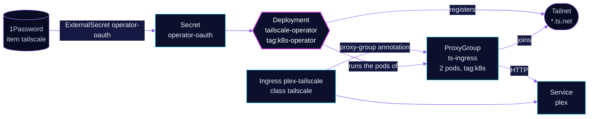

<!-- header: icon=share-2 -->
<!-- concept: From a Service to a tailnet device | tag Annotate | cpu Operate | server Proxy | share-2 Tailnet | users Reach -->
<p align="center"></p>

> Puts selected cluster services on the tailnet through shared Tailscale proxy pods.

**Live facts:** <https://skrumbach.github.io/home-ops/apps/network/tailscale-operator/> (workloads, routes, storage, backups, secrets and alerts, generated on every merge)

## What it does

- **Exposes services on the tailnet.** The operator watches Ingresses with `ingressClassName: tailscale` and
  Services with Tailscale annotations, and creates proxy pods that join the tailnet as `tag:k8s` devices named
  `<hostname>.<tailnet>.ts.net`. Proxy pods are created in `network`, whichever namespace the service is in.
- **Shares proxies.** ProxyGroup `ts-ingress` runs 2 shared proxy pods with tag `tag:k8s`. An object opts in with
  `tailscale.com/proxy-group: ts-ingress`; without it the operator makes a dedicated proxy pod.
- **Exposes nothing by itself.** No exposure is configured by this app; the annotations go on the app that owns
  the service. Today that is Ingress `plex-tailscale` in `media/plex`.
- **Leaves the API server alone.** The API server proxy is off (`apiServerProxyConfig.mode: "false"`): no kubectl
  over the tailnet.

## Why it is built this way

| Choice | Why |
|---|---|
| **Two Flux Kustomizations** | `tailscale-operator` installs the chart and its CRDs and waits. `tailscale-operator-config` depends on it and applies `ProxyGroup`, which needs the CRDs to exist. |
| **A shared ProxyGroup** | Many exposed services share 2 proxy pods instead of one pod each. Services opt in by annotation. |
| **Two tags** | The operator joins as `tag:k8s-operator`; the devices it creates are `tag:k8s`. The ACL lets the first own the second. |
| **OAuth client from 1Password** | ExternalSecret `operator-oauth` extracts `client_id` and `client_secret` from item `tailscale`. Nothing secret is in Git. |
| **Plex over the tailnet, not the tunnel** | Plex left the public gateway; its CiliumNetworkPolicy admits the ProxyGroup pods (`tailscale.com/parent-resource: ts-ingress`) on TCP 32400 only. |

## How it works

<p align="center"></p>

<details>
<summary><b>Resource graph</b>: every object involved, by name</summary>



</details>

1. **Flux.** Kustomization `tailscale-operator` ([overlay](../../../main/network/tailscale-operator.yaml)) waits
   for `onepassword-store`, applies `app/` and waits. Kustomization `tailscale-operator-config` then applies
   `config/` (the ProxyGroup).
2. **Login.** The operator mounts Secret `operator-oauth` and joins the tailnet as `tailscale-operator` with
   `tag:k8s-operator`.
3. **Expose.** An annotated Ingress or Service makes the operator create or reuse a proxy pod. The pod joins the
   tailnet with `tag:k8s` and forwards to the Service.
4. **Reach.** A tailnet user opens `https://<hostname>.<tailnet>.ts.net`; the proxy terminates TLS with a real
   certificate and forwards plain HTTP to the Service.

## Settings that matter

Values are in [`app/helmrelease.yaml`](app/helmrelease.yaml) and [`config/proxygroup.yaml`](config/proxygroup.yaml).
The chart is the home-operations mirror, pinned in [`app/ocirepository.yaml`](app/ocirepository.yaml).

| Setting | Value | Why |
|---|---|---|
| `operatorConfig.defaultTags` | `tag:k8s-operator` | The operator's own tag. |
| `proxyConfig.defaultTags` | `tag:k8s` | Tag of every proxy the operator creates. |
| `apiServerProxyConfig.mode` | `"false"` | No kubectl over the tailnet. |
| `operatorConfig.image`, `proxyConfig.image` | `ghcr.io/tailscale/k8s-operator`, `ghcr.io/tailscale/tailscale` | See Invariants (Docker Hub limits). |
| ProxyGroup `type`, `replicas`, `tags` | `ingress`, `2`, `tag:k8s` | Shared proxy pods for Ingress and Tailscale Services. Tags cannot change later. |
| `operatorConfig.resources` | 10m CPU, 128Mi request, 256Mi limit | The request is explicit; a limit-only container would reserve all 256Mi. |
| `oauthSecretVolume` | Secret `operator-oauth` | Credentials come from the ExternalSecret. |

## Operate it

### Verify

```bash
kubectl get externalsecret -n network operator-oauth
kubectl get deploy,pods -n network | grep -i -E 'operator|ts-ingress'
kubectl get proxygroup ts-ingress          # READY / status
```

`tailscale-operator` (tag `tag:k8s-operator`) must appear under Machines.

### One-time Tailscale setup

1. **DNS**: enable MagicDNS and HTTPS certificates (Admin console > DNS).
2. **ACL policy** (Access controls) needs the tags and the Services auto-approver:
   ```json
   "tagOwners": {
     "tag:k8s-operator": [],
     "tag:k8s": ["tag:k8s-operator"]
   },
   "autoApprovers": {
     "services": {"tag:k8s": ["tag:k8s"]}
   }
   ```
   Also make sure a grant lets your users reach `tag:k8s` (the default allow-all
   policy already does).
3. **OAuth client** (Settings > Trust credentials > + Credential > OAuth), scopes
   with **Write**, each tagged `tag:k8s-operator`:
   - Devices > Core
   - Keys > Auth Keys
   - General > Services
4. **1Password**: item `tailscale` in a Connect-visible vault (`Homelab`, not
   `Home-Lab`) with fields `client_id` and `client_secret`. `SecretSynced` does
   not mean the fields are non-empty; check the decoded key length if the
   operator fails to log in.

### Expose a service

Exposed services become `tag:k8s` devices named `<hostname>.<tailnet>.ts.net`.
Proxy pods are created in `network`, whichever namespace the service is in.
No exposure is configured by this app; add the annotations to the app that owns
the service.

**HTTP/HTTPS (Plex, web UIs): Ingress**

```yaml
apiVersion: networking.k8s.io/v1
kind: Ingress
metadata:
  name: plex-tailscale
  annotations:
    tailscale.com/proxy-group: ts-ingress   # share proxies; omit for a dedicated proxy pod
spec:
  ingressClassName: tailscale
  defaultBackend:
    service:
      name: plex
      port:
        number: 32400
  tls:
    - hosts: [plex]      # becomes https://plex.<tailnet>.ts.net
```

The proxy terminates TLS with a real certificate and forwards plain HTTP to the
Service. Add `tailscale.com/funnel: "true"` only to publish to the public internet.

**TCP (database, anything non-HTTP): annotate the Service**

Simplest, no Service type change; creates one dedicated proxy pod per Service:

```yaml
metadata:
  annotations:
    tailscale.com/expose: "true"
    tailscale.com/hostname: postgres      # postgres.<tailnet>.ts.net:5432
```

Alternative with shared proxies: `type: LoadBalancer`, `loadBalancerClass: tailscale`
and `tailscale.com/proxy-group: ts-ingress`. Verify this on the first use, because the
ProxyGroup path for plain TCP is newer than the per-Service one.

Restrict who can reach a database with a grant on `tag:k8s` ports in the ACL
policy, not just by obscurity of the hostname.

**Cluster to tailnet (egress)**

```yaml
apiVersion: v1
kind: Service
metadata:
  name: nas
  annotations:
    tailscale.com/tailnet-fqdn: nas.<tailnet>.ts.net
spec:
  type: ExternalName
  externalName: placeholder   # the operator rewrites this
```

**Sharing with people outside your tailnet**

Admin console > Machines > the exposed device (for example `plex`) > Share.
The recipient sees only that node. Revoke it from the same menu.

## Invariants

- A `ProxyGroupPolicy` can restrict which namespaces may use a ProxyGroup. If an
  Ingress or Service with the `proxy-group` annotation is rejected, check for one.
- Proxy pods are privileged-ish (`NET_ADMIN`); the namespace Pod Security
  labels are warn/audit only, so expect warnings, not rejections.
- ProxyGroup `tags` cannot change after the devices are created; recreate the group.
- Operator and proxy images are pinned to `ghcr.io/tailscale/*` to avoid Docker Hub
  limits. Chart bumps move the default image tag with them (Renovate bumps the
  OCIRepository).
- Retiring: delete exposed Ingress/Service annotations first, then the app, so the
  operator can clean up devices in the tailnet. Stale devices can be removed by hand.
- `SecretSynced` does not mean the fields are non-empty, and Connect cannot see `Home-Lab` (see One-time
  setup, step 4).

Upstream: [Tailscale Kubernetes operator](https://tailscale.com/kb/1236/kubernetes-operator)
