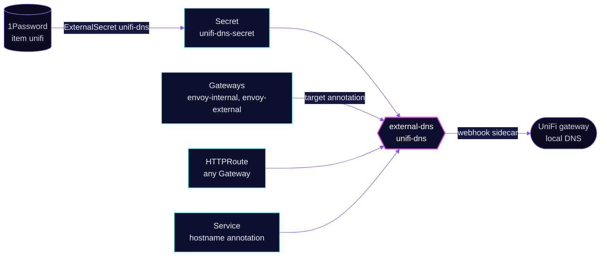

<!-- header: icon=router -->
<!-- concept: From a route or Service to a LAN DNS record | route Route | tag Target | router Router | refresh-cw Sync | activity Watch -->
<p align="center"></p>

> Writes the internal LAN DNS records into the UniFi gateway for routes and annotated Services.

**Live facts:** <https://skrumbach.github.io/home-ops/apps/network/unifi-dns/> (workloads, routes, storage, backups, secrets and alerts, generated on every merge)

## What it does

- **Publishes internal hostnames.** It runs external-dns with a webhook provider that talks to the UniFi
  controller. It watches `gateway-httproute` and `service`.
- **Watches every Gateway.** Unlike `cloudflare-dns` there is no `--gateway-name`, so routes on
  `envoy-internal` and `envoy-external` both get a LAN record. Services are read too: a LoadBalancer Service
  with `external-dns.kubernetes.io/hostname` gets a record, for example `kube-api` (`talos.sklab.dev`) and
  `postgres-18-lb` (`postgres-18.sklab.dev`).
- **Stays inside one zone.** `domainFilters` is `sklab.dev`.
- **Owns its records.** TXT ownership records use prefix `k8s.main.` and owner id `main`. `policy: sync`
  deletes a record when its source goes away.
- **Is the public half's twin.** [`network/cloudflare-dns`](../cloudflare-dns/README.md) writes the public records.

## Why it is built this way

| Choice | Why |
|---|---|
| **Split from `cloudflare-dns`** | Internal and public records have different audiences and providers. Only this instance reads Services, so a Service annotation can only make an internal-only record. |
| **A webhook provider** | `provider.name: webhook` with the `external-dns-unifi-webhook` sidecar is how this instance reaches the UniFi API. The manifest records no further reason. |
| **The Gateway decides the target** | A route's record points at the parent Gateway's `external-dns.kubernetes.io/target` annotation (`internal.sklab.dev` or `external.sklab.dev`), not at a route annotation. |

## How it works

<p align="center"></p>

<details>
<summary><b>Resource graph</b>: every object involved, by name</summary>



</details>

1. **Flux.** Kustomization `unifi-dns` ([overlay](../../../main/network/unifi-dns.yaml)) waits for
   `onepassword-store` and applies `app/` into `network`.
2. **Secret.** ExternalSecret `unifi-dns` builds Secret `unifi-dns-secret` from 1Password item `unifi`
   (`UNIFI_API_URL` as `UNIFI_HOST`, `UNIFI_API_KEY`). Reloader restarts the pod when it changes.
3. **Watch.** `triggerLoopOnEvent: true` starts a sync when a route or Service changes.
4. **Write.** external-dns hands the desired records to the webhook sidecar, which creates them on the UniFi
   gateway. Hand-made static records live in `terraform/unifi/dns.tofu` and are not touched here.

## Settings that matter

Values are in [`app/helmrelease.yaml`](app/helmrelease.yaml). The chart and the webhook image are pinned
there and in [`app/ocirepository.yaml`](app/ocirepository.yaml); Renovate bumps them.

| Setting | Value | Why |
|---|---|---|
| `sources` | `gateway-httproute`, `service` | Routes on any Gateway, plus annotated Services. |
| `provider.name` | `webhook` | The UniFi webhook sidecar is the provider. |
| `policy` | `sync` | Records are created, updated and deleted. |
| `txtPrefix`, `txtOwnerId` | `k8s.main.`, `main` | Ownership TXT records. The manifest records no reason for the `main` value. |
| `domainFilters` | `sklab.dev` | Limits the instance to one zone. |
| webhook probes | `/healthz`, `/readyz` on `http-webhook` | Both probes wait 10 s first. |
| `resources` | agent 25m / 64Mi request, 192Mi limit; webhook 25m / 32Mi request, 128Mi limit | The manifest records no reason. |

## Operate it

```bash
flux -n network get ks unifi-dns
flux -n network get hr unifi-dns
kubectl -n network get externalsecret unifi-dns
kubectl -n network logs deploy/unifi-dns --all-containers --tail=50   # UniFi API errors come from the webhook
kubectl get svc -A -o yaml | grep -B8 'external-dns.kubernetes.io/hostname'
```

### When an alert fires

| Alert | Fires when | First look |
|---|---|---|
| `ExternalDNSStale` | no completed sync for over 3 minutes, for 5 minutes | The rule sits in [`cloudflare-dns`](../cloudflare-dns/app/prometheusrule.yaml) and covers both instances; the `job` label says which. Pod logs, then the UniFi API key (`SecretSynced` does not mean the fields are non-empty). |

## Invariants

- **external-dns owns every app record.** Hand-made local records are the only ones in
  `terraform/unifi/dns.tofu` (the NAS), and an app record is never declared there. The owner is `main` and the TXT
  prefix `k8s.main.`; keep both in step with that file's header.

Upstream: [external-dns-unifi-webhook](https://github.com/home-operations/external-dns-unifi-webhook)
