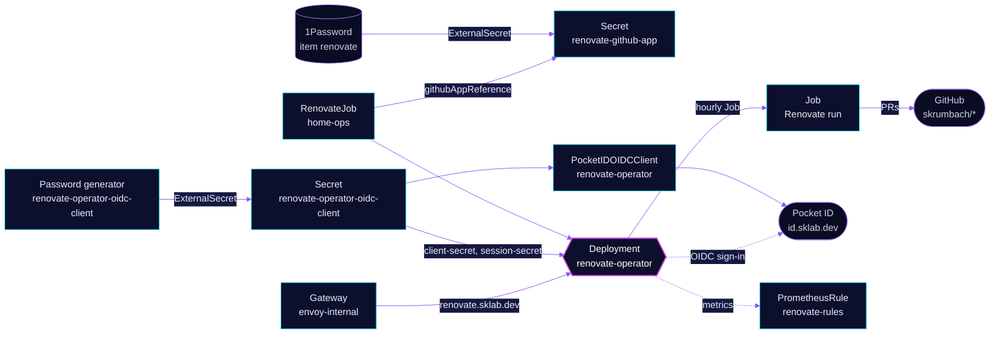

<!-- header: icon=refresh-cw -->
<!-- concept: From a schedule to a dependency pull request | clock Schedule | search Discover | package-search Check | git-pull-request Open PR -->
<p align="center"></p>

> Runs Renovate hourly inside the cluster and is the only writer of dependency pull requests for `skrumbach/*`.

**Live facts:** <https://skrumbach.github.io/home-ops/apps/renovate/renovate-operator/> (workloads, routes, storage, backups, secrets and alerts, generated on every merge)

The namespace document, [`renovate/README.md`](../README.md), holds the rollback steps for the GitHub Actions workflow.

## What it does

- **Runs Renovate on a schedule.** `RenovateJob` `home-ops` (`0 * * * *`) starts one Renovate Job per run. Each run
  discovers `skrumbach/*` and works on the repositories that have a Renovate config (`requireConfig: required`).
- **Authenticates as a GitHub App.** `githubAppReference` reads `APP_ID`, `INSTALL_ID` and `PEM` from Secret
  `renovate-github-app`, which the `renovate-jobs` Kustomization builds from 1Password item `renovate` (vault `Homelab`).
- **Serves a UI** at `renovate.sklab.dev` on `envoy-internal` only. People sign in through Pocket ID client
  `renovate-operator`, restricted to the `admins` group.
- **Exports metrics.** A ServiceMonitor, a Grafana dashboard (folder `Operators`) and the PrometheusRule
  `renovate-rules` come from this app.

## Why it is built this way

| Choice | Why |
|---|---|
| **In-cluster operator, not the GitHub Actions workflow** | `.github/workflows/renovate.yaml` is manual only and kept as the rollback; the operator is the live writer. |
| **Two Kustomizations, `renovate-operator` and `renovate-jobs`** | The `RenovateJob` CRD ships with the operator chart, so the job can only apply after the operator is installed (`dependsOn`). |
| **`authorization.enabled: false`** | Every signed-in user is admin, so Pocket ID decides who gets in: the client allows only the `admins` group. |
| **OIDC secrets generated in the cluster** | ExternalSecret `renovate-operator-oidc-client` uses a `Password` generator with `refreshPolicy: CreatedOnce`. Nothing is stored in 1Password and nothing rotates it. |
| **Self-update stays a reviewed PR** | `.renovate/autoMerge.json5` never auto-merges anything under `kubernetes/apps/base/renovate/**`. |
| **GitHub App key rewrapped by a template** | The 1Password item holds a headerless one-line PKCS#1 body. The operator only parses a PEM, so the ExternalSecret adds the header and footer. |

## How it works

<p align="center"></p>

<details>
<summary><b>Resource graph</b>: every object involved, by name</summary>



</details>

1. Flux applies `renovate-operator` after `onepassword-store`. Its health check is the Deployment, not the HelmRelease,
   because a HelmRelease check stays Ready through a crashloop.
2. `renovate-jobs` applies after both. It creates Secret `renovate-github-app` and `RenovateJob` `home-ops`.
3. On the hour the operator starts a Renovate Job (`parallelism: 1`, `backoffLimit` 0). A failed run is not retried;
   the next hourly run is the retry. Finished Jobs are removed after 24 hours.
4. The UI redirects people to Pocket ID. The callback is `https://renovate.sklab.dev/auth/callback`, with PKCE.
   The pod fetches the issuer from `https://id.sklab.dev` through envoy-external's LoadBalancer IP.
5. Reloader restarts the operator when Secret `renovate-operator-oidc-client` changes (`secret.reloader.stakater.com/reload`).
   After a regeneration the old client secret stays valid in Pocket ID for `clientSecretOverlap: 1h`.

## Settings that matter

| Setting | Value | Why |
|---|---|---|
| `config.defaultJobBackoffLimit` | `0` | Matches the retired CronJob: one attempt per run, the next hourly run is the retry. |
| `config.jobTTLSecondsAfterFinished` | `86400` | The manifest records no reason. |
| `spec.schedule` (`renovatejob.yaml`) | `0 * * * *` | Hourly. The manifest records no reason. |
| `discoveryFilters` | `skrumbach/*` | Every repository the App installation can see. `requireConfig: required` skips repositories without a Renovate config, so unconfigured repositories and forks stay untouched. |
| `renovateConfig.inline` | `onboarding: false`, `requireConfig: required`, `platformCommit: enabled`, `gitNoVerify: [commit, push]`, `internalChecksFilter: strict`, `configValidationError: true`, `binarySource: install` | The manifest records no reason for these. |
| `auth.oidc.redirectScheme` | `https` | TLS ends at `envoy-internal`, so the auto-detected redirect would be `http`. |
| `allowedUserGroups` (`pocketidoidcclient.yaml`) | `admins` in namespace `security` | The only access control, because `authorization.enabled` is `false`. |
| `callbackUrls`, `logoutCallbackUrls` | `https://renovate.sklab.dev/auth/callback`, `https://renovate.sklab.dev` | The path is fixed by the operator. Logout sends the redirect URL cut before `/auth/` as `post_logout_redirect_uri`. |
| `secret.enabled` (`PocketIDOIDCClient`) | `false` | The app reads its credentials from `renovate-operator-oidc-client`, so no copy is needed. |
| `Password` generator | 64 characters, alphanumeric (`symbols: 0`), keys `client-secret` and `session-secret` | Pocket ID takes printable ASCII, and the value is pasted into JSON and Python. |
| `resources` | operator: 10m CPU, 64Mi request, 256Mi limit; Renovate Job: 100m CPU, 512Mi request, 2Gi limit | The manifest records no reason. |
| `INSTALL_ID` (`jobs/externalsecret.yaml`) | the installation of `skrumbach` for the `mortyops` App | Not a secret, so it sits in Git. |

## Operate it

```bash
flux -n renovate get ks renovate-operator renovate-jobs
kubectl -n renovate get renovatejob,jobs,pods
kubectl -n renovate logs deploy/renovate-operator
kubectl -n renovate logs job/<job-name>              # one Renovate run
kubectl -n renovate get externalsecret,pocketidoidcclient
```

To stop the writer and fall back to the workflow, follow the rollback in [`renovate/README.md`](../README.md).

### When an alert fires

From [`app/prometheusrule.yaml`](app/prometheusrule.yaml), routed by the `alerts` component.

| Alert | Fires when | First look |
|---|---|---|
| `RenovateRunFailed` | runs for a project failed for 2h | The renovate UI, or the latest Job logs in namespace `renovate`. |
| `RenovateRunMissing` | no completed run in 8h, and the job is not suspended | That the `RenovateJob` is not suspended and that 1Password item `renovate` (`BOT_APP_ID`, `BOT_APP_PRIVATE_KEY`) still resolves. |
| `RenovateDiscoveryEmpty` | discovery found no repository for 2h | The App installation lost access, or the token could not be minted. |
| `RenovateJobSuspended` | `home-ops` has been suspended for 12h | `spec.suspend` in `renovatejob.yaml`. |
| `RenovateOperatorAbsent` | no metrics for the job for 1h | The operator is down, the ServiceMonitor is not scraped, or Flux did not apply `jobs/`. |

## Invariants

- Deleting `PocketIDOIDCClient` `renovate-operator` deletes the client in Pocket ID.
- `clientID` is immutable once created and must match `auth.oidc.clientId` in `app/helmrelease.yaml`.
- The OIDC client secret and session secret exist only in the cluster. They change only when the ExternalSecret or its Secret is deleted.

Upstream: [renovate-operator](https://github.com/mogenius/renovate-operator) •
[Renovate docs](https://docs.renovatebot.com/)
