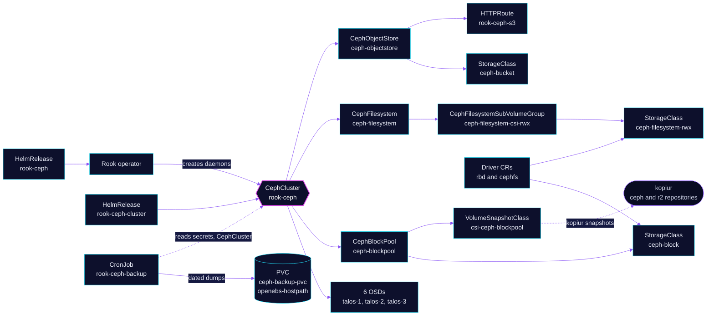

<!-- header: icon=hard-drive -->
<!-- concept: From six NVMe drives to replicated cluster storage | file-cog Declare | hard-drive Provision | copy Replicate | plug Attach | archive Protect -->
<p align="center"></p>

> Rook runs one Ceph cluster on the three nodes' NVMe drives and serves block, file and S3 storage to every namespace.

**Live facts:** <https://skrumbach.github.io/home-ops/apps/rook-ceph/rook-ceph/> (workloads, routes, storage, backups, secrets and alerts, generated on every merge)

## What it does

- **Runs the Ceph cluster.** The `rook-ceph-cluster` chart renders the `CephCluster` `rook-ceph`: three mons, the
  mgr, six OSDs (two NVMe drives on each of `talos-1`, `talos-2` and `talos-3`), a toolbox Deployment and the
  crash collector. The operator creates the daemons from that CR.
- **Serves block storage.** Pool `ceph-blockpool` (size 3, failure domain host) backs StorageClass `ceph-block`,
  the default class, and VolumeSnapshotClass `csi-ceph-blockpool`.
- **Serves shared files.** Filesystem `ceph-filesystem` (two active MDS plus standbys) backs
  `ceph-filesystem-rwx`, the class every RWX claim uses. It sits on the subvolume group `csi-rwx`
  ([`cluster/storageclass.yaml`](cluster/storageclass.yaml)).
- **Serves S3.** `CephObjectStore` `ceph-objectstore` runs two RGW instances. StorageClass `ceph-bucket` hands out
  `ObjectBucketClaim` buckets, and HTTPRoute `rook-ceph-s3` publishes `s3.sklab.dev` on `envoy-internal`.
- **Wires the CSI drivers.** The operator chart enables the RBD and CephFS drivers. [`operator/rbac.yaml`](operator/rbac.yaml)
  holds the CSI ServiceAccounts and RBAC, and [`operator/driver.yaml`](operator/driver.yaml) adds tolerations to the
  two `Driver` CRs.
- **Keeps a metadata backup.** CronJob `rook-ceph-backup` dumps the mon secrets and the `CephCluster` to the PVC
  `ceph-backup-pvc` every day at 03:00 UTC.

## Why it is built this way

| Choice | Why |
|---|---|
| **Two Flux Kustomizations, operator first** | `rook-ceph` installs the operator and its CRDs. `rook-ceph-cluster` `dependsOn` it because the operator owns the `ceph.rook.io` CRDs the cluster chart renders. |
| **Host networking, msgr2 only** | `network.provider: host` with `requireMsgr2: true`. Every Ceph daemon then sits on a node IP, which is why the host firewall `ceph-lan-isolation` in `kube-system/cilium` exists. |
| **Fixed disks by `/dev/disk/by-id`** | `useAllNodes` and `useAllDevices` are `false`. Only the six named drives become OSDs, one OSD per device. |
| **Mons on `openebs-hostpath`, not Ceph** | Each mon takes a 10Gi `openebs-hostpath` claim. The manifest records no reason. |
| **Replica 3 across hosts on every pool** | Size 3 with failure domain `host` puts one copy of every object on each node. |
| **A separate `ceph-filesystem-rwx` class** | The default CephFS group `csi` still returns `EINVAL`. The `csi-rwx` group is the working one, so a class pins it by `clusterID`. |
| **Overrides kept in Git** | The `volumesnapshotclass-patch.yaml` adds the `pool` parameter the chart's class lacks. Without it the CSI driver searches `.rgw.root`. |
| **`prune: disabled` on both HelmReleases and the `Driver` CRs** | Deleting a Flux Kustomization deletes its resources whatever `prune` says. The annotation keeps the cluster and the CSI drivers in place through that. |
| **No `wait` on `rook-ceph-cluster`** | `wait: true` would ignore `healthChecks`. The chart renders only the toolbox; the operator creates the daemons. So the health checks are the toolbox Deployment and the `CephCluster`, whose `status.phase` a `healthCheckExprs` rule reads. |

## How it works

<p align="center"></p>

<details>
<summary><b>Resource graph</b>: every object involved, by name</summary>



</details>

1. Flux applies `rook-ceph` (the `operator/` piece): the chart with its CRDs, the CSI RBAC and the two `Driver`
   patches. The `rook-ceph-cluster` Kustomization waits for it, for `onepassword-store` and for `openebs-hostpath`.
2. The `cluster/` piece installs the `rook-ceph-cluster` chart and pulls in `../backup`. The chart's `cephClusterSpec`
   becomes the `CephCluster`, and the pool, filesystem and object store lists become their CRs and StorageClasses.
3. The operator reads the `CephCluster`, starts mons on `openebs-hostpath`, prepares an OSD on each named drive and
   starts the mgr, MDS and RGW daemons. `cephConfig` is applied to the mon config database.
4. A PVC on `ceph-block` or `ceph-filesystem-rwx` goes to the CSI provisioner, which creates an RBD image or a
   CephFS subvolume in group `csi-rwx`. The node plugin maps it on the pod's node.
5. kopiur snapshots RBD claims through `csi-ceph-blockpool`. That is the data backup. The `rook-ceph-backup`
   CronJob saves only the mon secrets, the admin keyring, the `CephCluster` and the mon endpoints, not data.

## Settings that matter

| Setting | Value | Why |
|---|---|---|
| `cephClusterSpec.security.cephx.daemon` | `keyType: aes256k`, `keyGeneration: 2` | The next rotation sets `keyGeneration` to the current value plus one. `csi` stays `aes`, because kernel clients need Linux 7.0 or newer. |
| `mon_auth_allow_insecure_key`, `mon_auth_emergency_allowed_ciphers` | left alone | Turning them off cuts auth on every RBD map and CephFS mount. They cause the `AUTH_INSECURE_*` warnings. |
| `client.rgw.rgw_sigv4_insecure` | `"false"` | Restores the CVE-2026-54330 `x-amz-*` check. Rook does not delete a removed key from the mon DB, so the key stays. After a Ceph bump, an unsigned content-type PUT must return 200 and an unsigned `x-amz-*` PUT 403. |
| `osd.osd_memory_target`, OSD `resources` | 10 GiB, request 12Gi, limit 14Gi | The target is the BlueStore cache, not RSS. The request sits above the 9317 Mi peak, and the limit lets a spike burst. OSDs stay Burstable. |
| `osd_mclock_profile` | `high_client_ops` | Client I/O outranks background work on latency-sensitive drives. |
| `osd.N.osd_mclock_max_capacity_iops_ssd` | 15000 (Samsung), 7000 (Lexar NM790) | Literature caps, not fio runs. A set cap makes the OSD skip its own benchmark. There is no `osd.1`. |
| `osd_max_scrubs`, `osd_scrub_begin_hour`, `osd_scrub_end_hour` | `1`, `1`, `7` | One scrub per OSD, only between 01:00 and 07:00. |
| `bluestore_slow_ops_warn_threshold`, `_lifetime` | `5`, `3600` | Threshold 5 is Ceph's own non-default and still trips on a real stall. A one-hour lifetime stops one stall latching `HEALTH_WARN` for a day and blocking the reboot gate. |
| `osdMaxUpdatesInParallel` | `1` | Under `storage`, not the spec root. The CRD default is 20. |
| `mds_cache_memory_limit` and MDS limit | 8 GiB, 10Gi | The pod limit stays above the cache limit plus headroom. |
| `placement.all.tolerations` | `home-operations.com/dedicated`, `tuppr.home-operations.com/outdated`, both `PreferNoSchedule` | Rook drops a node with any untolerated taint, `PreferNoSchedule` included, so tuppr's taint would skip every OSD update. `all` covers mon, osd and mgr, not MDS or RGW. |
| `mon` and `logcollector` resources | requests equal limits | Guaranteed QoS, so the Talos OOMController skips them. The manifest says not to copy this onto MDS. |
| `compression_mode` on pools | `none`; StorageClass `ceph-block` says `aggressive` and `zstd` | Media and RBD never hit the ratio, and zstd added write latency on these drives. The class parameters are immutable and only tag new images, so the pool's `none` governs. |
| Pool `parameters.bulk` | `"true"` | Lets the autoscaler grow PGs. Do not set `pg_num` by hand. |
| `dataPools` `deviceClass` | unset | A shadow CRUSH root made the autoscaler skip every pool. |
| `mgr.modules` `rook`, `nfs`, `insights` | `false` | No consumer of the Rook orchestrator. `nfs` crash-reports through the disabled `rook` module, so re-enable it only together with `rook`. The manifest records no reason for `insights`. |
| `csi.cephfs.kernelMountOptions` | `ms_mode=prefer-crc` | The kernel client then uses msgr2. |
| Operator `resources.limits.memory` | `1Gi` | The chart default 512Mi OOMKilled the operator, and `limits: {}` does not clear it. |
| `preserveFilesystemOnDelete` | `true` | A deleted CR leaves the filesystem. `preservePoolsOnDelete` on the object store is `false`. The manifest records no reason for the difference. |
| `osd.0` device | Samsung 980 PRO on `talos-1` | A stopgap with a known silent-write fault. Checksums and size 3 contain a bad read. Do not mark it out. |

## Operate it

```bash
flux -n rook-ceph get ks rook-ceph rook-ceph-cluster
flux -n rook-ceph get hr
kubectl -n rook-ceph get cephcluster,cephblockpool,cephfilesystem,cephobjectstore
kubectl -n rook-ceph get pods -o wide
kubectl get sc,volumesnapshotclass | grep -i ceph
kubectl -n rook-ceph get cronjob,pvc rook-ceph-backup ceph-backup-pvc
kubectl -n rook-ceph get cm -l backup-type=ceph-metadata --sort-by=.metadata.creationTimestamp
task rook:check-disks
task rook:check-osd-device-paths      # reboot gate, see Invariants
```

Cluster state needs `exec` into the toolbox, which only the admin kubeconfig grants. These commands only read:

```bash
kubectl -n rook-ceph exec deploy/rook-ceph-tools -- ceph status
kubectl -n rook-ceph exec deploy/rook-ceph-tools -- ceph osd tree
kubectl -n rook-ceph exec deploy/rook-ceph-tools -- ceph health detail
kubectl -n rook-ceph exec deploy/rook-ceph-tools -- ceph df
```

Recovery, in order of how bad it is:

- An OSD that will not start, or device-path drift:
  [`ceph-osd-recovery.md`](../../../../../.agents/skills/incident-runbooks/references/ceph-osd-recovery.md).
- Planned power-down and power-up of the nodes:
  [`power-down-up.md`](../../../../../.agents/skills/incident-runbooks/references/power-down-up.md).
- Whole-cluster restore from kopiur backups:
  [`restore.md`](../../../../../.agents/skills/incident-runbooks/references/restore.md).
- Emergency recovery, including the post-rebuild RGW realm, zone and system user:
  [`backup/RECOVERY-PROCEDURES.md`](backup/RECOVERY-PROCEDURES.md).

### When an alert fires

The rules are in [`cluster/prometheusrule.yaml`](cluster/prometheusrule.yaml).

| Alert | Fires when | First look |
|---|---|---|
| `CephOSDDown`, `CephOSDOut`, `CephOSDFlapping`, `CephOSDRestarts` | An OSD is down, out, flapping or restarting | `ceph osd tree`, then the OSD pod. If it sits in `Init` or `CrashLoopBackOff`, read `ceph-osd-recovery.md`. |
| `CephOSDSlowOps`, `CephOSDHighLatency`, `CephOSDLatencyDisparity` | Slow ops or latency on one OSD | `ceph health detail` for the OSD id, then the drive model in `cluster/helmrelease.yaml`. |
| `CephClusterNearFull`, `CephClusterCriticallyFull`, `CephOSDNearFull`, `CephOSDFull` | Cluster or OSD fill level | `ceph df` and `ceph osd df` in the toolbox. |
| `CephPGDegraded`, `CephPGInactive`, `CephPGInconsistent`, `CephPGRecoveryFull` | PGs are not clean | `ceph health detail`, then `ceph pg ls` for the PG states. |
| `CephMonitorQuorumAtRisk`, `CephMonitorMemoryHigh` | Mon quorum or memory | `ceph status`, then the mon pods on `openebs-hostpath`. |
| `CephCrashesDetected` | The crash collector holds new crashes | `ceph crash ls` in the toolbox. |

## Invariants

- **Never run `ceph auth` or `ceph config set` by hand.** CephX and Ceph config are GitOps only. Change
  `cephClusterSpec.cephConfig` or `security.cephx` in `cluster/helmrelease.yaml`.
- **Never set `security.cephx.csi: aes256k`.** `keyGeneration` only increases.
- **`rgw_sigv4_insecure` stays explicitly `"false"`.** After a Ceph bump, RGW PUTs can return 403 while the
  cluster reports `HEALTH_OK`.
- **Before any node reboot:** `ceph status` must be `HEALTH_OK` and `task rook:check-osd-device-paths` must be
  clean. Reboot one node at a time. Never use `just talos shutdown-node` for planned power work.
- **The metadata backup is OpenEBS hostpath.** A host wipe destroys `ceph-backup-pvc`. Emergency steps:
  [`backup/RECOVERY-PROCEDURES.md`](backup/RECOVERY-PROCEDURES.md).
- **Do not delete [`operator/rbac.yaml`](operator/rbac.yaml).** Rook ships no CSI ServiceAccounts or RBAC
  (rook/rook#17644). Without them `ctrlplugin` and `nodeplugin` stay at `FailedCreate` and every RBD and CephFS
  attach fails. On each Rook minor, diff it against `helm template` of the matching `ceph-csi-drivers` chart.
- **Keep `prune: disabled` and `ssa: Merge` on the `Driver` CRs.** Otherwise Flux deletes the operator-owned
  Drivers and every RBD and CephFS mount with them.
- **Do not delete `CephFilesystemSubVolumeGroup` `ceph-filesystem-csi-rwx`.** Four RWX claims use it, and the
  `clusterID` in `ceph-filesystem-rwx` must match its `status.info.clusterID`.
- **Leave new claims off `ceph-filesystem`.** Use `ceph-filesystem-rwx` for RWX.
- **talos-3 has a `PreferNoSchedule` taint.** A hard `NoSchedule` strands drains. MDS and RGW have no toleration
  for it.

Upstream: [Rook docs](https://rook.io/docs/rook/latest-release/), [Ceph docs](https://docs.ceph.com/)
