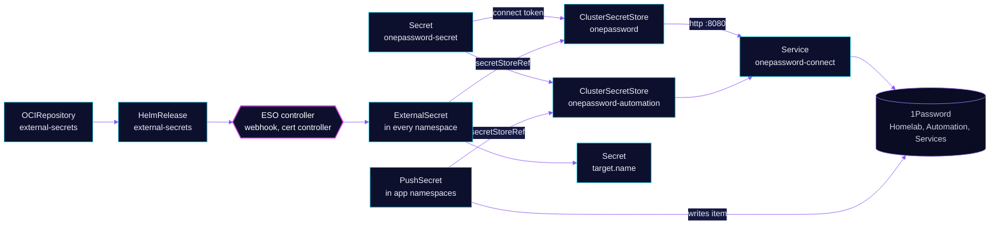

<!-- header: icon=vault -->
<!-- concept: From a 1Password item to a Kubernetes Secret | vault Item | plug Connect | download Sync | key-round Secret | refresh-cw Refresh -->
<p align="center"></p>

> Turns 1Password items into Kubernetes Secrets, and generated values or Secrets into 1Password items, through Connect.

**Live facts:** <https://skrumbach.github.io/home-ops/apps/security/external-secrets/> (workloads, routes, storage, backups, secrets and alerts, generated on every merge)

## What it does

- **Syncs** every `ExternalSecret` in the cluster into a Secret. Apps name a store, an item and fields; nothing secret is in Git.
- **Reads through one store.** `ClusterSecretStore` `onepassword` reads vaults `Homelab`, `Automation` and `Services`, in that priority order
  ([`stores/clustersecretstore.yaml`](stores/clustersecretstore.yaml)).
- **Writes through a second.** `onepassword-automation` lists vault `Automation` only
  ([`stores/clustersecretstore-automation.yaml`](stores/clustersecretstore-automation.yaml)), so a `PushSecret` that names it always lands there.
- **Generates values.** `Password` generators plus an `ExternalSecret` with `refreshPolicy: CreatedOnce` create a value once, in the cluster.
- **Validates and injects.** The webhook admits ESO objects, the cert controller keeps its CA bundle current.

## Why it is built this way

| Choice | Why |
|---|---|
| **Two Flux Kustomizations** | `external-secrets` installs the chart and the CRDs. `onepassword-store` ([overlay](../../../main/security/external-secrets.yaml)) applies the stores, `wait: true`, and depends on both this app and `onepassword-connect`. A store cannot apply before its CRD exists. |
| **A separate write store** | The read store resolves by vault priority. A `PushSecret` through it could land in `Homelab`. `onepassword-automation` can only name `Automation`. |
| **Cluster-scoped stores** | A namespaced store may only reference a Secret in its own namespace, and the Connect token Secret `onepassword-secret` lives in `security`. |
| **Two webhook replicas, spread by node** | A webhook outage blocks every ESO object apply. `maxSkew: 1` on `kubernetes.io/hostname` keeps one drain from taking both. The manifest comment says `nodeTaintsPolicy: Honor` does not see the talos-3 `PreferNoSchedule` taint. |
| **A webhook PDB** | `pdb.yaml` sets `minAvailable: 1` for `external-secrets-webhook`. |

## How it works

<p align="center"></p>

<details>
<summary><b>Resource graph</b>: every object involved, by name</summary>



</details>

1. Flux applies `app/`. The HelmRelease depends on `onepassword-connect` and installs the controller, the webhook and the cert controller.
2. Flux then applies `stores/`. Both stores point at `http://onepassword-connect.security.svc.cluster.local:8080` and read the token from key `token` in Secret `onepassword-secret`.
3. An `ExternalSecret` names store `onepassword`, an item and fields. ESO asks Connect, which returns the item from the first vault that has it, and ESO writes the target Secret.
4. A `PushSecret` that names `onepassword-automation` writes an item into `Automation`. Three do: `ai/toolhive`, `media/seerr` and `media/wizarr`. The others still name `onepassword`, see [Known gaps](#known-gaps).
5. The generated-secret pattern holds no 1Password item. The `Password` generator and `refreshPolicy: CreatedOnce` produce the value once; `monitoring/grafana` is one example.

The Connect token Secret `onepassword-secret` is the only pre-ESO secret. Bootstrap applies it from `ref+op://Home-Lab/1password/...` (see [`bootstrap/README.md`](../../../../../bootstrap/README.md)).

## Settings that matter

Values are in [`app/helmrelease.yaml`](app/helmrelease.yaml). The chart is pinned in [`app/ocirepository.yaml`](app/ocirepository.yaml), cosign-verified, and Renovate bumps it.

| Setting | Value | Why |
|---|---|---|
| `leaderElect` | `true` | Only one controller replica acts at a time. The manifest records no further reason. |
| `webhook.replicaCount` | `2` | See the PDB and spread rows above. |
| `serviceMonitor.enabled` (controller, webhook, certController) | `true` | Feeds the `externalsecret_status_condition` metric the alert uses. |
| `vaults` on `onepassword` | `Homelab: 1`, `Automation: 2`, `Services: 3` | Lookup order. The vault is `Homelab`, never the hyphenated `Home-Lab` (that one is for `vals`; see [`AGENTS.md`](../../../../../AGENTS.md)). |
| `vaults` on `onepassword-automation` | `Automation: 1` | Write target only. |
| `resources` | 10m CPU, 64Mi (controller, cert controller) and 32Mi (webhook) requested; 128Mi and 64Mi limits | Every limit has a request. The manifest records no further reason. |

## Operate it

```bash
flux -n security get ks external-secrets onepassword-store
kubectl get clustersecretstore                           # READY and STATUS Valid for both stores
kubectl get externalsecret -A                            # STATUS SecretSynced, READY True
kubectl get pushsecret -A
kubectl -n security get pods -l app.kubernetes.io/instance=external-secrets -o wide
kubectl -n security get secret onepassword-secret        # exists; never print its data
```

`SecretSynced` does not mean the value is non-empty (see [`AGENTS.md`](../../../../../AGENTS.md)). Check the field in 1Password when an app misbehaves.

### When an alert fires

Defined in `monitoring/kube-prometheus-stack` ([`silent-failure-gaps.yaml`](../../monitoring/kube-prometheus-stack/app/alerts/silent-failure-gaps.yaml)).

| Alert | Fires when | First look |
|---|---|---|
| `ExternalSecretNotReady` | an ExternalSecret is not Ready for 30 min | `kubectl describe externalsecret -n <exported_namespace> <name>`. Then the store status and `onepassword-connect` pods. The metric's `namespace` is `security`; the ExternalSecret's own is `exported_namespace`. |

## Invariants

- **Read vault is `Homelab`.** Connect cannot see `Home-Lab`. The two names differ on purpose.
- **Stores stay cluster-scoped** while the Connect token Secret lives in `security`.

## Known gaps

- **Most PushSecrets still write through the read store.** 26 `PushSecret`s name store `onepassword`, among them the
  LiteLLM virtual keys, `flux-system/headlamp`, `monitoring/grafana-sa-provisioner`, `network/certificates`,
  `system/kopiur` and `system/volsync`. The comment in
  [`stores/clustersecretstore-automation.yaml`](stores/clustersecretstore-automation.yaml) says a push through that
  store resolves by vault priority and could land in `Homelab`. Only three use `onepassword-automation`.

Upstream: [External Secrets docs](https://external-secrets.io/latest/) •
[1Password provider](https://external-secrets.io/latest/provider/1password-automation/)
