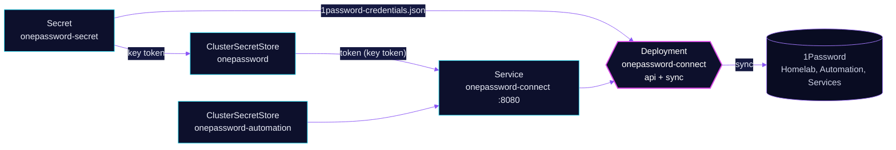

<!-- header: icon=plug -->
<!-- concept: From a credentials file to a local 1Password API | file-key Credentials | server Connect | database Cache | key-round Token | plug Serve -->
<p align="center"></p>

> The in-cluster 1Password Connect server that External Secrets reads and writes vault items through.

**Live facts:** <https://skrumbach.github.io/home-ops/apps/security/onepassword-connect/> (workloads, routes, storage, backups, secrets and alerts, generated on every merge)

## What it does

- **Serves the Connect API** on port 8080 at `onepassword-connect.security.svc.cluster.local`, to the two `ClusterSecretStore`s in `security/external-secrets`.
- **Syncs the vaults.** The `sync` container pulls vault data from 1Password and the `api` container answers from it. They talk to each other over `localhost` (`OP_BUS_PEERS`).
- **Has no route.** Only in-cluster clients reach it.

## Why it is built this way

| Choice | Why |
|---|---|
| **Connect, not a service account** | The cluster's stores use the 1Password Connect provider. The Connect server is the only thing that holds the credentials file. |
| **One pod, two containers** | `api` and `sync` share an `emptyDir` at `/config` (`XDG_DATA_HOME`) and find each other on the pod's `localhost`. |
| **Memory sized for `api`** | One YAML anchor serves both containers, so the request fits the larger one. The manifest says this pair is load-bearing for every ExternalSecret, hence the conservative ratio. |
| **Read-only root, non-root user** | `readOnlyRootFilesystem`, capabilities dropped, user and group 999, `RuntimeDefault` seccomp. The `emptyDir` is the only writable path. |

## How it works

<p align="center"></p>

<details>
<summary><b>Resource graph</b>: every object involved, by name</summary>



</details>

1. Bootstrap applies Secret `onepassword-secret` with keys `1password-credentials.json` and `token`. ESO cannot create it, because ESO needs this app first ([`bootstrap/README.md`](../../../../../bootstrap/README.md)).
2. Flux applies the HelmRelease (the bjw-s app-template chart). Both containers read the credentials file from that Secret as `OP_SESSION`.
3. `api` and `sync` start; each has `/heartbeat` liveness and `/health` readiness probes (ports 8080 and 8081).
4. `external-secrets` depends on this app (HelmRelease `dependsOn`), and `onepassword-store` depends on it as a Kustomization.
5. When `onepassword-secret` changes, the `reloader.stakater.com/auto` annotation restarts the pod.

## Settings that matter

Values are in [`app/helmrelease.yaml`](app/helmrelease.yaml). Images are pinned by digest and Renovate bumps them.

| Setting | Value | Why |
|---|---|---|
| `strategy` | `RollingUpdate` | The manifest records no reason. |
| `reloader.stakater.com/auto` | `"true"` | Restarts the pod when `onepassword-secret` changes. |
| `resources` (both containers) | request 10m CPU, 192M; limit 256M | One anchor, sized for `api`. See the table above. |
| `persistence.config` | `emptyDir` at `/config` | Scratch cache shared by `api` and `sync`. It is empty after every restart and refills from 1Password. |
| Kustomization `onepassword-connect` | no `wait`, no `healthChecks` | The manifest records no reason. `onepassword-store` waits on the stores instead. |

## Operate it

```bash
flux -n security get ks onepassword-connect
flux -n security get hr onepassword-connect
kubectl -n security get pods -o wide | grep onepassword-connect
kubectl -n security logs deploy/onepassword-connect -c api --tail=50
kubectl get clustersecretstore                           # Valid when Connect answers
```

## Invariants

- **Vault names.** Connect sees `Homelab`, `Automation` and `Services`, not `Home-Lab` (the `vals` vault). See [`AGENTS.md`](../../../../../AGENTS.md).
- **`onepassword-secret` is annotated `prune: disabled` at bootstrap** because ESO cannot recreate it. Never seed other Secrets there.

Upstream: [1Password Connect](https://developer.1password.com/docs/connect/) •
[Kubernetes deployment](https://developer.1password.com/docs/connect/get-started/)
