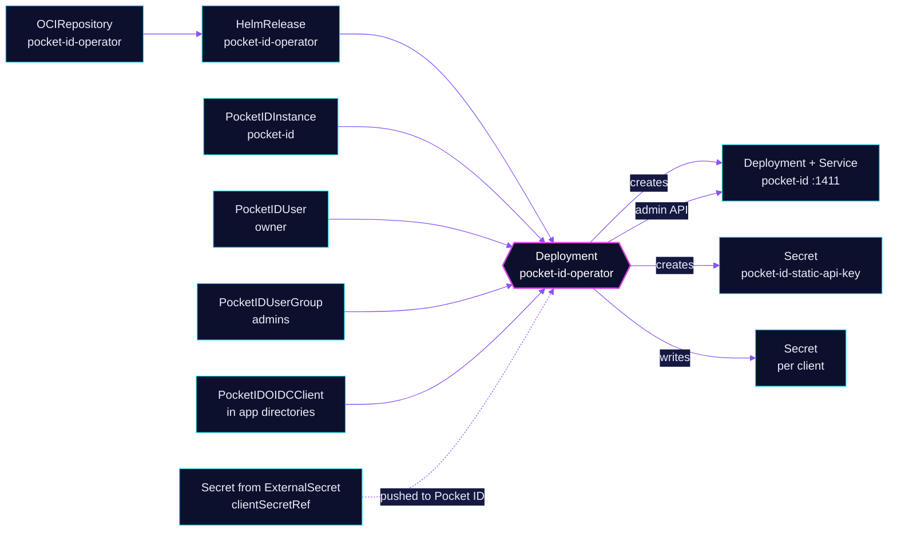

<!-- header: icon=cog -->
<!-- concept: From a custom resource to an identity provider object | file-key Resource | cog Reconcile | key-round API key | users Identity | log-in Client -->
<p align="center"></p>

> Runs Pocket ID from a PocketIDInstance and turns its users, groups and OIDC client objects into Pocket ID state.

**Live facts:** <https://skrumbach.github.io/home-ops/apps/security/pocket-id-operator/> (workloads, routes, storage, backups, secrets and alerts, generated on every merge)

## What it does

- **Creates the Pocket ID workload.** A `PocketIDInstance` becomes Deployment and Service `pocket-id` (port 1411) and Secret `pocket-id-static-api-key`.
- **Reconciles identity objects.** `PocketIDUser`, `PocketIDUserGroup` and `PocketIDOIDCClient` (API `pocketid.internal/v1alpha1`) become users, groups and clients in Pocket ID, through its admin API.
- **Writes client credentials.** For a client with no `clientSecretRef`, it generates the client ID and secret and writes a Secret in the client's namespace. For one with `clientSecretRef`, it pushes the referenced value to Pocket ID.
- **Ships the CRDs.** They come in the chart's `crds/` directory, applied with `CreateReplace` by the `cluster-apps` defaults.

## Why it is built this way

| Choice | Why |
|---|---|
| **Operator, not UI clicks** | Clients, groups and users live in Git next to the app that needs them. Any `userManagement` field on the instance also disables the settings UI, so config stays in manifests. |
| **`instance.enabled: false`** | The chart's deprecated root `instance` block defaults to enabled and would render a second, empty `PocketIDInstance`. The real one is in `security/pocket-id`. |
| **Own Flux Kustomization with a health check** | `pocket-id-operator` is Ready only after the Deployment is, so the CRDs exist before `pocket-id` applies its custom resources. |
| **Two ways to get a client secret** | Operator-generated Secret (for example `kube-system/cilium`, `network/echo`) or a `clientSecretRef` to a Secret an ExternalSecret and `Password` generator create once (for example `monitoring/grafana`, `ai/litellm`, `database/cloudnative-pg` pgadmin, `renovate/renovate-operator`, `selfhosted/paperless-ngx`). Use the second when the app must read the secret before the operator runs. |

## How it works

<p align="center"></p>

<details>
<summary><b>Resource graph</b>: every object involved, by name</summary>



</details>

1. Flux applies the HelmRelease. The Kustomization `pocket-id-operator` waits for its Deployment.
2. Flux applies `pocket-id` after it. The operator sees `PocketIDInstance` `pocket-id` and creates the Deployment, the Service and the static API key Secret.
3. The operator calls Pocket ID's API with that key. It creates `PocketIDUser` `owner`, `PocketIDUserGroup` `admins` and one client per `PocketIDOIDCClient`.
4. A client lives with the app it protects, in `kubernetes/apps/base/<ns>/<app>/`. `git grep -l "kind: PocketIDOIDCClient"` lists them.
5. Deleting a `PocketIDOIDCClient` or a `PocketIDUserGroup` deletes it in Pocket ID. Deleting a `PocketIDUser` keeps the user and its passkeys (see [`pocket-id`](../pocket-id/README.md)).

## Settings that matter

Values are in [`app/helmrelease.yaml`](app/helmrelease.yaml). The chart is pinned in [`app/ocirepository.yaml`](app/ocirepository.yaml) and Renovate bumps it.

| Setting | Value | Why |
|---|---|---|
| `instance.enabled` | `false` | See the table above. |
| `metrics.enabled`, `metrics.serviceMonitor.enabled` | `true` | Feeds the chart's own `PrometheusRule`, which renders whenever the CRD exists. |
| Kustomization `healthChecks` | Deployment `pocket-id-operator` | CRDs exist before dependents apply. |

## Operate it

```bash
flux -n security get ks pocket-id-operator
flux -n security get hr pocket-id-operator
kubectl -n security get deploy,pods | grep pocket-id-operator
kubectl get pocketidinstance,pocketiduser,pocketidusergroup -n security
kubectl get pocketidoidcclient -A
kubectl -n <ns> describe pocketidoidcclient <name>       # status conditions say why a client is not synced
```

## Invariants

- **The API is `v1alpha1`.** Read the release notes on every chart bump.
- **Operator 0.16.x supports Pocket ID `>=v2.14.0 <v3.0.0`** and crash-loops outside that range, so a Pocket ID v3 bump waits for an operator release that supports it (comment in `security/pocket-id`).

Upstream: [pocket-id-operator](https://github.com/aclerici38/pocket-id-operator) •
[Pocket ID docs](https://pocket-id.org/docs/)
