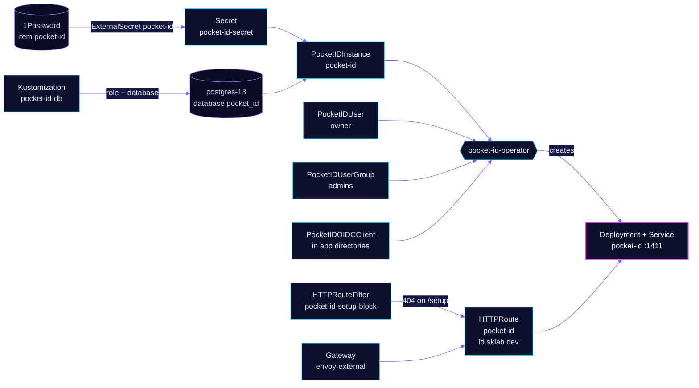

<!-- header: icon=fingerprint -->
<!-- concept: From a passkey to a signed-in app | fingerprint Passkey | log-in Sign in | id-card Token | shield-check Verify | users Group -->
<p align="center"></p>

> The cluster's only identity provider: passkey sign-in and OIDC for every protected app, at id.sklab.dev.

**Live facts:** <https://skrumbach.github.io/home-ops/apps/security/pocket-id/> (workloads, routes, storage, backups, secrets and alerts, generated on every merge)

## What it does

- **Signs users in with passkeys.** Host `id.sklab.dev`, served on `envoy-external` in `network`. Self sign-up is off (`allowUserSignups: disabled`).
- **Issues OIDC tokens** to the apps that declare a `PocketIDOIDCClient`: Grafana, LiteLLM, Headlamp, Coder, Hubble and others. `git grep -l "kind: PocketIDOIDCClient"` lists them.
- **Holds the owner and the admin group.** `PocketIDUser` `owner` (admin) and `PocketIDUserGroup` `admins` come from this directory. The group carries the claim `litellm_role: proxy_admin`.
- **Stores state in Postgres.** Database `pocket_id` on the shared `postgres-18` cluster; uploaded files go there too (`fileBackend: database`).
- **Is run by the operator.** `pocket-id-operator` creates the Deployment and Service `pocket-id` (port 1411) from the `PocketIDInstance`.

## Why it is built this way

| Choice | Why |
|---|---|
| **Public route on `envoy-external`** | The browser of a public app must reach the issuer. One Gateway per hostname, so LAN clients reach `envoy-external` directly. Pods (Envoy's OIDC filter, renovate-operator) resolve the name through CoreDNS and the LAN resolver. |
| **`/setup` answers 404** | Pocket ID opens first-admin setup whenever its database has no user. On a fresh install or a restore without the database, that is the moment the public route appears. `HTTPRouteFilter` `pocket-id-setup-block` blocks `/setup` and `/api/signup/setup`. The operator creates users through its API key, so nothing needs them. |
| **Kustomization is not Ready until `owner` exists** | A health check on `PocketIDUser` `owner` (CEL on its `Ready` condition) means a Pocket ID that serves an open `/setup` page never counts as healthy. |
| **Stateless pod, data in Postgres** | The data volume is an `emptyDir`; no PVC, no kopiur claim here. |
| **Config in the instance, not the UI** | Any `userManagement` field also sets `UI_CONFIG_DISABLED`, so settings live in `pocketidinstance.yaml`. |
| **Username and email from the Secret** | `pocketiduser.yaml` reads `OWNER_USERNAME` and `OWNER_EMAIL` from `pocket-id-secret`, so neither is in Git. |

## How it works

<p align="center"></p>

<details>
<summary><b>Resource graph</b>: every object involved, by name</summary>



</details>

1. Flux applies `pocket-id-db` first: role `pocket_id` and database `pocket_id` on `postgres-18` through `components/cnpg-database`, `wait: true`.
2. Kustomization `pocket-id` depends on `pocket-id-operator` and `pocket-id-db`. It applies ExternalSecret `pocket-id` (item `pocket-id`, target Secret `pocket-id-secret`), the instance, the route, the owner and the `admins` group.
3. The operator creates the Deployment from `PocketIDInstance` `pocket-id`. The pod reads `ENCRYPTION_KEY` and `DB_CONNECTION_STRING` from `pocket-id-secret`.
4. The operator creates `owner` through its API key. The first reconcile writes a one-hour login link to `status.oneTimeLoginURL` of the `PocketIDUser`; the owner registers a passkey there.
5. Apps declare a `PocketIDOIDCClient`. Envoy `SecurityPolicy` objects and apps with their own OIDC login point at `https://id.sklab.dev/...`. `allowedUserGroups` usually names `admins`, so Pocket ID refuses anyone outside the group.
6. Pocket ID trusts the forwarded headers from the pod CIDR (`trustedProxies.cidrs: 10.42.0.0/16`), where the Envoy pods run.

## Settings that matter

Values are in [`app/pocketidinstance.yaml`](app/pocketidinstance.yaml) and [`app/httproute.yaml`](app/httproute.yaml). The image is pinned by digest and Renovate bumps it.

| Setting | Value | Why |
|---|---|---|
| `hostnames` | `id.sklab.dev` | Every registered passkey is bound to it. Never change it. |
| `spec.appUrl` | `https://id.sklab.dev` | The issuer URL apps use. |
| `userManagement.allowUserSignups` | `disabled` | Accounts come from `PocketIDUser` objects only. |
| `userManagement.emailsVerified` | `true` | Covers self sign-ups only, which are off. The admin API creates a `PocketIDUser` with `email_verified=false` regardless; Coder ignores the claim. |
| `fileBackend` | `database` | Uploads live in Postgres, so the pod needs no volume. |
| `trustedProxies` | enabled, `10.42.0.0/16` | The route is ours, so the operator's default trust does not apply. |
| `ENCRYPTION_KEY` (in `pocket-id-secret`) | from 1Password item `pocket-id` | Encrypts data at rest. Never rotate or lose it: the database is unreadable without it. |
| `DB_CONNECTION_STRING` | role `pocket_id`, `postgres-18-rw.database`, database `pocket_id` | The password sits in the URL unescaped. `pocket-id-db` reads the same field `POSTGRES_DB_USER_PASSWORD`. |

## Operate it

```bash
flux -n security get ks pocket-id pocket-id-db pocket-id-operator
kubectl -n security get pocketidinstance,pocketiduser,pocketidusergroup
kubectl -n security get deploy,pods -l app.kubernetes.io/name=pocket-id -o wide
kubectl -n security get httproute/pocket-id httproutefilter/pocket-id-setup-block
kubectl -n database get databaserole,database
curl -s -o /dev/null -w '%{http_code}\n' https://id.sklab.dev/healthz    # 204
curl -s -o /dev/null -w '%{http_code}\n' https://id.sklab.dev/setup      # 404
```

Gatus checks `https://id.sklab.dev/healthz` for status 204 (annotation on the HTTPRoute).

## Invariants

- **Never change the hostname `id.sklab.dev`.** Every registered passkey is bound to it.
- **Never rotate or lose `ENCRYPTION_KEY`.** The database is unreadable without it.
- **First-admin setup is never served.** Keep `pocket-id-setup-block` on `/setup` and `/api/signup/setup`.
- **Pin Pocket ID to the range the operator supports** (`>=v2.14.0 <v3.0.0` for operator 0.16.x). Outside it the operator crash-loops.
- **Deleting `PocketIDUser` `owner` keeps the user and its passkeys.** Deleting `PocketIDUserGroup` `admins` deletes the group, and the operator owns its claims: claims added in the UI are removed on the next reconcile.
- **`pocket-id-db` retains data.** Removing it never drops the database (comment in the overlay).

Upstream: [Pocket ID docs](https://pocket-id.org/docs/) •
[pocket-id-operator](https://github.com/aclerici38/pocket-id-operator)
