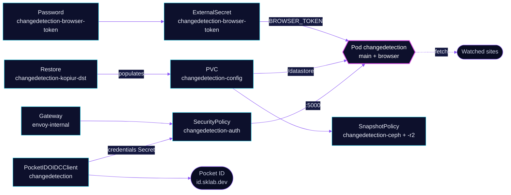

<!-- header: icon=eye -->
<!-- concept: From a watched page to an alert | globe Page | chrome Browser | git-compare Compare | bell Alert -->
<p align="center"></p>

> Watches web pages for changes and sends alerts, with a headless Chrome sidecar for pages that need JavaScript.

**Live facts:** <https://skrumbach.github.io/home-ops/apps/selfhosted/changedetection/> (workloads, routes, storage, backups, secrets and alerts, generated on every merge)

## What it does

- **Watches pages** for changes. Its datastore is PVC `changedetection-config`, mounted at `/datastore`.
- **Renders JavaScript pages** through the `browser` container (browserless Chrome) in the same pod. The `main`
  container reaches it on `ws://localhost:3000` with a token.
- **Serves the UI** at `changedetection.sklab.dev` on `envoy-internal`. SecurityPolicy `changedetection-auth`
  signs people in with Pocket ID before a request reaches the app, which has no password of its own.
- **Backs up** its datastore with kopiur to the in-cluster `ceph` and the offsite `r2` repositories. A recreated
  claim is restored from the newest ceph snapshot.

## Why it is built this way

| Choice | Why |
|---|---|
| **Pocket ID at Envoy, not an app password** | The app has no password of its own and its page shows the RSS token. The whole route is gated and nothing is exempt: no consumer of `/rss` or `/api` was found. |
| **Browser on `localhost`, token-gated** | Port 3000 is not in the Service, and the DevTools socket also needs the token, so reaching Chrome takes the token as well as a network path. |
| **Token made by a generator, never refreshed** | `refreshPolicy: CreatedOnce` keeps the token stable across ESO refreshes. Deleting the ExternalSecret mints a new one, and both containers then need a restart. |
| **Browser runs as uid 999, the rest as 1000** | At uid 1000 Chrome fails to launch (`chrome_crashpad_handler: --database is required`) while the container still reports Ready, which silently breaks every browser-backed watch. |
| **Gatus probes the Service, not the route** | The route redirects to the Pocket ID sign-in page, so a route check would measure that page. |

## How it works

<p align="center"></p>

<details>
<summary><b>Resource graph</b>: every object involved, by name</summary>



</details>

1. Flux applies Kustomization `changedetection` after `onepassword-store` and `kopiur-repository`. The `kopiur`
   component adds the two SnapshotPolicies and the standing Restore `changedetection-kopiur-dst`; `kopiur/pvc` owns
   the claim, so a recreated claim is filled from the newest ceph snapshot.
2. The Password generator and ExternalSecret `changedetection-browser-token` write Secret
   `changedetection-browser-token` with the key `BROWSER_TOKEN`. Both containers read it at start.
3. `main` builds `PLAYWRIGHT_DRIVER_URL` from that token (`$(BROWSER_TOKEN)`) and uses `browser` for browser-backed watches.
4. The pod-level identity is 1000:1000. `browser` overrides it to 999.
5. A person opens `https://changedetection.sklab.dev`. Envoy redirects to Pocket ID. Only the group `admins`
   (namespace `security`) is allowed. The operator writes the client ID and secret to Secret
   `changedetection-oidc-credentials`, which the policy reads.

## Settings that matter

All values are in [`app/helmrelease.yaml`](app/helmrelease.yaml) unless noted.

| Setting | Value | Why |
|---|---|---|
| `env` as a list, `BROWSER_TOKEN` first | list form | `$(BROWSER_TOKEN)` expands only when the variable is defined earlier in the list. |
| `LOGGER_LEVEL` | `WARNING` | Apprise notification URLs carry credentials and are logged at INFO. |
| `USE_X_SETTINGS`, `BASE_URL` | `"1"`, `https://changedetection.sklab.dev` | The app sits behind Envoy. The manifest records no further reason. |
| `main` `readOnlyRootFilesystem` | `false` | The app writes Python bytecode and temp files outside `/datastore`. |
| `browser` `readOnlyRootFilesystem` | `false` | Chrome writes its profile and crash data under the root filesystem. |
| `browser` `MAX_CONCURRENT_SESSIONS`, `CONNECTION_TIMEOUT` | `10`, `300000` | The manifest records no reason. |
| `resources` (`main` / `browser`) | requests 10m CPU, 128Mi / 100m, 512Mi; limits 512Mi / 2Gi | The manifest records no reason for the sizes. |
| `persistence.config.existingClaim` | `"${KOPIUR_CLAIM}"`, no default | An undefined `KOPIUR_CLAIM` would render an empty `existingClaim`. |
| `KOPIUR_CAPACITY` ([overlay](../../../main/selfhosted/changedetection.yaml)) | `1Gi` | The live claim is 1Gi. The component default of 5Gi would provision a rebuilt claim at five times that. |
| `KOPIUR_SCHEDULE_R2` (overlay) | `H 14 * * *` | The namespace's r2 hour. Ceph keeps the component default, every 4 hours. |

## Operate it

```bash
flux -n selfhosted get ks changedetection
flux -n selfhosted get hr changedetection
kubectl -n selfhosted get pods -l app.kubernetes.io/name=changedetection -o wide
kubectl -n selfhosted logs deploy/changedetection -c browser --tail=50
kubectl -n selfhosted get snapshotpolicy,restore,pvc
kubectl -n selfhosted get securitypolicy/changedetection-auth pocketidoidcclient/changedetection
```

A browser-backed watch that fails while the pod is Ready points at the `browser` container: read its log.
Restores: [`restore.md`](../../../../../.agents/skills/incident-runbooks/references/restore.md).

## Invariants

- The browser sidecar keeps uid 999. At uid 1000 Chrome crashes at launch while the container reports Ready.
- The pod does not earn kopiur's `SecurityContextCompatible` condition, because the 999 sidecar suppresses it. A
  whole-volume kopia read is the proof that the backup works.
- A SecurityPolicy that fails to translate makes the route answer 500. One whose `targetRef` matches no route
  leaves the route open.
- A future RSS reader or API client gets a named route rule plus `sectionName`, not an exemption on the whole route.

Upstream: [changedetection.io](https://github.com/dgtlmoon/changedetection.io) •
[Envoy Gateway OIDC](https://gateway.envoyproxy.io/docs/tasks/security/oidc/)
