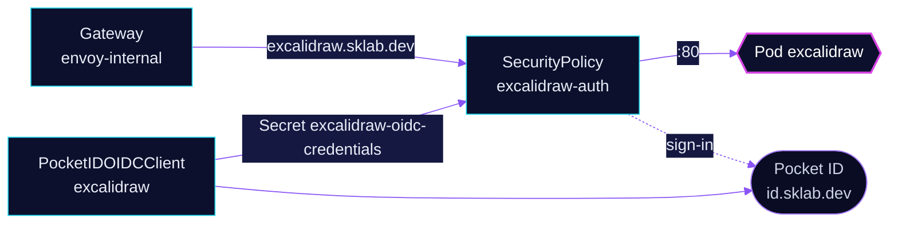

<!-- header: icon=pen-tool -->
<!-- concept: From a sign-in to a whiteboard | fingerprint Sign-in | door-open Route | pen-tool Canvas -->
<p align="center"></p>

> A stateless Excalidraw whiteboard on the LAN, behind Pocket ID sign-in at the gateway.

**Live facts:** <https://skrumbach.github.io/home-ops/apps/selfhosted/excalidraw/> (workloads, routes, storage, backups, secrets and alerts, generated on every merge)

## What it does

- **Serves the whiteboard** at `excalidraw.sklab.dev` on `envoy-internal` only.
- **Signs people in at Envoy.** SecurityPolicy `excalidraw-auth` runs native OIDC against Pocket ID; only the group
  `admins` (namespace `security`) is allowed.
- **Keeps no state.** The Deployment mounts no volume, so there is nothing to back up.

## Why it is built this way

| Choice | Why |
|---|---|
| **Gate the whole route** | Live collaboration goes from the browser to excalidraw.com's own collab server, not through this route, so no websocket path needs an exemption. |
| **Gatus probes the Service** | The route redirects to the Pocket ID sign-in page, so a route check would measure that page. |

## How it works

<p align="center"></p>

<details>
<summary><b>Resource graph</b>: every object involved, by name</summary>



</details>

1. Flux applies Kustomization `excalidraw` with no dependencies and no components.
2. The Pocket ID operator turns `PocketIDOIDCClient` `excalidraw` into a client at Pocket ID and writes its ID and
   secret to Secret `excalidraw-oidc-credentials`, with the keys `client-id` and `client-secret`.
3. A request to `https://excalidraw.sklab.dev` meets the SecurityPolicy first. Without a session, Envoy sends the
   browser to Pocket ID and back to `/oauth2/callback`, with PKCE (`pkceEnabled: true`).
4. Envoy forwards the request to Service `excalidraw` on port 80.

## Settings that matter

| Setting | Value | Why |
|---|---|---|
| `authorizationEndpoint`, `tokenEndpoint`, `endSessionEndpoint` ([`app/securitypolicy.yaml`](app/securitypolicy.yaml)) | `id.sklab.dev` paths | Skips discovery. Otherwise the Envoy Gateway controller fetches the issuer's configuration on every translation, and a failed fetch turns the route into a 500 until the next one. |
| `topologySpreadConstraints` | `DoNotSchedule`, `nodeTaintsPolicy: Honor` | `Honor` only filters NoSchedule and NoExecute, and the talos-3 taint is `PreferNoSchedule`, so talos-3 stays in the spread domains and the TaintToleration score keeps the pod off it. |
| `resources` | requests 5m CPU, 10Mi; limit 50Mi memory | The manifest records no reason. |

## Operate it

```bash
flux -n selfhosted get ks excalidraw
flux -n selfhosted get hr excalidraw
kubectl -n selfhosted get pods -l app.kubernetes.io/name=excalidraw -o wide
kubectl -n selfhosted get securitypolicy/excalidraw-auth pocketidoidcclient/excalidraw
kubectl -n selfhosted get secret excalidraw-oidc-credentials
```

## Invariants

- A SecurityPolicy that fails to translate (for example the operator has not yet written
  `excalidraw-oidc-credentials`) makes the route answer 500, not pass through. A policy whose `targetRef` matches
  no route leaves that route open.
- Deleting the `PocketIDOIDCClient` deletes the client in Pocket ID.

Upstream: [Excalidraw](https://github.com/excalidraw/excalidraw) •
[Envoy Gateway OIDC](https://gateway.envoyproxy.io/docs/tasks/security/oidc/)
