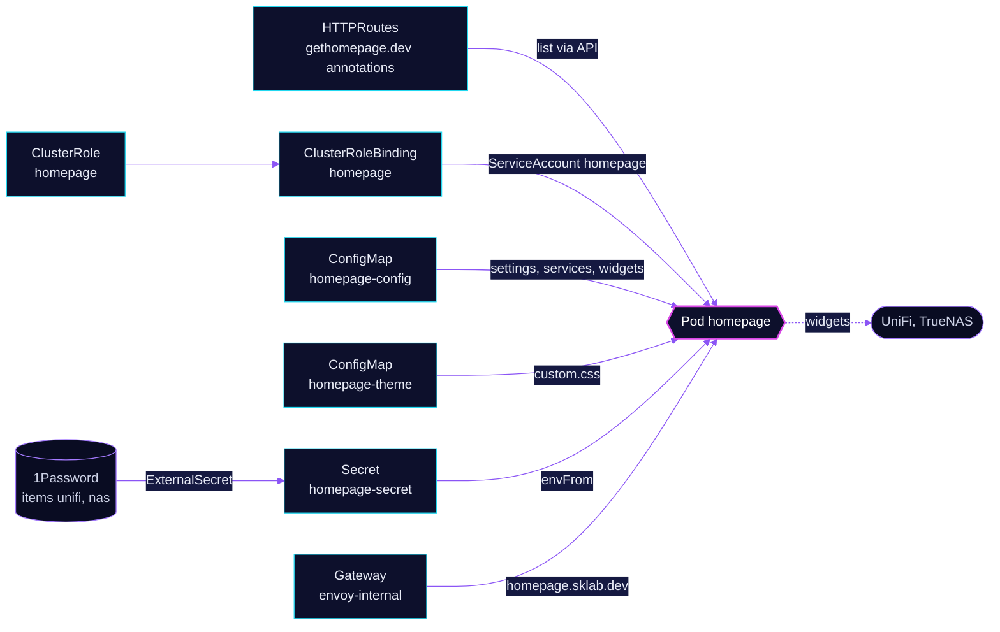

<!-- header: icon=layout-dashboard -->
<!-- concept: From a route annotation to a dashboard tile | tag Annotation | search Discover | layout-grid Group | layout-dashboard Tile -->
<p align="center"></p>

> The LAN dashboard: it builds its tiles from HTTPRoute annotations across the cluster, so apps add themselves.

**Live facts:** <https://skrumbach.github.io/home-ops/apps/selfhosted/homepage/> (workloads, routes, storage, backups, secrets and alerts, generated on every merge)

## What it does

- **Discovers tiles** from `gethomepage.dev/*` annotations on HTTPRoutes in any namespace. The app lists routes
  through the Kubernetes API (`gateway: true` in `kubernetes.yaml`) and needs no edit when an app is added.
- **Groups tiles** under the order set in `settings.yaml` (`layout`). A group not listed there lands at the bottom.
- **Adds a few fixed tiles** in `services.yaml` for things that have no route in the cluster: UniFi and TrueNAS, each
  with a widget.
- **Shows cluster widgets**: CPU and memory, search, weather and the date, from `widgets.yaml`.
- **Serves itself** at `homepage.sklab.dev` on `envoy-internal`, with no SecurityPolicy.
- **Takes its look from the GitHub profile card.** [`app/resources/custom.css`](app/resources/custom.css) restyles
  the page with the card's palette and type families.

## Why it is built this way

| Choice | Why |
|---|---|
| **Annotations on routes, not a tile list** | Tiles join a group through the `gethomepage.dev/group` annotation on their HTTPRoute (the `settings.yaml` comment). Only tiles with no route are written in `services.yaml`. The manifest records no further reason. |
| **CSS as a generated ConfigMap** | `configMapGenerator` builds `homepage-theme` from `resources/custom.css` with `disableNameSuffixHash: true`. The HelmRelease reloads on changes to `homepage-config` and `homepage-theme`. |
| **`headerStyle: boxed`, text status** | The stylesheet restyles the boxed header and the text status badge, so `headerStyle` and `statusStyle` stay at these values. |

## How it works

<p align="center"></p>

<details>
<summary><b>Resource graph</b>: every object involved, by name</summary>



</details>

1. Flux applies Kustomization `homepage` after `onepassword-store`. The overlay sets `CONFIG_TIMEZONE`, which
   becomes the container's `TZ`.
2. ExternalSecret `homepage-secret` reads the 1Password items `unifi` and `nas` and writes the
   `HOMEPAGE_VAR_*` variables that `services.yaml` refers to.
3. ClusterRole `homepage` lets the pod get and list namespaces, pods, nodes, ingresses, HTTPRoutes, Gateways and
   the metrics API. The token is mounted because `automountServiceAccountToken: true` is set on the pod.
4. The app reads every HTTPRoute with `gethomepage.dev/enabled: "true"` and builds a tile from
   `name`, `description`, `icon` and `group`. A `pod-selector` annotation adds a pod status dot. A
   `widget.type` and `widget.url` pair adds a widget.
5. The config files are mounted from ConfigMap `homepage-config`, each by `subPath`. `custom.css` is mounted
   at `/app/config/custom.css`.

## Settings that matter

| Setting | Value | Why |
|---|---|---|
| `HOMEPAGE_ALLOWED_HOSTS` | `homepage.sklab.dev` | The app rejects other `Host` headers. |
| Probe `Host` header | `homepage.sklab.dev` on `/api/healthcheck :3000` | Must match `HOMEPAGE_ALLOWED_HOSTS` or the probes are rejected. |
| `resources.limits.memory` | `512Mi` | The app idles near 110Mi but was OOM-killed 7 times at 256Mi on 2026-11-12, on page loads that query every tile at once. |
| `readOnlyRootFilesystem` | `false` | Next.js writes its cache under the root filesystem. |
| `automountServiceAccountToken` | `true` | app-template v5 defaults it to false; the Kubernetes integration (cluster widgets, pod-selector status) needs the token. |
| `kubernetes.yaml` | `mode: cluster`, `gateway: true`, `ingress: false` | Route discovery is on the Gateway API. The ClusterRole still allows `ingresses`. |

## Operate it

```bash
flux -n selfhosted get ks homepage
flux -n selfhosted get hr homepage
kubectl -n selfhosted get pods -l app.kubernetes.io/name=homepage -o wide
kubectl -n selfhosted logs deploy/homepage --tail=50
kubectl get httproute -A -o json | jq -r '.items[] | select(.metadata.annotations["gethomepage.dev/enabled"]=="true") | "\(.metadata.namespace)/\(.metadata.name)"'
kubectl auth can-i list httproutes --as=system:serviceaccount:selfhosted:homepage
```

To add a tile, put the `gethomepage.dev/*` annotations on the app's HTTPRoute. To add a group, add it to `layout` in
[`app/configmap.yaml`](app/configmap.yaml).

Upstream: [Homepage docs](https://gethomepage.dev/) •
[Kubernetes integration](https://gethomepage.dev/configs/kubernetes/)
