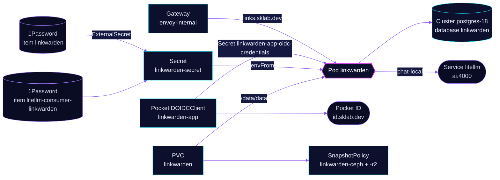

<!-- header: icon=bookmark -->
<!-- concept: From a saved link to a tagged page archive | bookmark Save | archive Archive | tags Tag | search Find -->
<p align="center"></p>

> Bookmark manager that archives saved pages and tags them with the local model, with one sign-in, done by Linkwarden itself (password form or Pocket ID button).

**Live facts:** <https://skrumbach.github.io/home-ops/apps/selfhosted/linkwarden/> (workloads, routes, storage, backups, secrets and alerts, generated on every merge)

## What it does

- **Saves and archives links** at `links.sklab.dev` on `envoy-internal` only. Page archives are written to PVC
  `linkwarden`, mounted at `/data/data`.
- **Tags links with AI** through `ai/litellm`, with Linkwarden's own virtual key from 1Password item
  `litellm-consumer-linkwarden`. The model is the role alias `chat-local`.
- **Signs people in itself**, once: Linkwarden's own login page has the password form and a Pocket ID button
  (generic provider `oidc`, client `linkwarden-app`). The route is not gated at Envoy, so the browser extension and
  mobile app reach `/api` as before. Linkwarden has no group check, so `allowedUserGroups` (`admins`) on the client is the fence.
- **Stores its data** in the shared `postgres-18` Cluster (role and database `linkwarden`), with the claim backed
  up by kopiur to `ceph` and `r2`.

## Why it is built this way

| Choice | Why |
|---|---|
| **No Envoy gate** | A gate in front of Linkwarden's own login meant two sign-ins in a row, and the extension and mobile app cannot follow an SSO redirect. Linkwarden's login and access tokens are the one sign-in. |
| **Password form kept for now** | `NEXT_PUBLIC_CREDENTIALS_ENABLED` stays `"true"` as break-glass. It can go once the owner has signed in through Pocket ID and the account is linked. |
| **`NEXTAUTH_URL` ends in `/api/v1/auth`** | next-auth builds the OIDC `redirect_uri` from it, and a bare origin gives `/api/auth/callback/oidc`, which Linkwarden does not serve. Password sign-in never used it, so it worked before. |
| **`DISABLE_NEW_SSO_USERS` unset** | The check refuses any identity with no linked account row, which includes the first sign-in of the existing local account, before it can link. Set it after the owner is linked. |
| **`chat-local` with no cloud fallback** | `chat-local` is the local B70 llama.cpp and a terminal alias. When the B70 is down, tagging fails and nothing else does. |
| **No `affinity` away from talos-3** | The `PreferNoSchedule` taint on talos-3 (no toleration here) keeps the pod off it through the scheduler score. |

## How it works

<p align="center"></p>

<details>
<summary><b>Resource graph</b>: every object involved, by name</summary>



</details>

1. Flux applies `linkwarden-db` (role and database on `postgres-18`), then `linkwarden` after `onepassword-store`,
   `kopiur-repository` and `cloudnative-pg`. The `kopiur/pvc` component owns PVC `linkwarden`, so a recreated claim is
   filled from the newest ceph snapshot. The HelmRelease waits for `rook-ceph-cluster`.
2. The pod reads `NEXTAUTH_SECRET`, `OPENAI_API_KEY` and `DATABASE_URL` from Secret `linkwarden-secret`.
3. A person opens `https://links.sklab.dev`; Envoy passes every path straight to the pod.
4. On Linkwarden's login page the person types a password or presses the Pocket ID button. next-auth sends them to `id.sklab.dev` (PKCE and state, scopes
   `openid email profile`) and Pocket ID returns them to `/api/v1/auth/callback/oidc`. The first time, an existing local account
   is linked by exact email match, and only when Pocket ID sends `email_verified: true`; otherwise the sign-in is refused. A
   linked account keeps its password when its email was already verified in Linkwarden, and loses it when it was not. An email
   with no local account creates a new, empty account.
5. When a link is saved, Linkwarden archives the page (Monolith, `MONOLITH_MAX_BUFFER`) and asks
   `chat-local` for tags.
6. Gatus calls `/api/v1/logins` and expects `credentialsEnabled` in the body. That proves the pod itself answers.

## Settings that matter

All values are in [`app/helmrelease.yaml`](app/helmrelease.yaml) unless noted.

| Setting | Value | Why |
|---|---|---|
| `NEXT_PUBLIC_OIDC_ENABLED`, `OIDC_*` | `"true"`, `OIDC_WELLKNOWN_URL` on `id.sklab.dev` | Linkwarden's own Pocket ID login. Client ID and secret come from Secret `linkwarden-app-oidc-credentials`; the pod waits for it. A local account with no e-mail cannot be linked on first sign-in (username collision); its `email` must be set to the Pocket ID e-mail in the database first. |
| `MONOLITH_MAX_BUFFER` | `"256"` | One image-heavy page overflowed the 100MB default, which gave a partial archive. |
| `NEXT_PUBLIC_DISABLE_REGISTRATION` | `"true"` | The manifest records no reason. |
| `OPENAI_MODEL` | `chat-local` | Role alias only, never a real model name ([`ai/AGENTS.md`](../../ai/AGENTS.md)). The key is limited to `chat-local` and rate-limited. |
| `securityContext` (container) | `allowPrivilegeEscalation: false`, drop `ALL` | Playwright starts Chromium with `--no-sandbox` by default, so no setuid helper or extra capability is needed. |
| `resources` | requests 250m CPU, 512Mi; limits 2 CPU, 4Gi | The manifest records no reason. |
| `KOPIUR_CAPACITY`, `KOPIUR_SCHEDULE_R2` (overlay) | `5Gi`, `H 14 * * *` | Claim size. The offsite copy runs daily in hour 14. Ceph keeps the component default. |

## Operate it

```bash
flux -n selfhosted get ks linkwarden linkwarden-db
flux -n selfhosted get hr linkwarden
kubectl -n selfhosted get pods -l app.kubernetes.io/name=linkwarden -o wide
kubectl -n selfhosted logs deploy/linkwarden --tail=50
kubectl -n selfhosted get snapshotpolicy,snapshotschedule,restore,pvc
kubectl -n selfhosted get pocketidoidcclient/linkwarden-app
```

Restores: [`restore.md`](../../../../../.agents/skills/incident-runbooks/references/restore.md).

## Invariants

- Keep it to one sign-in: do not put an Envoy `SecurityPolicy` back in front of the route without dropping the login form,
  and keep `/api` reachable for the extension and mobile app.
- The Kustomization that owns the kopiur claim never sets `wait: true`.

Upstream: [Linkwarden docs](https://docs.linkwarden.app/)
