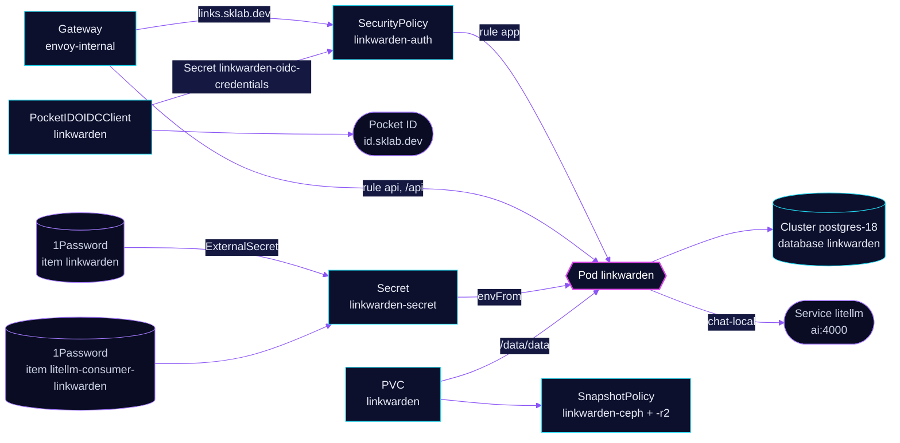

<!-- header: icon=bookmark -->
<!-- concept: From a saved link to a tagged page archive | bookmark Save | archive Archive | tags Tag | search Find -->
<p align="center"></p>

> Bookmark manager that archives saved pages and tags them with the local model, behind Pocket ID sign-in.

**Live facts:** <https://skrumbach.github.io/home-ops/apps/selfhosted/linkwarden/> (workloads, routes, storage, backups, secrets and alerts, generated on every merge)

## What it does

- **Saves and archives links** at `links.sklab.dev` on `envoy-internal` only. Page archives are written to PVC
  `linkwarden`, mounted at `/data/data`.
- **Tags links with AI** through `ai/litellm`, with Linkwarden's own virtual key from 1Password item
  `litellm-consumer-linkwarden`. The model is the role alias `chat-local`.
- **Gates the browser UI with Pocket ID** at Envoy (`SecurityPolicy` `linkwarden-auth`). Only group `admins` passes.
  `/api` stays outside the gate, so the browser extension and mobile app keep working.
- **Stores its data** in the shared `postgres-18` Cluster (role and database `linkwarden`), with the claim backed
  up by kopiur to `ceph` and `r2`.

## Why it is built this way

| Choice | Why |
|---|---|
| **Gate rule `app`, leave rule `api` open** | The extension and mobile app cannot follow an SSO redirect. `/api` answers to Linkwarden's own access-token and session auth. |
| **Envoy signs people in, Linkwarden does not** | The manifests set no SSO provider in Linkwarden. `NEXT_PUBLIC_CREDENTIALS_ENABLED` stays `"true"`, so after the Envoy gate people use Linkwarden's own login. |
| **`chat-local` with no cloud fallback** | `chat-local` is the local B70 llama.cpp and a terminal alias. When the B70 is down, tagging fails and nothing else does. |
| **No `affinity` away from talos-3** | The `PreferNoSchedule` taint on talos-3 (no toleration here) keeps the pod off it through the scheduler score. |

## How it works

<p align="center"></p>

<details>
<summary><b>Resource graph</b>: every object involved, by name</summary>



</details>

1. Flux applies `linkwarden-db` (role and database on `postgres-18`), then `linkwarden` after `onepassword-store`,
   `kopiur-repository` and `cloudnative-pg`. The `kopiur/pvc` component owns PVC `linkwarden`, so a recreated claim is
   filled from the newest ceph snapshot. The HelmRelease waits for `rook-ceph-cluster`.
2. The pod reads `NEXTAUTH_SECRET`, `OPENAI_API_KEY` and `DATABASE_URL` from Secret `linkwarden-secret`.
3. A person opens `https://links.sklab.dev`. Envoy sends them to Pocket ID, which refuses anyone outside `admins`.
   Callbacks `/oauth2/callback` and `/oauth2/logout` fall in rule `app` (`PathPrefix /`), so the round trip works
   on a rule-level policy.
4. When a link is saved, Linkwarden archives the page (Monolith, `MONOLITH_MAX_BUFFER`) and asks
   `chat-local` for tags.
5. Gatus calls `/api/v1/logins` and expects `credentialsEnabled` in the body. That proves the pod answers and that
   `/api` still bypasses the gate.

## Settings that matter

All values are in [`app/helmrelease.yaml`](app/helmrelease.yaml) unless noted.

| Setting | Value | Why |
|---|---|---|
| `MONOLITH_MAX_BUFFER` | `"256"` | One image-heavy page overflowed the 100MB default, which gave a partial archive. |
| `NEXT_PUBLIC_DISABLE_REGISTRATION` | `"true"` | The manifest records no reason. |
| `OPENAI_MODEL` | `chat-local` | Role alias only, never a real model name ([`ai/AGENTS.md`](../../ai/AGENTS.md)). The key is limited to `chat-local` and rate-limited. |
| `securityContext` (container) | `allowPrivilegeEscalation: false`, drop `ALL` | Playwright starts Chromium with `--no-sandbox` by default, so no setuid helper or extra capability is needed. |
| `resources` | requests 250m CPU, 512Mi; limits 2 CPU, 4Gi | The manifest records no reason. |
| `KOPIUR_CAPACITY`, `KOPIUR_SCHEDULE_R2` (overlay) | `5Gi`, `H 14 * * *` | Claim size. The offsite copy runs daily in hour 14. Ceph keeps the component default. |

## Operate it

```bash
flux -n selfhosted get ks linkwarden linkwarden-db
flux -n selfhosted get hr linkwarden
kubectl -n selfhosted get pods -l app.kubernetes.io/name=linkwarden -o wide
kubectl -n selfhosted logs deploy/linkwarden --tail=50
kubectl -n selfhosted get snapshotpolicy,snapshotschedule,restore,pvc
kubectl -n selfhosted get securitypolicy/linkwarden-auth pocketidoidcclient/linkwarden
```

Restores: [`restore.md`](../../../../../.agents/skills/incident-runbooks/references/restore.md).

## Invariants

- Only rule `app` is gated, and the SecurityPolicy targets it by `sectionName`. Renaming a rule leaves the gate
  attached to nothing and the UI open (`scripts/ci/securitypolicy-section-name-test.py`).
- A SecurityPolicy that fails to translate makes the route answer 500 instead of passing traffic through, for
  example until the operator has written `linkwarden-oidc-credentials`.
- The Kustomization that owns the kopiur claim never sets `wait: true`.

Upstream: [Linkwarden docs](https://docs.linkwarden.app/) •
[Envoy Gateway OIDC](https://gateway.envoyproxy.io/docs/tasks/security/oidc/)
