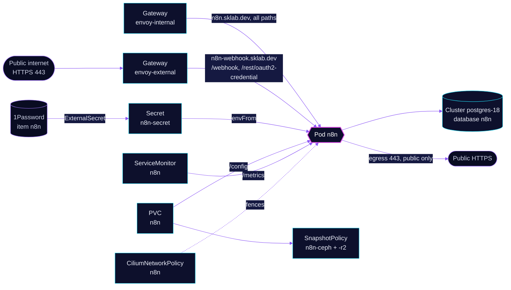

<!-- header: icon=workflow -->
<!-- concept: From an outside event to a fenced workflow run | webhook Trigger | workflow Flow | shield-check Fence | database Record -->
<p align="center"></p>

> Workflow automation with a private editor and a public webhook route that exposes two path prefixes only.

**Live facts:** <https://skrumbach.github.io/home-ops/apps/selfhosted/n8n/> (workloads, routes, storage, backups, secrets and alerts, generated on every merge)

## What it does

- **Serves the editor and API** at `n8n.sklab.dev` on `envoy-internal`. The route has no SecurityPolicy.
- **Receives webhooks** at `n8n-webhook.sklab.dev` on `envoy-external`. Only `/webhook` and `/rest/oauth2-credential`
  (the OAuth callback) are routed. Everything else on that host is not routed.
- **Runs user code fenced in.** `NODE_FUNCTION_ALLOW_BUILTIN: "*"` lets a Code node use every Node.js built-in, so
  CiliumNetworkPolicy `n8n` limits traffic both ways.
- **Stores workflows** in the shared `postgres-18` Cluster (role and database `n8n`). PVC `n8n` holds the user
  folder `/config`, backed up by kopiur to `ceph` and `r2`.
- **Exposes metrics** at `/metrics` (`N8N_METRICS`), scraped by ServiceMonitor `n8n`.

## Why it is built this way

| Choice | Why |
|---|---|
| **Two hostnames, two gateways** | The editor is internal. Only the webhook host is public, and `scripts/ci/external-routes-test.py` fails when it exposes any path outside `/webhook` and `/rest/oauth2-credential` ("not the editor"). `WEBHOOK_URL` is `https://n8n-webhook.sklab.dev/`, so n8n hands out the public host in webhook and OAuth URLs. |
| **Egress limited to public HTTPS, DNS and the database** | Workflows run user code and HTTP Request nodes. The `toCIDRSet` rule cuts out `10.0.0.0/8`, `172.16.0.0/12`, `192.168.0.0/16`, `100.64.0.0/10` and `169.254.0.0/16`, so a workflow cannot reach the LAN or the nodes. |
| **Liveness on `/healthz`, readiness on `/healthz/readiness`** | `/healthz` cannot fail. A database-aware liveness probe would restart the pod on every CNPG switchover. Gatus uses `/healthz/readiness` too, because `/healthz` stayed green through a database outage. |
| **Task runners on** (`N8N_RUNNERS_ENABLED`) | The JS task runner talks to the broker over loopback, which network policy never sees. The manifest records no further reason. |

## How it works

<p align="center"></p>

<details>
<summary><b>Resource graph</b>: every object involved, by name</summary>



</details>

1. Flux applies `n8n-db` (role and database on `postgres-18`), then `n8n` after `onepassword-store` and
   `kopiur-repository`. The `kopiur/pvc` component owns PVC `n8n`. The HelmRelease waits for `rook-ceph-cluster`.
2. Secret `n8n-secret` carries `N8N_ENCRYPTION_KEY` (from item `n8n`) and the `DB_POSTGRESDB_*` settings. The host
   `postgres-18-rw.database.svc.cluster.local` is hardcoded in the ExternalSecret; the role and database come from
   `components/cnpg-database`.
3. An outside service calls `https://n8n-webhook.sklab.dev/webhook/...`. The route on `envoy-external` matches the
   prefix and sends it to Service `n8n:80`. A path outside the two prefixes has no route.
4. The network policy admits ingress on port 80 from both Envoy gateways, from Prometheus (`monitoring`) and from the
   local host (kubelet probes). Replies from `postgres-18` and CoreDNS are admitted with no `toPorts`
   (cilium/cilium#47913).
5. Gatus probes the editor host at `/healthz/readiness` (200) and the webhook host at `/webhook/any`. The webhook
   probe expects 404 with `code` 404, which proves the route reaches n8n.

## Settings that matter

All values are in [`app/helmrelease.yaml`](app/helmrelease.yaml) unless noted.

| Setting | Value | Why |
|---|---|---|
| `N8N_HOST`, `N8N_PROTOCOL` | `n8n.sklab.dev`, `https` | The editor host. The webhook host comes from `WEBHOOK_URL`. |
| `N8N_PROXY_HOPS` | `1` | The manifest records no reason. |
| `EXECUTIONS_DATA_PRUNE`, `EXECUTIONS_DATA_MAX_AGE`, `EXECUTIONS_DATA_PRUNE_MAX_COUNT` | `true`, `168`, `50000` | `EXECUTIONS_DATA_MAX_AGE` is in hours, so 168 is 7 days. |
| `N8N_PUBLIC_API_DISABLED`, `N8N_PUBLIC_API_SWAGGERUI_DISABLED` | `false`, `true` | The public API is on, its Swagger UI is off. The manifest records no reason. |
| `N8N_ENFORCE_SETTINGS_FILE_PERMISSIONS` | `false` | The manifest records no reason. |
| `N8N_USER_FOLDER` | `/config` | The claim `n8n` is the persistence entry `config`. |
| `defaultPodOptions.securityContext` | uid/gid/fsGroup `1000`, `OnRootMismatch` | Matches the kopiur mover identity (component default 1000). |
| `resources` | requests 100m CPU, 200Mi; limit 1000Mi, no CPU limit | The manifest records no reason. |
| `KOPIUR_CAPACITY`, `KOPIUR_SCHEDULE_R2` (overlay) | `8Gi`, `H 14 * * *` | Claim size. The offsite copy runs daily in hour 14. Ceph keeps the component default. |

## Operate it

```bash
flux -n selfhosted get ks n8n n8n-db
flux -n selfhosted get hr n8n
kubectl -n selfhosted get pods -l app.kubernetes.io/name=n8n -o wide
kubectl -n selfhosted logs deploy/n8n --tail=50
kubectl -n selfhosted get httproute
kubectl -n selfhosted get ciliumnetworkpolicy n8n
kubectl -n selfhosted get snapshotpolicy,snapshotschedule,restore,pvc
```

Restores: [`restore.md`](../../../../../.agents/skills/incident-runbooks/references/restore.md). A workflow that must
reach a LAN host or an in-cluster Service needs its own egress rule in
[`app/ciliumnetworkpolicy.yaml`](app/ciliumnetworkpolicy.yaml), and an in-cluster peer also needs a reply rule like
the `postgres-18` one.

## Invariants

- The public host `n8n-webhook.sklab.dev` routes only `/webhook` and `/rest/oauth2-credential`. A third path fails
  `scripts/ci/external-routes-test.py`.
- The editor route stays on `envoy-internal`. The webhook route is the only n8n route on `envoy-external`.
- Egress never opens private, CGNAT or link-local ranges for all workflows. Add a narrow rule per workflow instead.
- The Kustomization that owns the kopiur claim never sets `wait: true`.

Upstream: [n8n docs](https://docs.n8n.io/) •
[Environment variables](https://docs.n8n.io/hosting/configuration/environment-variables/)
